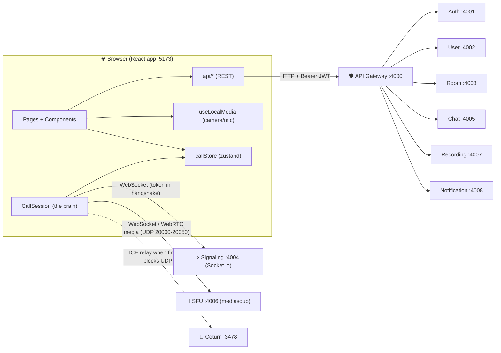
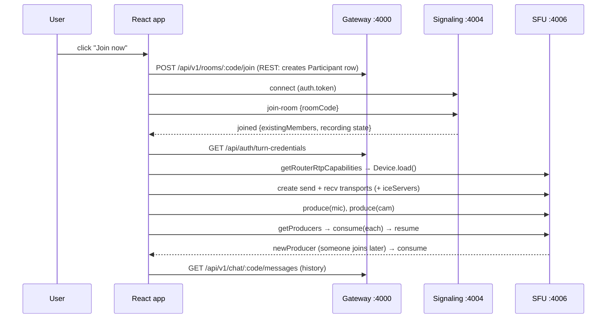
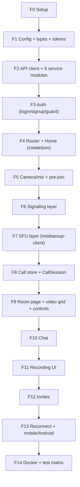
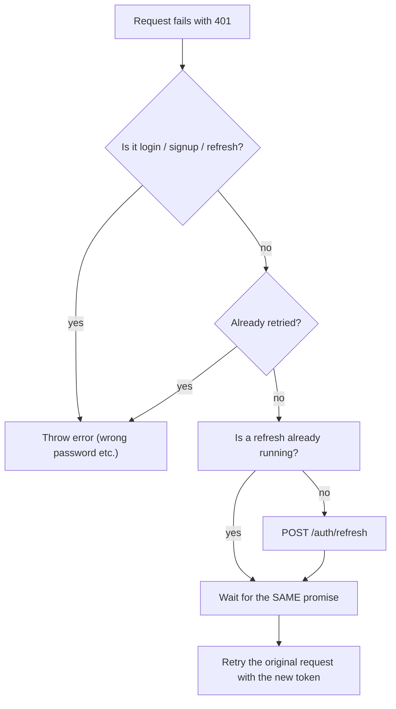
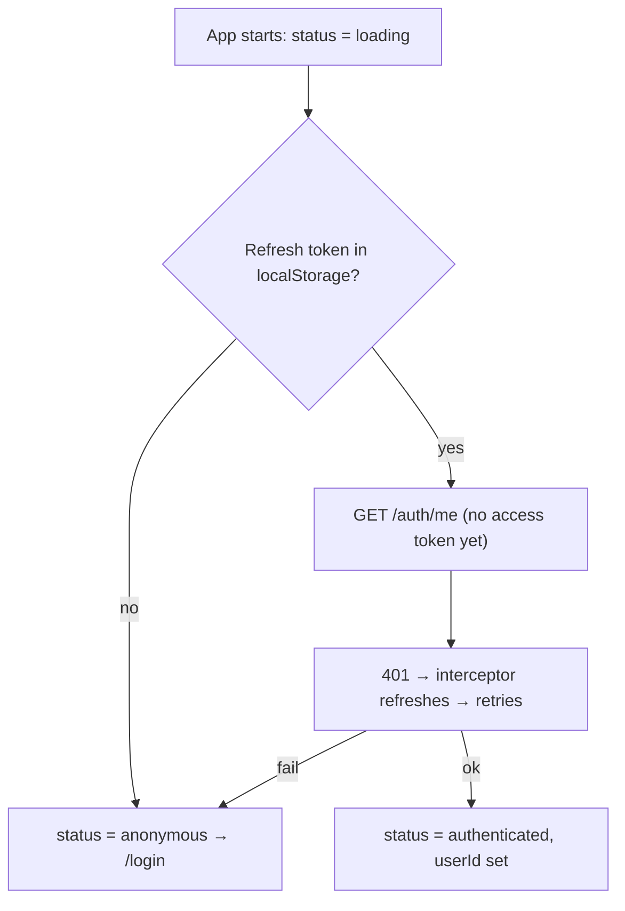
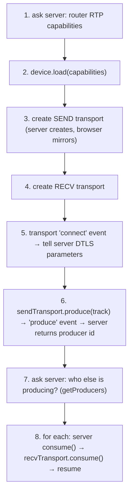
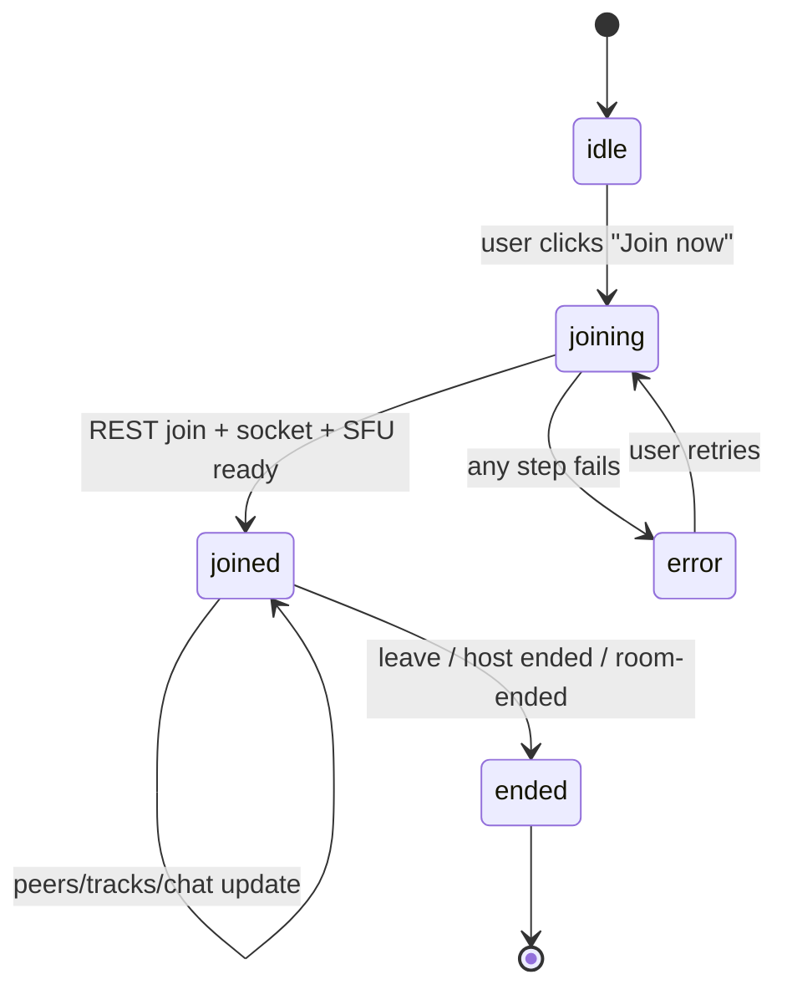
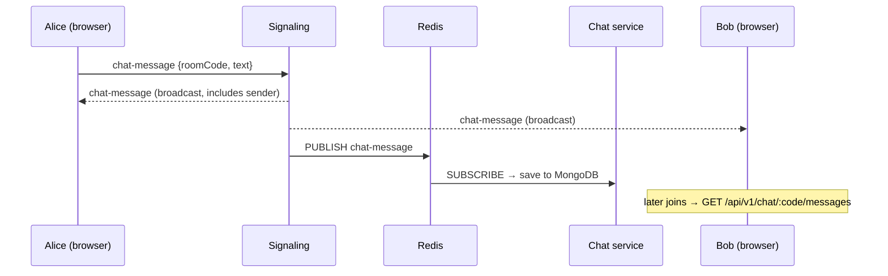

# 🎥 Phase F — Frontend Build Guide (React + WebRTC + mediasoup)

> **Project:** Video Meet App (Google Meet clone) · **Goal:** a real browser client for the 9 backend services you already built (Phases 0–13).
> **Where this lives:** `GOOGLE_MEET/FRONTEND/web/` (next to your existing `Phase_9_sfu_frontend_guide.md`)
> **Style of this guide:** every step = **WHY → WHAT → HOW → KEY POINTS → EXAMPLE → create EMPTY file → paste code → CHECKPOINT**

---

## 0. How to use this guide (the working rules)

| # | Rule | What it means for you |
| :-: | :--- | :--- |
| 1 | **Explain first, code second** | Before any code you read *why* we do it, *what* it is, *how* it connects. |
| 2 | **Empty file first** | For every file there is a **Step A** (create the empty file) and a **Step B** (paste code). Never paste into a file that does not exist yet. |
| 3 | **Steps inside every file** | Every code file starts with a `/** … */` header and has `// STEP 1`, `// STEP 2` … comments, so you can read a file top-to-bottom like a recipe. |
| 4 | **Key points + example** | Each phase has the traps (key points) and a small real-life example. |
| 5 | **Checkpoint** | After each phase you run something and *see* it work before moving on. |
| 6 | **⚠ VERIFY marker** | Where I could not see your backend code, the guide says `⚠ VERIFY` — you check that one thing (takes 1 minute) and fix one line. |

**Windows note:** all "create empty file" commands are PowerShell. `New-Item -Force` also creates missing folders, so you never need `mkdir`.

---

## 1. Reality check — what I know vs. what you must verify

I built this guide from your three documents (status report, STEP.MD, README). I have **not** seen your source code. So:

### ✅ Confirmed from your docs (safe to rely on)

| Area | Fact |
| :--- | :--- |
| Gateway | `http://localhost:4000`, all REST under `/api/...` |
| Auth | `POST /api/auth/signup \| login \| refresh \| logout`, `GET /api/auth/me → { userId }`, `GET /api/auth/turn-credentials` |
| Login response | token is at `.data.accessToken` (from your curl test) |
| Users | `GET/PATCH /api/users/me` |
| Rooms | `POST /api/v1/rooms`, `GET /:code`, `POST /:code/join \| leave \| end`; room code at `.data.room.code` |
| Chat history | `GET /api/v1/chat/:roomId/messages?limit=20` (you pass the **room code** as `roomId` in your manual test) |
| Recordings | `POST /api/v1/recordings/start \| stop`, `GET /room/:roomId`, `GET /:id`, `GET /:id/download` (supports HTTP 206 Range) |
| Invites | `POST /api/v1/notifications/invites` with `{ roomCode, guestEmails[] }` |
| Signaling | `io("http://localhost:4004", { auth: { token } })`; events `join-room`, `joined`, `peer-joined`, `peer-left`, `chat-message`, `leave-room`, `recording-started \| stopped \| ready \| failed` |
| Rate limits | Auth 10/15 min, Refresh 30/15 min, Standard 100/min, Global 300/min, Downloads 120/hour → frontend must handle **429** |
| Tokens | Access token = JWT, 15 min. Refresh token stored in `auth_db` |
| Ports in use | 3000 (test-client), 3001 (Grafana), 4000–4008, 8025 (Mailpit), 9090, 16686 → we use **5173** for the frontend |

### ⚠ Assumed (check once, fix one line if different)

| # | Assumption | Where to verify | File to change if wrong |
| :-: | :--- | :--- | :--- |
| A1 | Success body is `{ data: ... }` for **every** endpoint (true for login and rooms; check the rest) | run the curl checks in **Checkpoint F2** | `src/api/*.ts` |
| A2 | `POST /auth/refresh` takes `{ refreshToken }` and returns `.data.accessToken` (+ maybe a new `refreshToken`) | `auth-service` refresh controller | `src/lib/apiClient.ts` |
| A3 | Signaling/SFU socket calls use **Socket.io acknowledgements** (`socket.emit(event, payload, ack)`) | `signaling-service` / `sfu-service` handlers | `src/call/signaling.ts` (`request()`) |
| A4 | **SFU event names** (`getRouterRtpCapabilities`, `createWebRtcTransport`, …) | `FRONTEND/Phase_9_sfu_frontend_guide.md` or the SFU socket handler | **only** `SFU_EVENTS` in `src/call/sfuClient.ts` |
| A5 | Is the SFU reached directly on `:4006` or **relayed through signaling** (STEP 9.6 says signaling calls an SFU internal API)? | same as A4 | `VITE_SFU_URL` in `.env` |
| A6 | Recording `start/stop` body field is `roomId` (= room code) | `recording-service` Joi schema | `src/api/recordings.ts` |
| A7 | `chat-message` emit payload is `{ roomCode, text }` | `signaling-service` chat handler | `CallSession.sendChat()` |
| A8 | `turn-credentials` returns `{ username, password, ttl\|expiry }` | curl it | `src/call/iceServers.ts` |

> 🧠 **Design trick used everywhere:** every guess lives in **one tiny file** (an *adapter*). If a guess is wrong you fix one line, not the whole app.

---

## 2. Big picture — how the frontend connects to everything



**Read it like this:**
- **Everything that is "request → answer"** (login, create room, history, recordings, invites) goes **through the Gateway** (one URL, rate-limited, JWT-checked).
- **Everything that is "live"** (who joined, chat in real time, recording-started) goes **directly to Signaling** — your README says the Gateway is bypassed for WebSocket.
- **Audio/video itself** never goes through REST or signaling. It goes **browser ⇄ SFU** over WebRTC (UDP). Coturn is only the fallback road.

### The join flow (the most important picture in this guide)



---

## 3. Decisions (and the reason for each)

| Decision | Choice | Why this and not the alternative |
| :--- | :--- | :--- |
| Framework | **Vite + React 18/19 + TypeScript** | Your docs disagree: the status report says *Next.js 15*, STEP.MD says *React app*. A video call is 100% browser-side (WebRTC, `getUserMedia`, sockets) and needs **no SEO / SSR**. Next.js would force `"use client"` on nearly every file and adds a server we don't need. If you *prefer* Next.js, Phases F2–F13 copy over unchanged — only F0 (setup) and routing (F4) differ. |
| Server data | **axios** with interceptors | One place to attach the JWT, refresh it on 401, and translate 429/502/504 (your gateway's sanitized errors) into friendly messages. |
| Call state | **zustand** | The call changes many times per second (peers, tracks). Putting it in React Context would re-render everything. Zustand lets each component subscribe to only what it needs. |
| WebRTC logic | **A plain class `CallSession`**, not inside components | Components re-mount (React StrictMode, navigation). A class owns sockets/transports, so a re-render can never accidentally join twice or leak a camera. |
| Access token | **In memory** | Not readable by other scripts after reload → smaller XSS window. |
| Refresh token | `localStorage` (⚠ simple option) | Needed so a page reload keeps you logged in. The safer production option is an httpOnly cookie, which needs a backend change — noted in Appendix B. |
| Styling | **Plain CSS** (one file) | Fewer moving parts than Tailwind config; CSS Grid does the video layout perfectly. |
| Mobile | `100dvh`, `playsInline`, HTTPS note | Android Chrome / iOS Safari behave differently — see Phase F13. |

---

## 4. Final folder structure

```
FRONTEND/web/
├── .env                      # URLs of the services (VITE_*)
├── index.html
├── package.json
└── src/
    ├── main.tsx              # React entry
    ├── App.tsx               # routes
    ├── styles/global.css
    ├── config/env.ts         # validated env (fail-fast)
    ├── types/api.ts          # TypeScript shapes of backend data
    ├── lib/
    │   ├── tokenStore.ts     # access (memory) + refresh (localStorage)
    │   └── apiClient.ts      # axios + refresh + error mapping
    ├── api/                  # ONE FILE PER BACKEND SERVICE
    │   ├── auth.ts           # → auth-service
    │   ├── users.ts          # → user-service
    │   ├── rooms.ts          # → room-service
    │   ├── chat.ts           # → chat-service
    │   ├── recordings.ts     # → recording-service
    │   └── notifications.ts  # → notification-service
    ├── auth/
    │   ├── AuthContext.tsx
    │   └── ProtectedRoute.tsx
    ├── media/useLocalMedia.ts
    ├── call/
    │   ├── signaling.ts      # socket.io helpers
    │   ├── sfuClient.ts      # mediasoup-client wrapper (ADAPTER for A4)
    │   ├── iceServers.ts     # TURN credentials → iceServers
    │   ├── callStore.ts      # zustand state
    │   └── CallSession.ts    # orchestrates everything
    ├── components/
    │   ├── VideoTile.tsx · VideoGrid.tsx · PreJoin.tsx
    │   ├── ControlsBar.tsx · ChatPanel.tsx
    │   └── RecordingPanel.tsx · InvitePanel.tsx
    └── pages/
        ├── AuthPage.tsx · HomePage.tsx · RoomPage.tsx
```

---

## 5. Roadmap



Do them **in order**. Every phase ends with a checkpoint you can see in the browser.

---
---

# PHASE F0 — Project Setup

### 🧭 WHY
You need a build tool that hot-reloads React and exposes env variables safely. Vite does both with almost zero config.

### 📦 WHAT
An empty React + TypeScript app plus 5 libraries:

| Library | Used for |
| :--- | :--- |
| `react-router-dom` | pages (`/login`, `/`, `/room/:code`) |
| `axios` | REST to the Gateway |
| `socket.io-client` | Signaling / SFU sockets |
| `mediasoup-client` | the browser half of your SFU |
| `zustand` | call state |

### 🔧 HOW
Create the app, install, add `.env`, and (important) allow the new origin in your backend CORS.

### ⚡ KEY POINTS
- `mediasoup-client` (browser) must stay on the same **major** version family as the `mediasoup` server (v3).
- Vite only exposes variables starting with `VITE_`. Anything else is invisible to the browser (good — never put secrets here).
- Everything in `.env` is **public** once built. No JWT secrets, no `METRICS_TOKEN`.
- The Vite template's newer `tsconfig` uses `verbatimModuleSyntax` → write `import type { X }` for types. The code in this guide already does.

### 💡 EXAMPLE
If your Gateway CORS list only has `http://localhost:3000` (test-client), the browser will block the app on `http://localhost:5173` with `CORS error` even though `curl` works. That is the #1 first-run problem.

### Step A — create the app (run once)
```powershell
cd GOOGLE_MEET\FRONTEND
npm create vite@latest web -- --template react-ts
cd web
npm install
npm install react-router-dom axios socket.io-client mediasoup-client zustand
```

### Step B — create the empty `.env` file, then fill it
```powershell
New-Item -ItemType File -Force -Path .env | Out-Null
New-Item -ItemType File -Force -Path .env.example | Out-Null
```

```ini
# =====================================================================
# FRONTEND/web/.env   (copy the same text into .env.example)
# STEP 1 — REST goes through the Gateway (one URL for 6 services)
# STEP 2 — Live connections go DIRECT (README: signaling bypasses gateway)
# STEP 3 — SFU: use :4006 if the browser talks to the SFU directly.
#          If your SFU events are relayed through signaling (STEP 9.6/9.7),
#          set VITE_SFU_URL to the SAME value as VITE_SIGNALING_URL.   ⚠ VERIFY (A5)
# STEP 4 — TURN host for the relay fallback (Coturn container)
# =====================================================================
VITE_API_URL=http://localhost:4000
VITE_SIGNALING_URL=http://localhost:4004
VITE_SFU_URL=http://localhost:4006
VITE_TURN_URL=turn:localhost:3478
```

### Step C — allow the frontend origin in the backend (⚠ do this now)
Add `http://localhost:5173` to the allowed origins of: **api-gateway** (CORS), **signaling-service** (Socket.io `cors.origin`), and **sfu-service** (if the browser connects to it directly). Make sure the Gateway's CORS `exposedHeaders` includes `x-request-id` and `retry-after` — the frontend reads them to show "try again in 30 s".

### ✅ CHECKPOINT F0
```powershell
npm run dev
```
Open `http://localhost:5173` → you see the Vite + React starter page.

---
---

# PHASE F1 — Config, Types, Token Store

### 🧭 WHY
Three tiny foundations that every later file imports. If they are wrong, everything is wrong — so we build them first and make them strict.

### 📦 WHAT
1. `env.ts` — reads `.env` once and **crashes on startup** if something is missing (same fail-fast habit as your Phase 12/13 backend configs).
2. `api.ts` types — TypeScript shapes for backend data.
3. `tokenStore.ts` — the only place that knows where tokens live.

### 🔧 HOW
Plain modules, no React. Everything else imports from them.

### ⚡ KEY POINTS
- **One token store** = one place to change if you later move to cookies.
- We decode the JWT `exp` (just base64, *not* verification — the server verifies) so we can refresh **before** a socket reconnect would fail on an expired token.
- Types are *our promise* about the backend. Checkpoint F2 proves them.

### 💡 EXAMPLE
You forget `VITE_API_URL`. Without fail-fast you get `undefined/api/auth/login` and a confusing 404. With fail-fast you get: `Missing env var VITE_API_URL. Check FRONTEND/web/.env`.

---

#### 📄 File 1/3 — `src/config/env.ts`
**Why this file:** one validated source of truth for service URLs.

**Step A — create the empty file**
```powershell
New-Item -ItemType File -Force -Path src\config\env.ts | Out-Null
```
**Step B — paste the code**
```ts
/**
 * src/config/env.ts
 * -------------------------------------------------------------
 * Reads Vite env variables ONCE and fails fast if one is missing.
 * Used by: apiClient.ts, signaling.ts, CallSession.ts, iceServers.ts
 */

// STEP 1 — helper that reads one variable or throws a clear error
function required(name: string): string {
  const value = import.meta.env[name] as string | undefined;
  if (!value) {
    throw new Error(`Missing env var ${name}. Check FRONTEND/web/.env`);
  }
  return value.replace(/\/$/, ''); // remove a trailing slash if present
}

// STEP 2 — export one frozen object (no one can mutate it later)
export const env = Object.freeze({
  apiUrl: required('VITE_API_URL'),             // Gateway :4000
  signalingUrl: required('VITE_SIGNALING_URL'), // Signaling :4004
  sfuUrl: required('VITE_SFU_URL'),             // SFU :4006 (or = signaling)
  turnUrl: required('VITE_TURN_URL'),           // turn:host:3478
});
```

---

#### 📄 File 2/3 — `src/types/api.ts`
**Why this file:** typed backend shapes → typos become compile errors, not runtime bugs.

**Step A**
```powershell
New-Item -ItemType File -Force -Path src\types\api.ts | Out-Null
```
**Step B**
```ts
/**
 * src/types/api.ts
 * -------------------------------------------------------------
 * TypeScript shapes of what the backend returns.
 * ⚠ VERIFY (A1): confirm each shape in Checkpoint F2 and adjust.
 */

// STEP 1 — every success response is wrapped as { data: ... }
export interface ApiEnvelope<T> {
  data: T;
}

// STEP 2 — auth-service
export interface AuthTokens {
  accessToken: string;
  refreshToken?: string; // ⚠ VERIFY (A2): present if body-based refresh
}
export interface Me {
  userId: string; // GET /auth/me returns ONLY this (README inconsistency #2)
}
export interface TurnCredentials {
  username: string;
  password: string;
  ttl?: number;
  expiry?: number;
  urls?: string[];
}

// STEP 3 — user-service
export interface Profile {
  displayName?: string;
  avatarUrl?: string;
  preferences?: Record<string, unknown>;
}

// STEP 4 — room-service
export interface Room {
  code: string;
  title?: string;
  hostId?: string;
  status?: string;
  scheduledAt?: string | null;
}
export interface Participant {
  userId: string;
  role: 'host' | 'participant';
  leftAt?: string | null;
}
export interface RoomDetails {
  room: Room;
  participants?: Participant[];
}

// STEP 5 — chat-service
export interface ChatMessage {
  id?: string;
  roomId?: string;
  senderId: string;
  senderName?: string;
  text: string;
  createdAt?: string;
}

// STEP 6 — recording-service (states come from your STEP.MD Phase 10)
export type RecordingStatus =
  | 'STARTING' | 'RECORDING' | 'STOPPING' | 'PROCESSING' | 'COMPLETED' | 'FAILED';
export interface Recording {
  id: string;
  status: RecordingStatus;
  durationSec?: number;
  sizeBytes?: number;
  createdAt?: string;
}
```

---

#### 📄 File 3/3 — `src/lib/tokenStore.ts`
**Why this file:** hides *where* tokens live. Access token = memory, refresh token = localStorage.

**Step A**
```powershell
New-Item -ItemType File -Force -Path src\lib\tokenStore.ts | Out-Null
```
**Step B**
```ts
/**
 * src/lib/tokenStore.ts
 * -------------------------------------------------------------
 * The ONLY file that knows where tokens are stored.
 *  - access token  → JS variable (lost on reload, re-created by refresh)
 *  - refresh token → localStorage (survives reload)
 */

const REFRESH_KEY = 'vm_refresh_token';

// STEP 1 — in-memory access token
let accessToken: string | null = null;

// STEP 2 — safe localStorage wrappers (private mode / blocked storage can throw)
function readRefresh(): string | null {
  try { return localStorage.getItem(REFRESH_KEY); } catch { return null; }
}
function writeRefresh(token: string | null): void {
  try {
    if (token) localStorage.setItem(REFRESH_KEY, token);
    else localStorage.removeItem(REFRESH_KEY);
  } catch { /* storage blocked → user simply has to log in again after reload */ }
}

// STEP 3 — public API
export const tokenStore = {
  getAccess: () => accessToken,
  setAccess: (t: string | null) => { accessToken = t; },
  getRefresh: readRefresh,
  setRefresh: writeRefresh,
  clear() { accessToken = null; writeRefresh(null); },

  // STEP 4 — milliseconds until the JWT expires (decode only; server verifies)
  msUntilExpiry(): number {
    if (!accessToken) return 0;
    try {
      const payload = accessToken.split('.')[1].replace(/-/g, '+').replace(/_/g, '/');
      const { exp } = JSON.parse(atob(payload)) as { exp?: number };
      return exp ? exp * 1000 - Date.now() : 0;
    } catch { return 0; }
  },
};
```

### ✅ CHECKPOINT F1
`npm run dev` still opens with no red errors in the terminal. (To test fail-fast: temporarily rename a variable in `.env` → the page crashes with the clear message → rename it back.)

---
---

# PHASE F2 — API Client + One Module per Backend Service

### 🧭 WHY
Your backend is **6 services behind 1 gateway**. If every component wrote its own `fetch("http://localhost:4000/api/...")`, you'd repeat the token header, the refresh logic and the error handling 40 times. One client + one small module per service keeps the frontend shaped like the backend.

### 📦 WHAT
- `apiClient.ts` — an axios instance that (1) adds `Authorization: Bearer`, (2) on `401` refreshes the token **once** and retries, (3) turns errors into a friendly `ApiError` with `status`, `requestId`, `retryAfter`.
- `api/auth.ts`, `users.ts`, `rooms.ts`, `chat.ts`, `recordings.ts`, `notifications.ts` — each maps 1:1 to a backend service.

### 🔧 HOW (the refresh logic, step by step)



### ⚡ KEY POINTS
- **Single-flight refresh.** If 5 requests fail at once, only **one** `/auth/refresh` is sent (the others wait for the same promise). Your refresh limit is 30 per 15 min — a stampede would burn it.
- **Never refresh on `/auth/login`**: a 401 there means "wrong password", not "expired".
- **429** from your gateway carries `Retry-After`. We expose it as `error.retryAfter` so the UI can say *"Too many attempts, try again in 42 s"*.
- **502/504** come from your sanitized proxy trap → we show *"Service temporarily unavailable"*, never a stack trace.
- **`x-request-id`** (your Phase 12 tracing) is kept in the error so you can paste it into Jaeger/Grafana when debugging.
- The recording **download** must use `responseType: 'blob'` (see Phase F11 for the `<video>` caveat).

### 💡 EXAMPLE
Access token expires after 15 min. You click "Create meeting". `POST /v1/rooms` → 401 → interceptor calls `/auth/refresh` → gets a new token → silently replays `POST /v1/rooms` → the room is created. You never saw an error.

---

#### 📄 File 1/7 — `src/lib/apiClient.ts`
**Step A**
```powershell
New-Item -ItemType File -Force -Path src\lib\apiClient.ts | Out-Null
```
**Step B**
```ts
/**
 * src/lib/apiClient.ts
 * -------------------------------------------------------------
 * axios instance for ALL REST calls through the API Gateway.
 *  - adds the Bearer token
 *  - refreshes on 401 (single-flight) and retries once
 *  - converts every failure into a friendly ApiError
 */
import axios, { AxiosError, type InternalAxiosRequestConfig } from 'axios';
import { env } from '../config/env';
import { tokenStore } from './tokenStore';

// STEP 1 — our own error type (explicit fields: Vite's TS config forbids
//          constructor parameter-properties)
export class ApiError extends Error {
  status: number;
  requestId?: string;
  retryAfter?: number; // seconds, present on 429
  constructor(message: string, status: number, requestId?: string, retryAfter?: number) {
    super(message);
    this.name = 'ApiError';
    this.status = status;
    this.requestId = requestId;
    this.retryAfter = retryAfter;
  }
}

// STEP 2 — the axios instance. baseURL already contains /api
export const api = axios.create({
  baseURL: `${env.apiUrl}/api`,
  timeout: 15_000,
});

// STEP 3 — callback AuthContext registers, called when refresh fails
let onSessionExpired: (() => void) | null = null;
export function setSessionExpiredHandler(fn: (() => void) | null) {
  onSessionExpired = fn;
}

// STEP 4 — attach the access token to every request
api.interceptors.request.use((config) => {
  const token = tokenStore.getAccess();
  if (token) config.headers.Authorization = `Bearer ${token}`;
  return config;
});

// STEP 5 — single-flight refresh
//   ⚠ VERIFY (A2): body = { refreshToken } and answer = .data.accessToken
let refreshing: Promise<string> | null = null;

async function refreshAccessToken(): Promise<string> {
  const refreshToken = tokenStore.getRefresh();
  if (!refreshToken) throw new Error('No refresh token');
  // plain axios (NOT `api`) so this call can never trigger the interceptor again
  const res = await axios.post(`${env.apiUrl}/api/auth/refresh`, { refreshToken });
  const body = res.data.data as { accessToken: string; refreshToken?: string };
  tokenStore.setAccess(body.accessToken);
  if (body.refreshToken) tokenStore.setRefresh(body.refreshToken);
  return body.accessToken;
}

/** Returns a token valid for at least 30 s (used before opening sockets). */
export async function getValidAccessToken(): Promise<string | null> {
  if (tokenStore.getAccess() && tokenStore.msUntilExpiry() > 30_000) {
    return tokenStore.getAccess();
  }
  if (!tokenStore.getRefresh()) return tokenStore.getAccess();
  refreshing ??= refreshAccessToken().finally(() => { refreshing = null; });
  try { return await refreshing; } catch { return null; }
}

// STEP 6 — response interceptor: refresh on 401, otherwise map the error
const NO_REFRESH_PATHS = ['/auth/login', '/auth/signup', '/auth/refresh'];
type RetryConfig = InternalAxiosRequestConfig & { _retried?: boolean };

api.interceptors.response.use(
  (res) => res,
  async (err: AxiosError) => {
    const original = err.config as RetryConfig | undefined;
    const isAuthCall = NO_REFRESH_PATHS.some((p) => original?.url?.startsWith(p));

    if (err.response?.status === 401 && original && !original._retried && !isAuthCall) {
      original._retried = true;
      try {
        refreshing ??= refreshAccessToken().finally(() => { refreshing = null; });
        const newToken = await refreshing;
        original.headers.Authorization = `Bearer ${newToken}`;
        return api(original); // replay the request
      } catch {
        tokenStore.clear();
        onSessionExpired?.();
      }
    }
    throw toApiError(err);
  },
);

// STEP 7 — error mapping (uses your Phase 12 headers)
function toApiError(err: AxiosError): ApiError {
  const status = err.response?.status ?? 0;
  const body = err.response?.data as
    | { message?: string; error?: string | { message?: string } }
    | undefined;
  const headers = err.response?.headers as Record<string, string> | undefined;

  let message =
    (typeof body?.error === 'object' ? body.error?.message : body?.error) ??
    body?.message ??
    err.message;

  if (status === 0) message = 'Cannot reach the server. Is the Gateway running (and CORS allowed)?';
  if (status === 429) message = 'Too many requests. Please wait a moment.';
  if (status === 502 || status === 504) message = 'Service temporarily unavailable. Try again shortly.';

  const retryAfter = headers?.['retry-after'] ? Number(headers['retry-after']) : undefined;
  return new ApiError(message, status, headers?.['x-request-id'], retryAfter);
}
```

---

#### 📄 File 2/7 — `src/api/auth.ts`  (→ auth-service :4001)
**Step A**
```powershell
New-Item -ItemType File -Force -Path src\api\auth.ts | Out-Null
```
**Step B**
```ts
/**
 * src/api/auth.ts  →  auth-service (:4001) via Gateway
 * Gateway rewrites /api/auth/* → /api/v1/auth/*  (README route map)
 */
import { api } from '../lib/apiClient';
import { tokenStore } from '../lib/tokenStore';
import type { ApiEnvelope, AuthTokens, Me, TurnCredentials } from '../types/api';

// STEP 1 — signup (public). Account only; we log in right after.
export async function signup(email: string, password: string): Promise<void> {
  await api.post('/auth/signup', { email, password });
}

// STEP 2 — login (public). Returns tokens; caller stores them.
export async function login(email: string, password: string): Promise<AuthTokens> {
  const res = await api.post<ApiEnvelope<AuthTokens>>('/auth/login', { email, password });
  return res.data.data;
}

// STEP 3 — logout (protected). Best effort: we clear local tokens anyway.
export async function logout(): Promise<void> {
  await api.post('/auth/logout', { refreshToken: tokenStore.getRefresh() }).catch(() => {});
}

// STEP 4 — who am I? (returns ONLY { userId })
export async function getMe(): Promise<Me> {
  const res = await api.get<ApiEnvelope<Me>>('/auth/me');
  return res.data.data;
}

// STEP 5 — short-lived TURN credentials (HMAC) for WebRTC NAT traversal
export async function getTurnCredentials(): Promise<TurnCredentials> {
  const res = await api.get<ApiEnvelope<TurnCredentials>>('/auth/turn-credentials');
  return res.data.data;
}
```

---

#### 📄 File 3/7 — `src/api/users.ts`  (→ user-service :4002)
**Step A**
```powershell
New-Item -ItemType File -Force -Path src\api\users.ts | Out-Null
```
**Step B**
```ts
/**
 * src/api/users.ts  →  user-service (:4002) via Gateway
 * Gateway strips /users:  /api/users/me → /me
 */
import { api } from '../lib/apiClient';
import type { ApiEnvelope, Profile } from '../types/api';

// STEP 1 — read my profile (auto-created by the Redis "user-created" event)
export async function getProfile(): Promise<Profile> {
  const res = await api.get<ApiEnvelope<Profile>>('/users/me');
  return res.data.data;
}

// STEP 2 — update displayName / avatarUrl / preferences
export async function updateProfile(patch: Partial<Profile>): Promise<Profile> {
  const res = await api.patch<ApiEnvelope<Profile>>('/users/me', patch);
  return res.data.data;
}
```

---

#### 📄 File 4/7 — `src/api/rooms.ts`  (→ room-service :4003)
**Step A**
```powershell
New-Item -ItemType File -Force -Path src\api\rooms.ts | Out-Null
```
**Step B**
```ts
/**
 * src/api/rooms.ts  →  room-service (:4003) via Gateway
 * NOTE: /v1 is part of the client URL for this service (README inconsistency #1)
 */
import { api } from '../lib/apiClient';
import type { ApiEnvelope, Room, RoomDetails } from '../types/api';

// STEP 1 — create a room (caller becomes host). Optional scheduledAt (ISO string)
export async function createRoom(title: string, scheduledAt?: string): Promise<Room> {
  const res = await api.post<ApiEnvelope<{ room: Room }>>('/v1/rooms', {
    title,
    ...(scheduledAt ? { scheduledAt } : {}),
  });
  return res.data.data.room;
}

// STEP 2 — room info + participants (also our "does this room exist?" check)
export async function getRoom(code: string): Promise<RoomDetails> {
  const res = await api.get<ApiEnvelope<RoomDetails>>(`/v1/rooms/${encodeURIComponent(code)}`);
  return res.data.data;
}

// STEP 3 — join / leave / end
export const joinRoom = (code: string) => api.post(`/v1/rooms/${encodeURIComponent(code)}/join`);
export const leaveRoom = (code: string) => api.post(`/v1/rooms/${encodeURIComponent(code)}/leave`);
export const endRoom = (code: string) => api.post(`/v1/rooms/${encodeURIComponent(code)}/end`); // host only
```

---

#### 📄 File 5/7 — `src/api/chat.ts`  (→ chat-service :4005)
**Step A**
```powershell
New-Item -ItemType File -Force -Path src\api\chat.ts | Out-Null
```
**Step B**
```ts
/**
 * src/api/chat.ts  →  chat-service (:4005) via Gateway
 * Live messages come over the socket; this is only HISTORY (MongoDB).
 */
import { api } from '../lib/apiClient';
import type { ApiEnvelope, ChatMessage } from '../types/api';

// STEP 1 — fetch the latest messages. ⚠ VERIFY (A1): list may be at data.messages or data
export async function getMessages(roomCode: string, limit = 50): Promise<ChatMessage[]> {
  const res = await api.get<ApiEnvelope<ChatMessage[] | { messages: ChatMessage[] }>>(
    `/v1/chat/${encodeURIComponent(roomCode)}/messages`,
    { params: { limit } },
  );
  const d = res.data.data;
  return Array.isArray(d) ? d : d.messages ?? [];
}
```

---

#### 📄 File 6/7 — `src/api/recordings.ts`  (→ recording-service :4007)
**Step A**
```powershell
New-Item -ItemType File -Force -Path src\api\recordings.ts | Out-Null
```
**Step B**
```ts
/**
 * src/api/recordings.ts  →  recording-service (:4007) via Gateway
 * start/stop are HOST-ONLY (403 for others, 409 if room is empty).
 */
import { api } from '../lib/apiClient';
import type { ApiEnvelope, Recording } from '../types/api';

// STEP 1 — start / stop.  ⚠ VERIFY (A6): body field name (roomId = room code?)
export async function startRecording(roomCode: string): Promise<Recording> {
  const res = await api.post<ApiEnvelope<Recording>>('/v1/recordings/start', { roomId: roomCode });
  return res.data.data;
}
export async function stopRecording(roomCode: string): Promise<void> {
  await api.post('/v1/recordings/stop', { roomId: roomCode });
}

// STEP 2 — list recordings of a room, and read one (used for status polling)
export async function listRecordings(roomCode: string): Promise<Recording[]> {
  const res = await api.get<ApiEnvelope<Recording[] | { recordings: Recording[] }>>(
    `/v1/recordings/room/${encodeURIComponent(roomCode)}`,
  );
  const d = res.data.data;
  return Array.isArray(d) ? d : d.recordings ?? [];
}
export async function getRecording(id: string): Promise<Recording> {
  const res = await api.get<ApiEnvelope<Recording>>(`/v1/recordings/${id}`);
  return res.data.data;
}

// STEP 3 — download as Blob (a plain <video src> cannot send the Authorization header)
export async function downloadRecording(id: string): Promise<Blob> {
  const res = await api.get<Blob>(`/v1/recordings/${id}/download`, {
    responseType: 'blob',
    timeout: 10 * 60_000, // gateway allows 10 min for streaming downloads
  });
  return res.data;
}
```

---

#### 📄 File 7/7 — `src/api/notifications.ts`  (→ notification-service :4008)
**Step A**
```powershell
New-Item -ItemType File -Force -Path src\api\notifications.ts | Out-Null
```
**Step B**
```ts
/**
 * src/api/notifications.ts  →  notification-service (:4008) via Gateway
 * Host sends email invites; reminders are scheduled by the backend (BullMQ).
 */
import { api } from '../lib/apiClient';

// STEP 1 — invite guests by email (deduped server-side, 15-min reminder if scheduled)
export async function sendInvites(roomCode: string, guestEmails: string[]): Promise<void> {
  await api.post('/v1/notifications/invites', { roomCode, guestEmails });
}
```

### ✅ CHECKPOINT F2 — prove the contract (do this, it saves hours)
Your backend must be running (`docker compose up -d`). Run your README curl sequence and **look at the JSON shape** of each answer:

```powershell
# Git Bash / WSL (jq) — or just read the raw JSON
curl -s -X POST http://localhost:4000/api/auth/login -H "Content-Type: application/json" -d "{\"email\":\"test@example.com\",\"password\":\"password123\"}"
```
Tick each box. If a shape differs, change the matching type in `types/api.ts` **and** the one line in `src/api/*.ts`:

- [ ] login → `data.accessToken` ✔ (already known) · is there a `data.refreshToken`? (A2)
- [ ] `GET /auth/turn-credentials` → field names (A8)
- [ ] `GET /v1/rooms/:code` → where are `participants` and the host id?
- [ ] `GET /v1/chat/:code/messages` → array or `{ messages }`?
- [ ] `GET /v1/recordings/room/:code` → array or `{ recordings }`?

---
---

# PHASE F3 — Authentication (Context, Route Guard, Login/Signup)

### 🧭 WHY
Every other screen needs to know "who is logged in?". Without one central answer you get flicker (page shows login for half a second after reload) and unprotected routes.

### 📦 WHAT
- `AuthContext` — holds `status` (`loading | anonymous | authenticated`) and `userId`; exposes `login`, `signup`, `logout`.
- `ProtectedRoute` — a gate: not logged in → redirect to `/login`.
- `AuthPage` — one form used for both login and signup.

### 🔧 HOW (what happens on a page reload)



We do **not** write special "restore session" code. Calling `/auth/me` is enough: the interceptor from F2 does the refreshing for us.

### ⚡ KEY POINTS
- `status = 'loading'` is what prevents the login-page flicker. The guard shows a spinner while loading.
- Signup then **auto-login** (your signup endpoint is documented to create the user and fire `user-created`; login is a separate call).
- Auth limiter is **10 attempts / 15 min (fail-closed)**. The form shows the `retryAfter` countdown instead of letting the user hammer the button.
- When refresh fails anywhere in the app, `setSessionExpiredHandler` flips the state to anonymous and the guard redirects — no scattered `if (401)` code.

### 💡 EXAMPLE
User types a wrong password 10 times → 11th attempt returns 429 with `Retry-After: 540` → the form says "Too many requests. Try again in 540 s." instead of silently failing.

---

#### 📄 File 1/3 — `src/auth/AuthContext.tsx`
**Step A**
```powershell
New-Item -ItemType File -Force -Path src\auth\AuthContext.tsx | Out-Null
```
**Step B**
```tsx
/**
 * src/auth/AuthContext.tsx
 * -------------------------------------------------------------
 * Single source of truth for "who is logged in".
 * Talks to: src/api/auth.ts, src/lib/tokenStore.ts, src/lib/apiClient.ts
 */
import { createContext, useCallback, useContext, useEffect, useMemo, useState, type ReactNode } from 'react';
import * as authApi from '../api/auth';
import { setSessionExpiredHandler } from '../lib/apiClient';
import { tokenStore } from '../lib/tokenStore';

type Status = 'loading' | 'anonymous' | 'authenticated';

interface AuthValue {
  status: Status;
  userId: string | null;
  login: (email: string, password: string) => Promise<void>;
  signup: (email: string, password: string) => Promise<void>;
  logout: () => Promise<void>;
}

const AuthCtx = createContext<AuthValue | null>(null);

export function AuthProvider({ children }: { children: ReactNode }) {
  // STEP 1 — state
  const [status, setStatus] = useState<Status>('loading');
  const [userId, setUserId] = useState<string | null>(null);

  // STEP 2 — after tokens are stored, ask the server who we are
  const loadMe = useCallback(async () => {
    const me = await authApi.getMe();
    setUserId(me.userId);
    setStatus('authenticated');
  }, []);

  // STEP 3 — on first load: try to restore a session (interceptor refreshes if needed)
  useEffect(() => {
    if (!tokenStore.getRefresh()) { setStatus('anonymous'); return; }
    loadMe().catch(() => { tokenStore.clear(); setStatus('anonymous'); });
  }, [loadMe]);

  // STEP 4 — if a refresh fails anywhere later, drop to anonymous
  useEffect(() => {
    setSessionExpiredHandler(() => { setUserId(null); setStatus('anonymous'); });
    return () => setSessionExpiredHandler(null);
  }, []);

  // STEP 5 — actions
  const login = useCallback(async (email: string, password: string) => {
    const t = await authApi.login(email, password);
    tokenStore.setAccess(t.accessToken);
    if (t.refreshToken) tokenStore.setRefresh(t.refreshToken);
    await loadMe();
  }, [loadMe]);

  const signup = useCallback(async (email: string, password: string) => {
    await authApi.signup(email, password);
    await login(email, password); // auto-login after signup
  }, [login]);

  const logout = useCallback(async () => {
    await authApi.logout();
    tokenStore.clear();
    setUserId(null);
    setStatus('anonymous');
  }, []);

  const value = useMemo(
    () => ({ status, userId, login, signup, logout }),
    [status, userId, login, signup, logout],
  );
  return <AuthCtx.Provider value={value}>{children}</AuthCtx.Provider>;
}

// STEP 6 — hook for components
// eslint-disable-next-line react-refresh/only-export-components
export function useAuth(): AuthValue {
  const ctx = useContext(AuthCtx);
  if (!ctx) throw new Error('useAuth must be used inside <AuthProvider>');
  return ctx;
}
```

---

#### 📄 File 2/3 — `src/auth/ProtectedRoute.tsx`
**Step A**
```powershell
New-Item -ItemType File -Force -Path src\auth\ProtectedRoute.tsx | Out-Null
```
**Step B**
```tsx
/**
 * src/auth/ProtectedRoute.tsx
 * -------------------------------------------------------------
 * Wrap private pages. Used in App.tsx as a layout route.
 */
import { Navigate, Outlet, useLocation } from 'react-router-dom';
import { useAuth } from './AuthContext';

export function ProtectedRoute() {
  const { status } = useAuth();
  const location = useLocation();

  // STEP 1 — still restoring the session: show a spinner, do NOT redirect yet
  if (status === 'loading') return <div className="center">Loading…</div>;

  // STEP 2 — not logged in: go to /login and remember where we wanted to go
  if (status === 'anonymous') return <Navigate to="/login" replace state={{ from: location.pathname }} />;

  // STEP 3 — logged in: render the child route
  return <Outlet />;
}
```

---

#### 📄 File 3/3 — `src/pages/AuthPage.tsx`
**Step A**
```powershell
New-Item -ItemType File -Force -Path src\pages\AuthPage.tsx | Out-Null
```
**Step B**
```tsx
/**
 * src/pages/AuthPage.tsx
 * -------------------------------------------------------------
 * One form for /login and /signup (prop `mode` switches the labels).
 */
import { useState, type FormEvent } from 'react';
import { Link, useLocation, useNavigate } from 'react-router-dom';
import { useAuth } from '../auth/AuthContext';
import { ApiError } from '../lib/apiClient';

export default function AuthPage({ mode }: { mode: 'login' | 'signup' }) {
  const { login, signup } = useAuth();
  const navigate = useNavigate();
  const location = useLocation();
  // where to go after success (set by ProtectedRoute), default home
  const from = (location.state as { from?: string } | null)?.from ?? '/';

  // STEP 1 — local form state
  const [email, setEmail] = useState('');
  const [password, setPassword] = useState('');
  const [error, setError] = useState<string | null>(null);
  const [busy, setBusy] = useState(false);

  // STEP 2 — submit
  async function onSubmit(e: FormEvent) {
    e.preventDefault();
    setError(null);
    setBusy(true);
    try {
      if (mode === 'login') await login(email, password);
      else await signup(email, password);
      navigate(from, { replace: true });
    } catch (err) {
      // STEP 3 — friendly messages (429 shows the countdown from Retry-After)
      if (err instanceof ApiError && err.status === 429 && err.retryAfter) {
        setError(`Too many attempts. Try again in ${err.retryAfter}s.`);
      } else {
        setError(err instanceof Error ? err.message : 'Something went wrong');
      }
    } finally {
      setBusy(false);
    }
  }

  return (
    <main className="center">
      <form className="card" onSubmit={onSubmit}>
        <h1>{mode === 'login' ? 'Sign in' : 'Create account'}</h1>
        <input type="email" placeholder="Email" value={email} required
               autoComplete="email" onChange={(e) => setEmail(e.target.value)} />
        <input type="password" placeholder="Password (min 8 chars)" value={password} required minLength={8}
               autoComplete={mode === 'login' ? 'current-password' : 'new-password'}
               onChange={(e) => setPassword(e.target.value)} />
        {error && <p className="error">{error}</p>}
        <button className="btn primary" disabled={busy}>
          {busy ? 'Please wait…' : mode === 'login' ? 'Sign in' : 'Sign up'}
        </button>
        <p className="muted">
          {mode === 'login'
            ? <>No account? <Link to="/signup">Sign up</Link></>
            : <>Have an account? <Link to="/login">Sign in</Link></>}
        </p>
      </form>
    </main>
  );
}
```

### ✅ CHECKPOINT F3
After F4 wires the routes, you will sign up, see the home page, **refresh the browser** and stay logged in. (We test it at the end of F4.)

---
---

# PHASE F4 — Router Shell, Global CSS, Home Page (Create / Join)

### 🧭 WHY
We need the skeleton the rest of the app hangs on: routes, one stylesheet, and a home page where a user starts or joins a meeting.

### 📦 WHAT
- `main.tsx` + `App.tsx` — providers and routes.
- `global.css` — dark theme, centered cards, **responsive video grid**, mobile-safe heights.
- `HomePage` — "New meeting" (→ `POST /v1/rooms`) and "Join with code".

### 🔧 HOW

| User action | Frontend call | Backend service | Result |
| :--- | :--- | :--- | :--- |
| Click **New meeting** | `createRoom(title)` | room-service | gets `room.code` → `navigate('/room/<code>')` |
| Paste code / link, click **Join** | extract code → `navigate('/room/<code>')` | — | room existence is checked on the Room page |
| Click **Sign out** | `logout()` | auth-service | back to `/login` |

### ⚡ KEY POINTS
- Users will paste a **whole link** (`http://…/room/abc-defg`) into the code box → we extract the last path segment.
- Optional "schedule" input sends `scheduledAt` as ISO → your notification-service then schedules a 15-min reminder for invited guests (Phase 11).
- `100dvh` (not `100vh`) so the Android/iOS browser address bar doesn't hide the bottom controls.
- `<StrictMode>` stays ON. We never start the camera or join a room from a bare `useEffect` that can't be undone — joining happens on a **button click** (F8/F9).

### 💡 EXAMPLE
User pastes `https://meet.example.com/room/xk3-92ab?utm=x` → `extractCode()` returns `xk3-92ab` → navigate.

---

#### 📄 File 1/5 — `src/main.tsx`
**Step A** (Vite already created it — we replace its content)
```powershell
Clear-Content src\main.tsx
```
**Step B**
```tsx
/**
 * src/main.tsx — React entry point
 */
// STEP 1 — imports
import { StrictMode } from 'react';
import { createRoot } from 'react-dom/client';
import { BrowserRouter } from 'react-router-dom';
import { AuthProvider } from './auth/AuthContext';
import App from './App';
import './styles/global.css';

// STEP 2 — providers: Router (outer) → Auth (inner, may redirect)
createRoot(document.getElementById('root')!).render(
  <StrictMode>
    <BrowserRouter>
      <AuthProvider>
        <App />
      </AuthProvider>
    </BrowserRouter>
  </StrictMode>,
);
```

---

#### 📄 File 2/5 — `src/App.tsx`
**Step A**
```powershell
Clear-Content src\App.tsx
```
**Step B**
```tsx
/**
 * src/App.tsx — the route table
 */
import { Navigate, Route, Routes } from 'react-router-dom';
import { ProtectedRoute } from './auth/ProtectedRoute';
import AuthPage from './pages/AuthPage';
import HomePage from './pages/HomePage';
import RoomPage from './pages/RoomPage';

export default function App() {
  return (
    <Routes>
      {/* STEP 1 — public */}
      <Route path="/login" element={<AuthPage mode="login" />} />
      <Route path="/signup" element={<AuthPage mode="signup" />} />

      {/* STEP 2 — private (needs login) */}
      <Route element={<ProtectedRoute />}>
        <Route path="/" element={<HomePage />} />
        <Route path="/room/:code" element={<RoomPage />} />
      </Route>

      {/* STEP 3 — anything else */}
      <Route path="*" element={<Navigate to="/" replace />} />
    </Routes>
  );
}
```

---

#### 📄 File 3/5 — `src/styles/global.css`
**Step A**
```powershell
New-Item -ItemType File -Force -Path src\styles\global.css | Out-Null
```
**Step B**
```css
/**
 * src/styles/global.css
 * STEP 1 tokens · STEP 2 base · STEP 3 forms/buttons · STEP 4 call layout
 * STEP 5 video grid · STEP 6 side panel · STEP 7 mobile
 */

/* STEP 1 — design tokens */
:root {
  --bg: #0f1115; --panel: #1a1d24; --line: #2a2f3a; --text: #e8eaed;
  --muted: #9aa0a6; --accent: #4f8cff; --danger: #ea4335; --ok: #34a853;
  color-scheme: dark;
}

/* STEP 2 — base */
* { box-sizing: border-box; }
html, body, #root { height: 100%; margin: 0; }
body { background: var(--bg); color: var(--text); font-family: system-ui, sans-serif; }
.center { min-height: 100dvh; display: grid; place-items: center; padding: 16px; }
.muted { color: var(--muted); font-size: 14px; }
.error { color: var(--danger); font-size: 14px; margin: 0; }

/* STEP 3 — forms + buttons */
.card { background: var(--panel); border: 1px solid var(--line); border-radius: 12px;
        padding: 24px; width: min(420px, 100%); display: grid; gap: 12px; }
input { background: var(--bg); border: 1px solid var(--line); color: var(--text);
        border-radius: 8px; padding: 12px; font-size: 16px; /* 16px stops iOS zoom */ }
.btn { background: var(--panel); color: var(--text); border: 1px solid var(--line);
       border-radius: 999px; padding: 10px 16px; cursor: pointer; font-size: 15px; }
.btn.primary { background: var(--accent); border-color: var(--accent); color: #fff; }
.btn.danger { background: var(--danger); border-color: var(--danger); color: #fff; }
.btn.off { background: var(--danger); border-color: var(--danger); }
.btn:disabled { opacity: .5; cursor: not-allowed; }
.row { display: flex; gap: 8px; flex-wrap: wrap; align-items: center; }

/* STEP 4 — call layout: header / grid + panel / controls  (100dvh = mobile-safe) */
.call { height: 100dvh; display: grid; grid-template-rows: auto 1fr auto; }
.call-header { padding: 8px 16px; display: flex; justify-content: space-between; align-items: center; }
.call-body { display: grid; grid-template-columns: 1fr; min-height: 0; }
.call-body.with-panel { grid-template-columns: 1fr 340px; }
.banner { background: #7a5b00; padding: 6px 16px; text-align: center; font-size: 14px; }

/* STEP 5 — video grid: tiles auto-fit, any number of people */
.grid { display: grid; gap: 8px; padding: 8px; min-height: 0; overflow: auto;
        grid-template-columns: repeat(auto-fit, minmax(260px, 1fr)); align-content: center; }
.tile { position: relative; background: #000; border-radius: 12px; overflow: hidden;
        aspect-ratio: 16 / 9; }
.tile video { width: 100%; height: 100%; object-fit: cover; }
.tile.mirror video { transform: scaleX(-1); }
.tile .name { position: absolute; left: 8px; bottom: 8px; background: #0009;
              padding: 2px 8px; border-radius: 6px; font-size: 13px; }
.tile .placeholder { position: absolute; inset: 0; display: grid; place-items: center;
                     font-size: 40px; background: #20232b; }
.controls { display: flex; gap: 8px; justify-content: center; flex-wrap: wrap;
            padding: 10px; padding-bottom: calc(10px + env(safe-area-inset-bottom)); }

/* STEP 6 — side panel (chat / recordings / invite) */
.panel { background: var(--panel); border-left: 1px solid var(--line); display: grid;
         grid-template-rows: auto 1fr auto; min-height: 0; }
.panel h3 { margin: 0; padding: 12px 16px; border-bottom: 1px solid var(--line); }
.panel .list { overflow: auto; padding: 12px 16px; display: grid; gap: 8px; align-content: start; }
.panel .composer { display: flex; gap: 8px; padding: 12px; border-top: 1px solid var(--line); }
.panel .composer input { flex: 1; min-width: 0; }
.msg b { font-size: 13px; color: var(--muted); display: block; }

/* STEP 7 — mobile: the panel becomes a full-screen sheet */
@media (max-width: 760px) {
  .call-body.with-panel { grid-template-columns: 1fr; }
  .panel { position: fixed; inset: 0; z-index: 10; }
  .grid { grid-template-columns: repeat(auto-fit, minmax(150px, 1fr)); }
}
```

---

#### 📄 File 4/5 — `src/pages/HomePage.tsx`
**Step A**
```powershell
New-Item -ItemType File -Force -Path src\pages\HomePage.tsx | Out-Null
```
**Step B**
```tsx
/**
 * src/pages/HomePage.tsx
 * -------------------------------------------------------------
 * New meeting (→ room-service) or join with a code/link.
 */
import { useState } from 'react';
import { useNavigate } from 'react-router-dom';
import { createRoom } from '../api/rooms';
import { useAuth } from '../auth/AuthContext';

// STEP 1 — accept either "abc-123" or a full link and return just the code
function extractCode(input: string): string {
  const trimmed = input.trim().split('?')[0].replace(/\/$/, '');
  return trimmed.split('/').pop() ?? '';
}

export default function HomePage() {
  const { logout } = useAuth();
  const navigate = useNavigate();

  const [title, setTitle] = useState('');
  const [scheduledAt, setScheduledAt] = useState(''); // from <input type="datetime-local">
  const [joinInput, setJoinInput] = useState('');
  const [error, setError] = useState<string | null>(null);
  const [busy, setBusy] = useState(false);

  // STEP 2 — create room, then open it
  async function onCreate() {
    setError(null); setBusy(true);
    try {
      const iso = scheduledAt ? new Date(scheduledAt).toISOString() : undefined;
      const room = await createRoom(title || 'Untitled meeting', iso);
      navigate(`/room/${room.code}`);
    } catch (e) {
      setError(e instanceof Error ? e.message : 'Could not create the meeting');
    } finally { setBusy(false); }
  }

  // STEP 3 — join by code/link
  function onJoin() {
    const code = extractCode(joinInput);
    if (code) navigate(`/room/${code}`);
  }

  return (
    <main className="center">
      <div className="card">
        <div className="row" style={{ justifyContent: 'space-between' }}>
          <h1 style={{ margin: 0 }}>Video Meet</h1>
          <button className="btn" onClick={() => void logout()}>Sign out</button>
        </div>

        <input placeholder="Meeting title" value={title} onChange={(e) => setTitle(e.target.value)} />
        <label className="muted">Schedule (optional — enables email reminders)
          <input type="datetime-local" value={scheduledAt} style={{ width: '100%' }}
                 onChange={(e) => setScheduledAt(e.target.value)} />
        </label>
        <button className="btn primary" disabled={busy} onClick={() => void onCreate()}>
          {busy ? 'Creating…' : 'New meeting'}
        </button>

        <hr style={{ borderColor: 'var(--line)', width: '100%' }} />

        <div className="row">
          <input style={{ flex: 1 }} placeholder="Enter code or link" value={joinInput}
                 onChange={(e) => setJoinInput(e.target.value)}
                 onKeyDown={(e) => e.key === 'Enter' && onJoin()} />
          <button className="btn" onClick={onJoin} disabled={!joinInput.trim()}>Join</button>
        </div>
        {error && <p className="error">{error}</p>}
      </div>
    </main>
  );
}
```

---

#### 📄 File 5/5 — `src/pages/RoomPage.tsx` (temporary stub, replaced in F9)
**Why a stub?** `App.tsx` already imports it; without a file the dev server shows a red error.

**Step A**
```powershell
New-Item -ItemType File -Force -Path src\pages\RoomPage.tsx | Out-Null
```
**Step B**
```tsx
/** src/pages/RoomPage.tsx — TEMPORARY stub (replaced in Phase F9) */
import { useParams } from 'react-router-dom';
export default function RoomPage() {
  const { code } = useParams();
  return <div className="center">Room {code} (call screen comes in F9)</div>;
}
```

### ✅ CHECKPOINT F3 + F4
1. `npm run dev` → `http://localhost:5173` redirects to `/login`.
2. **Sign up** → you land on Home. **Refresh the page** → still logged in ✅ (this proves refresh restore).
3. **New meeting** → URL becomes `/room/<code>` (stub text). Check the code exists:
   Room DB or `GET /api/v1/rooms/<code>` in curl.
4. Open **Gateway logs**: you should see the `x-request-id` per request.
5. Wait 15+ min (or shorten JWT expiry temporarily) and click New meeting → still works (silent refresh).

---
---

# PHASE F5 — Camera & Microphone (`useLocalMedia`) + Pre-join Screen

### 🧭 WHY
Before joining, users must see themselves, fix permissions and choose mic/cam on/off — exactly like Google Meet. Also, **the same camera stream is reused for the call** (opening the camera twice fails on many Android phones).

### 📦 WHAT
- `useLocalMedia` — React hook around `getUserMedia`: start/stop, mic/cam toggles, front/back camera flip, readable error messages.
- `VideoTile` — one `<video>` bound to a `MediaStream` (used for local **and** remote).
- `PreJoin` — preview + "Join now".

### 🔧 HOW
`getUserMedia` → `MediaStream` (audio track + video track). Toggling = `track.enabled = false` (instant, no re-negotiation). Stopping = `track.stop()` (releases the camera light).

### ⚡ KEY POINTS
- **HTTPS rule:** browsers only expose the camera on `https://` or `localhost`. Testing from a phone on `http://192.168.x.x:5173` shows `navigator.mediaDevices === undefined`. We show a clear message (Phase F13 explains the fix).
- Error names matter: `NotAllowedError` (user clicked Block), `NotFoundError` (no camera), `NotReadableError` (camera used by another tab/app — very common on Android).
- **React StrictMode** mounts → unmounts → mounts in dev. `start()` therefore uses a request counter: if a newer call started, the older stream is **stopped immediately** (otherwise the camera light stays on forever).
- Local preview is **muted** (otherwise you hear your own echo) and **mirrored** (feels natural).
- `playsInline` on `<video>` is mandatory for iOS Safari (otherwise it goes fullscreen).

### 💡 EXAMPLE
User clicks "Block" on the permission popup → hook returns `error = "Camera/mic permission denied. Click the lock icon in the address bar and allow access."` and PreJoin still lets them join **without** media (listen-only).

---

#### 📄 File 1/3 — `src/media/useLocalMedia.ts`
**Step A**
```powershell
New-Item -ItemType File -Force -Path src\media\useLocalMedia.ts | Out-Null
```
**Step B**
```ts
/**
 * src/media/useLocalMedia.ts
 * -------------------------------------------------------------
 * Owns the user's camera + microphone MediaStream.
 * Used by: PreJoin (preview) and RoomPage/ControlsBar (during the call).
 */
import { useCallback, useEffect, useRef, useState } from 'react';

// STEP 1 — turn DOMException names into sentences users understand
function explain(e: unknown): string {
  if (!navigator.mediaDevices) {
    return 'Camera needs a secure page (https:// or localhost). See the HTTPS note in the guide.';
  }
  const name = (e as DOMException)?.name;
  if (name === 'NotAllowedError') return 'Camera/mic permission denied. Click the lock icon in the address bar and allow access.';
  if (name === 'NotFoundError') return 'No camera or microphone found.';
  if (name === 'NotReadableError') return 'Camera/mic is already in use by another app or tab.';
  return 'Could not access camera/microphone.';
}

export function useLocalMedia() {
  const streamRef = useRef<MediaStream | null>(null);
  const requestId = useRef(0); // protects against StrictMode double-start
  const [stream, setStream] = useState<MediaStream | null>(null);
  const [error, setError] = useState<string | null>(null);
  const [micOn, setMicOn] = useState(true);
  const [camOn, setCamOn] = useState(true);
  const [facing, setFacing] = useState<'user' | 'environment'>('user');

  // STEP 2 — stop everything (releases camera light)
  const stop = useCallback(() => {
    requestId.current++; // invalidate any pending start()
    streamRef.current?.getTracks().forEach((t) => t.stop());
    streamRef.current = null;
    setStream(null);
  }, []);

  // STEP 3 — start camera + mic
  const start = useCallback(async () => {
    const myId = ++requestId.current;
    try {
      const s = await navigator.mediaDevices.getUserMedia({
        audio: { echoCancellation: true, noiseSuppression: true, autoGainControl: true },
        video: { facingMode: 'user', width: { ideal: 1280 }, height: { ideal: 720 } },
      });
      if (myId !== requestId.current) { s.getTracks().forEach((t) => t.stop()); return null; }
      streamRef.current?.getTracks().forEach((t) => t.stop());
      streamRef.current = s;
      setStream(s); setError(null); setMicOn(true); setCamOn(true); setFacing('user');
      return s;
    } catch (e) {
      if (myId === requestId.current) setError(explain(e));
      return null;
    }
  }, []);

  // STEP 4 — toggles (instant: just enable/disable the track)
  const toggleMic = useCallback(() => {
    const next = !micOn;
    streamRef.current?.getAudioTracks().forEach((t) => { t.enabled = next; });
    setMicOn(next);
  }, [micOn]);

  const toggleCam = useCallback(() => {
    const next = !camOn;
    streamRef.current?.getVideoTracks().forEach((t) => { t.enabled = next; });
    setCamOn(next);
  }, [camOn]);

  // STEP 5 — flip front/back camera (phones). Returns the NEW video track so
  //          the caller can swap it inside the SFU producer (replaceTrack).
  const flipCamera = useCallback(async (): Promise<MediaStreamTrack | null> => {
    const cur = streamRef.current;
    if (!cur) return null;
    const next = facing === 'user' ? 'environment' : 'user';
    try {
      const vs = await navigator.mediaDevices.getUserMedia({ video: { facingMode: next } });
      const track = vs.getVideoTracks()[0];
      cur.getVideoTracks().forEach((t) => { t.stop(); cur.removeTrack(t); });
      cur.addTrack(track);
      track.enabled = camOn;
      setFacing(next);
      return track;
    } catch (e) { setError(explain(e)); return null; }
  }, [facing, camOn]);

  // STEP 6 — release the camera when the component using this hook unmounts
  useEffect(() => stop, [stop]);

  return { stream, error, micOn, camOn, facing, start, stop, toggleMic, toggleCam, flipCamera };
}
```

---

#### 📄 File 2/3 — `src/components/VideoTile.tsx`
**Step A**
```powershell
New-Item -ItemType File -Force -Path src\components\VideoTile.tsx | Out-Null
```
**Step B**
```tsx
/**
 * src/components/VideoTile.tsx
 * -------------------------------------------------------------
 * One video box. Works for local preview AND remote peers.
 */
import { useEffect, useRef } from 'react';

interface Props {
  stream: MediaStream | null;
  name?: string;
  muted?: boolean;   // true for OUR OWN tile (avoid echo)
  mirror?: boolean;  // true for OUR OWN camera
  videoOff?: boolean;
}

export function VideoTile({ stream, name, muted = false, mirror = false, videoOff = false }: Props) {
  const ref = useRef<HTMLVideoElement>(null);

  // STEP 1 — attach the MediaStream to the <video> element
  useEffect(() => {
    const el = ref.current;
    if (el && el.srcObject !== stream) el.srcObject = stream;
  }, [stream]);

  // STEP 2 — show a letter avatar when there is no live video
  const noVideo = videoOff || !stream || stream.getVideoTracks().length === 0;

  return (
    <div className={`tile ${mirror ? 'mirror' : ''}`}>
      {/* playsInline = required for iOS; autoPlay works because joining was a user click */}
      <video ref={ref} autoPlay playsInline muted={muted} />
      {noVideo && <div className="placeholder">{(name ?? '?').slice(0, 1).toUpperCase()}</div>}
      {name && <span className="name">{name}</span>}
    </div>
  );
}
```

---

#### 📄 File 3/3 — `src/components/PreJoin.tsx`
**Step A**
```powershell
New-Item -ItemType File -Force -Path src\components\PreJoin.tsx | Out-Null
```
**Step B**
```tsx
/**
 * src/components/PreJoin.tsx
 * -------------------------------------------------------------
 * "Green room": preview camera, toggle mic/cam, press Join.
 * The stream started HERE is passed into the call (no second getUserMedia).
 */
import { useEffect } from 'react';
import type { useLocalMedia } from '../media/useLocalMedia';
import { VideoTile } from './VideoTile';

interface Props {
  media: ReturnType<typeof useLocalMedia>;
  roomTitle?: string;
  joining: boolean;
  error: string | null;
  onJoin: () => void;
}

export function PreJoin({ media, roomTitle, joining, error, onJoin }: Props) {
  const { start } = media;

  // STEP 1 — open the camera preview when the screen appears
  useEffect(() => { void start(); }, [start]);

  return (
    <main className="center">
      <div className="card" style={{ width: 'min(560px, 100%)' }}>
        <h2 style={{ margin: 0 }}>{roomTitle ?? 'Ready to join?'}</h2>

        {/* STEP 2 — preview (muted + mirrored) */}
        <VideoTile stream={media.stream} name="You" muted mirror videoOff={!media.camOn} />

        {/* STEP 3 — toggles */}
        <div className="row" style={{ justifyContent: 'center' }}>
          <button className={`btn ${media.micOn ? '' : 'off'}`} onClick={media.toggleMic}>
            {media.micOn ? '🎤 Mic on' : '🔇 Mic off'}
          </button>
          <button className={`btn ${media.camOn ? '' : 'off'}`} onClick={media.toggleCam}>
            {media.camOn ? '📷 Camera on' : '🚫 Camera off'}
          </button>
        </div>

        {/* STEP 4 — errors (permission denied etc.) */}
        {media.error && <p className="error">{media.error}</p>}
        {error && <p className="error">{error}</p>}

        {/* STEP 5 — join (this click also satisfies browser autoplay rules) */}
        <button className="btn primary" disabled={joining} onClick={onJoin}>
          {joining ? 'Joining…' : 'Join now'}
        </button>
      </div>
    </main>
  );
}
```

### ✅ CHECKPOINT F5
After F9 replaces the stub, the room page will show this screen. To test **right now**, temporarily edit the stub `RoomPage.tsx`: render `<PreJoin media={useLocalMedia()} joining={false} error={null} onJoin={() => {}} />` → you see yourself; toggles change the button colours; closing the tab turns the camera light off. (Revert after.)

---
---

# PHASE F6 — Signaling Layer (Socket.io helpers + TURN → iceServers)

### 🧭 WHY
REST can only *answer* when asked. A meeting needs the server to *tell* you things the moment they happen: "Ravi joined", "new chat message", "recording started". That is what the WebSocket to your **Signaling Service (:4004)** is for.

### 📦 WHAT
- `createSocket(url)` — builds a Socket.io client that sends a **fresh JWT** on every (re)connect.
- `waitForConnect(socket)` — turns "connect or fail" into an `await`.
- `request(socket, event, payload)` — emit + **acknowledgement** + timeout as a Promise. This is how we talk to the SFU later.
- `buildIceServers()` — converts your TURN credentials endpoint into the `iceServers` list WebRTC needs.

### 🔧 HOW — three kinds of traffic, three different roads

| Kind | Example | Road |
| :--- | :--- | :--- |
| Request / answer | create room, history, recordings | **REST → Gateway :4000** |
| Live events | `peer-joined`, `chat-message`, `recording-ready` | **WebSocket → Signaling :4004** |
| Audio / video | your camera frames | **WebRTC (UDP) → SFU**, fallback via **Coturn** |

### ⚡ KEY POINTS
- The JWT is only checked **during the handshake**. If the socket reconnects after 20 minutes, the old token is dead → `auth` is a **function** that calls `getValidAccessToken()` (refreshes if < 30 s left). This is why F1 added `msUntilExpiry()`.
- `transports: ['websocket']` skips HTTP long-polling — fewer failure modes, and your Gateway rate limiter never sees socket traffic anyway.
- `request()` assumes the server answers with an **ack callback** (A3 ⚠). If your SFU instead emits a response event, this is the **only** function you rewrite.
- TURN credentials are **short-lived HMAC** values (Phase 7). Fetch them **per join**, never cache them for hours.
- With `iceServers` empty, calls work on the same Wi-Fi but fail on mobile data / corporate networks — the classic "works on my laptop" bug.

### 💡 EXAMPLE
Two people on the same office Wi-Fi connect directly (STUN is enough). One of them switches to a phone hotspot with a strict NAT → ICE tries UDP, fails, and falls back to `turn:host:3478?transport=tcp`. The call survives because we gave WebRTC the TURN entry.

---

#### 📄 File 1/2 — `src/call/signaling.ts`
**Step A**
```powershell
New-Item -ItemType File -Force -Path src\call\signaling.ts | Out-Null
```
**Step B**
```ts
/**
 * src/call/signaling.ts
 * -------------------------------------------------------------
 * Small helpers around socket.io-client.
 * Used by: CallSession.ts, sfuClient.ts
 */
import { io, type Socket } from 'socket.io-client';
import { getValidAccessToken } from '../lib/apiClient';

// STEP 1 — create (but do NOT connect) a socket.
//          `auth` as a function = fresh token on every reconnect.
export function createSocket(url: string): Socket {
  return io(url, {
    autoConnect: false,
    transports: ['websocket'],
    reconnectionDelayMax: 5000,
    auth: (cb) => {
      void getValidAccessToken().then((token) => cb({ token }));
    },
  });
}

// STEP 2 — await the first successful connection (or fail with a clear error)
export function waitForConnect(socket: Socket, timeoutMs = 10_000): Promise<void> {
  return new Promise((resolve, reject) => {
    if (socket.connected) { resolve(); return; }

    const finish = (err?: Error) => {
      clearTimeout(timer);
      socket.off('connect', onConnect);
      socket.off('connect_error', onError);
      if (err) reject(err); else resolve();
    };
    const onConnect = () => finish();
    const onError = (err: Error) => finish(new Error(`Socket connection failed: ${err.message}`));
    const timer = setTimeout(() => finish(new Error('Socket connection timed out')), timeoutMs);

    socket.on('connect', onConnect);
    socket.on('connect_error', onError);
  });
}

// STEP 3 — emit + wait for the server's acknowledgement.   ⚠ VERIFY (A3)
//          Server side looks like:  socket.on('x', (payload, ack) => ack({ ...data }))
//          On failure the server should call ack({ error: 'message' }).
export function request<T = unknown>(
  socket: Socket,
  event: string,
  payload?: unknown,
  timeoutMs = 10_000,
): Promise<T> {
  return new Promise<T>((resolve, reject) => {
    const timer = setTimeout(() => reject(new Error(`"${event}" timed out`)), timeoutMs);
    socket.emit(event, payload, (res: (T & { error?: string }) | undefined) => {
      clearTimeout(timer);
      if (res && typeof res === 'object' && 'error' in res && res.error) reject(new Error(String(res.error)));
      else resolve(res as T);
    });
  });
}
```

---

#### 📄 File 2/2 — `src/call/iceServers.ts`
**Step A**
```powershell
New-Item -ItemType File -Force -Path src\call\iceServers.ts | Out-Null
```
**Step B**
```ts
/**
 * src/call/iceServers.ts
 * -------------------------------------------------------------
 * Turns the /auth/turn-credentials answer into WebRTC `iceServers`.
 * ⚠ VERIFY (A8): field names username / password / urls.
 */
import { env } from '../config/env';
import type { TurnCredentials } from '../types/api';

export function buildIceServers(creds: TurnCredentials | null): RTCIceServer[] {
  // STEP 1 — STUN: free, finds our public address (same host as Coturn)
  const stunUrl = env.turnUrl.replace(/^turns?:/, 'stun:');
  const servers: RTCIceServer[] = [{ urls: stunUrl }];

  // STEP 2 — TURN: relay fallback, needs the short-lived credentials
  if (creds) {
    servers.push({
      urls: creds.urls ?? [env.turnUrl, `${env.turnUrl}?transport=tcp`],
      username: creds.username,
      credential: creds.password,
    });
  }
  return servers;
}
```

### ✅ CHECKPOINT F6
In the browser console (while logged in) you can't import modules directly, so test after F8. For now: `npm run build` must finish with **0 TypeScript errors** for these files (stub pages are fine).

---
---

# PHASE F7 — SFU Layer (mediasoup-client wrapper)

### 🧭 WHY
In a 4-person call without an SFU (mesh), each browser uploads its video **3 times**. With your mediasoup SFU, each browser uploads **once**, and the server forwards copies. That is the whole reason Phase 9 exists. This file is the browser half of it.

### 📦 WHAT — the 5 words you must know

| Word | Plain English | Analogy |
| :--- | :--- | :--- |
| **Device** | the browser's mediasoup engine; learns which codecs the server supports | a translator who learns the server's language |
| **Send transport** | one upload pipe to the SFU | an outgoing cable |
| **Recv transport** | one download pipe from the SFU | an incoming cable |
| **Producer** | one outgoing track (mic, cam, or screen) | "I am broadcasting this" |
| **Consumer** | one incoming track of someone else | "I am listening to that broadcast" |

### 🔧 HOW — the order is fixed (mediasoup will throw if you break it)



### ⚡ KEY POINTS
- **All server event names live in ONE object** (`SFU_EVENTS`). This is adapter **A4**. Open `FRONTEND/Phase_9_sfu_frontend_guide.md` or your SFU's socket handler and make these strings match. Nothing else in the app knows them.
- The `connect` and `produce` handlers are **callbacks you must answer** (`callback()` / `errback(err)`). Forgetting `callback()` makes the call hang silently — the #1 mediasoup beginner bug.
- Pass `iceServers` (TURN) into **both** transports.
- Consumers start **paused** on the server; you must `resumeConsumer` after the browser consumer exists, or you get black video.
- Producer `appData` carries `{ source: 'mic' | 'cam' | 'screen' }`. Your STEP 10.2 already forwards `userId` in producer appData, so other clients can label tiles.
- On **mobile**, `replaceTrack` (camera flip) is much cheaper than closing/creating a producer.
- The SFU is configured for **VP8, H.264, Opus** — Safari and Android Chrome support these.
- Your docs mention *simulcast* but STEP.MD doesn't confirm it → we start **without** it (simple, works). Adding it later = pass `encodings` to `produce()`.

### 💡 EXAMPLE (numbers)
4 people, each with mic + cam:
- Each browser **uploads 2 tracks** (mic, cam).
- Each browser **downloads 6 tracks** (3 peers × 2).
- Mesh would be 6 uploads and 6 downloads per person → laptops/phones on 4G collapse. SFU keeps upload constant.

---

#### 📄 File 1/1 — `src/call/sfuClient.ts`
**Step A**
```powershell
New-Item -ItemType File -Force -Path src\call\sfuClient.ts | Out-Null
```
**Step B**
```ts
/**
 * src/call/sfuClient.ts
 * -------------------------------------------------------------
 * Browser side of the mediasoup SFU (Phase 9).
 * Needs mediasoup-client >= 3.7 (exports the `types` namespace).
 * Used by: CallSession.ts
 */
import { Device } from 'mediasoup-client';
import type { types } from 'mediasoup-client';
import type { Socket } from 'socket.io-client';
import { request } from './signaling';

// STEP 1 — ⚠ VERIFY (A4): the ONLY place server event names are written.
export const SFU_EVENTS = {
  // client → server (request/ack)
  getRtpCapabilities: 'getRouterRtpCapabilities',
  createTransport: 'createWebRtcTransport',
  connectTransport: 'connectWebRtcTransport',
  produce: 'produce',
  closeProducer: 'closeProducer',
  getProducers: 'getProducers',
  consume: 'consume',
  resumeConsumer: 'resumeConsumer',
  // server → client (notifications)
  newProducer: 'newProducer',
  producerClosed: 'producerClosed',
} as const;

// STEP 2 — shapes shared with CallSession
export type Source = 'mic' | 'cam' | 'screen';
export interface RemoteProducerInfo {
  producerId: string;
  userId: string;   // forwarded in producer appData (STEP 10.2)
  source: Source;
}
export interface ConsumedTrack extends RemoteProducerInfo {
  track: MediaStreamTrack;
}

export class SfuClient {
  private socket: Socket;
  private device = new Device();
  private roomCode = '';
  private iceServers: RTCIceServer[] = [];
  private sendTransport: types.Transport | null = null;
  private recvTransport: types.Transport | null = null;
  private producers = new Map<Source, types.Producer>();
  private consumers = new Map<string, types.Consumer>(); // key = remote producerId
  onTransportState: ((state: string) => void) | null = null;

  constructor(socket: Socket) {
    this.socket = socket;
  }

  // STEP 3 — load the device and create both pipes
  async init(roomCode: string, iceServers: RTCIceServer[]): Promise<void> {
    this.roomCode = roomCode;
    this.iceServers = iceServers;

    const res = await request<types.RtpCapabilities | { rtpCapabilities: types.RtpCapabilities }>(
      this.socket, SFU_EVENTS.getRtpCapabilities, { roomCode },
    );
    const routerRtpCapabilities = 'rtpCapabilities' in res ? res.rtpCapabilities : res;
    await this.device.load({ routerRtpCapabilities });

    this.sendTransport = await this.createTransport('send');
    this.recvTransport = await this.createTransport('recv');
  }

  // STEP 4 — create ONE transport (server makes it, browser mirrors it)
  private async createTransport(direction: 'send' | 'recv'): Promise<types.Transport> {
    const params = await request<Record<string, unknown>>(
      this.socket, SFU_EVENTS.createTransport, { roomCode: this.roomCode, direction },
    );
    const options = { ...params, iceServers: this.iceServers } as unknown as types.TransportOptions;
    const transport =
      direction === 'send' ? this.device.createSendTransport(options) : this.device.createRecvTransport(options);

    // STEP 4a — first media use triggers 'connect': give the server our DTLS params
    transport.on('connect', ({ dtlsParameters }, callback, errback) => {
      request(this.socket, SFU_EVENTS.connectTransport, { transportId: transport.id, dtlsParameters })
        .then(() => callback())   // ← MUST be called or the call hangs forever
        .catch(errback);
    });

    // STEP 4b — send transport only: 'produce' → server creates the producer, returns its id
    if (direction === 'send') {
      transport.on('produce', ({ kind, rtpParameters, appData }, callback, errback) => {
        request<{ id: string }>(this.socket, SFU_EVENTS.produce, {
          transportId: transport.id, kind, rtpParameters, appData,
        })
          .then(({ id }) => callback({ id }))
          .catch(errback);
      });
    }

    transport.on('connectionstatechange', (state) => this.onTransportState?.(state));
    return transport;
  }

  // STEP 5 — publish one local track (mic / cam / screen)
  async produce(track: MediaStreamTrack, source: Source): Promise<void> {
    if (!this.sendTransport) throw new Error('SFU not initialised');
    const producer = await this.sendTransport.produce({ track, appData: { source } });
    this.producers.set(source, producer);
  }

  // STEP 6 — stop publishing one source (e.g. stop screen share)
  async closeProducer(source: Source): Promise<void> {
    const p = this.producers.get(source);
    if (!p) return;
    p.close();
    this.producers.delete(source);
    await request(this.socket, SFU_EVENTS.closeProducer, { producerId: p.id }).catch(() => {});
  }

  // STEP 7 — camera flip: swap the track without renegotiating
  async replaceVideoTrack(track: MediaStreamTrack): Promise<void> {
    await this.producers.get('cam')?.replaceTrack({ track });
  }

  // STEP 8 — who is already publishing in this room? (when we join late)
  async getProducers(): Promise<RemoteProducerInfo[]> {
    const res = await request<RemoteProducerInfo[] | { producers: RemoteProducerInfo[] }>(
      this.socket, SFU_EVENTS.getProducers, { roomCode: this.roomCode },
    );
    return Array.isArray(res) ? res : res.producers ?? [];
  }

  // STEP 9 — receive one remote track
  async consume(info: RemoteProducerInfo): Promise<ConsumedTrack> {
    if (!this.recvTransport) throw new Error('SFU not initialised');
    const r = await request<{
      id: string; producerId: string; kind: 'audio' | 'video'; rtpParameters: types.RtpParameters;
    }>(this.socket, SFU_EVENTS.consume, {
      transportId: this.recvTransport.id,
      producerId: info.producerId,
      rtpCapabilities: this.device.rtpCapabilities,
    });

    const consumer = await this.recvTransport.consume({
      id: r.id, producerId: r.producerId, kind: r.kind, rtpParameters: r.rtpParameters,
    });
    this.consumers.set(info.producerId, consumer);

    // consumers start paused on the server → resume, or video stays black
    await request(this.socket, SFU_EVENTS.resumeConsumer, { consumerId: consumer.id });
    return { ...info, track: consumer.track };
  }

  // STEP 10 — a remote producer went away
  dropConsumer(producerId: string): void {
    this.consumers.get(producerId)?.close();
    this.consumers.delete(producerId);
  }

  // STEP 11 — leave: close everything (closing transports closes their producers/consumers)
  close(): void {
    this.sendTransport?.close();
    this.recvTransport?.close();
    this.producers.clear();
    this.consumers.clear();
    this.sendTransport = null;
    this.recvTransport = null;
  }
}
```

### ✅ CHECKPOINT F7
`npm run build` → 0 errors. If TypeScript says `Module 'mediasoup-client' has no exported member 'types'` → upgrade: `npm i mediasoup-client@latest`.
**Before F8:** open your SFU socket handler (or the Phase 9 frontend guide) and fix every string in `SFU_EVENTS`. This 5-minute check decides whether F8 works first time.

---
---

# PHASE F8 — Call Store (state) + CallSession (the brain)

### 🧭 WHY
This is where all earlier phases meet. Doing it in the UI components would be a mess (a WebRTC join has ~10 async steps with failure at each). Instead:
- **`callStore`** = *what is true right now* (peers, tracks, messages, recording state).
- **`CallSession`** = *how to make it true* (REST join → socket → SFU → listeners).
- **Components** only *read* the store and *call* a few session methods.

### 📦 WHAT — the join, as a state machine



### 🔧 HOW — `join()` in 5 steps (in this exact order)

| Step | Action | Backend touched | Why in this order |
| :-: | :--- | :--- | :--- |
| 1 | `POST /rooms/:code/join` | room-service | creates the `Participant` row; 409 "already joined" is OK (idempotent) |
| 2 | bind listeners **then** connect sockets | signaling | listeners first, so we never miss an event fired right after connect |
| 3 | emit `join-room`, wait for `joined` | signaling + Redis presence | learn who is already here + recording state |
| 4 | TURN creds → SFU init → produce mic/cam → consume existing | auth + SFU | needs socket ready; late `newProducer` events are **queued** until we're ready |
| 5 | load chat history | chat-service | independent; failure must not break the call |

### ⚡ KEY POINTS
- **Race condition handled:** someone may start producing *while* we're still creating transports. `newProducer` events that arrive before `mediaReady` go into `pending[]` and are drained after `getProducers()`. `consuming` Set prevents consuming the same producer twice.
- **New `MediaStream` on every track change** → React sees a new object → `VideoTile` re-attaches `srcObject`. (Mutating a stream in place does not trigger a re-render.)
- **Reconnect:** when the socket reconnects, the server has already forgotten us (Redis presence cleaned on disconnect, SFU peer closed). `rejoin()` rebuilds a fresh `SfuClient`, re-enters the room and re-produces. Local screen share is dropped (browsers can't silently restart it).
- **We don't add our own chat message locally.** The signaling service broadcasts to everyone in the room (STEP 5), including the sender. Adding it twice would duplicate it. Messages with an `id` are de-duplicated.
- **Host ends the meeting** → REST `end` → everyone should get a `room-ended` event (⚠ VERIFY, A9). If it doesn't exist, add it in signaling's Redis `room-events` subscriber — one small backend task listed in Appendix B.
- **React StrictMode safe:** a session object is only created inside a click handler, never in an effect.

### 💡 EXAMPLE
Alice is in a room. Bob clicks Join:
1. REST join ✔ → 2. socket connected ✔ → 3. `joined` says `existingMembers: [Alice]` → store creates Alice's peer (no video yet) → 4. `getProducers` returns Alice's mic+cam → `consume` ×2 → two tracks arrive → `addTrack` builds a MediaStream → Alice's tile lights up. Meanwhile Alice receives `peer-joined` (Bob) + `newProducer` ×2 → Bob's tile lights up for her.

---

#### 📄 File 1/2 — `src/call/callStore.ts`
**Step A**
```powershell
New-Item -ItemType File -Force -Path src\call\callStore.ts | Out-Null
```
**Step B**
```ts
/**
 * src/call/callStore.ts
 * -------------------------------------------------------------
 * zustand store = "what is true right now" in the call.
 * Written by: CallSession.ts     Read by: all call components
 */
import { create } from 'zustand';
import type { ChatMessage } from '../types/api';

// STEP 1 — types
export type Phase = 'idle' | 'joining' | 'joined' | 'ended' | 'error';
export type RecState = 'idle' | 'recording' | 'processing' | 'ready' | 'failed';
export interface Peer {
  userId: string;
  name?: string;
  cam: MediaStream | null;     // mic + camera tracks
  screen: MediaStream | null;  // screen-share track
}
interface CallState {
  phase: Phase;
  error: string | null;
  connection: 'connected' | 'reconnecting';
  local: MediaStream | null;
  sharing: boolean;
  peers: Record<string, Peer>;
  messages: ChatMessage[];
  recording: { state: RecState; recordingId?: string };

  setPhase: (p: Phase) => void;
  setError: (message: string) => void;
  setConnection: (c: 'connected' | 'reconnecting') => void;
  setLocal: (s: MediaStream | null) => void;
  setSharing: (v: boolean) => void;
  upsertPeer: (userId: string, name?: string) => void;
  removePeer: (userId: string) => void;
  addTrack: (userId: string, source: string, track: MediaStreamTrack) => void;
  removeTrack: (userId: string, source: string, track: MediaStreamTrack) => void;
  clearRemoteTracks: () => void;
  addMessage: (m: ChatMessage) => void;
  setMessages: (history: ChatMessage[]) => void;
  setRecording: (state: RecState, recordingId?: string) => void;
  reset: () => void;
}

// STEP 2 — initial values (also used by reset())
const initial = {
  phase: 'idle' as Phase,
  error: null as string | null,
  connection: 'connected' as const,
  local: null as MediaStream | null,
  sharing: false,
  peers: {} as Record<string, Peer>,
  messages: [] as ChatMessage[],
  recording: { state: 'idle' as RecState },
};

// mic + cam share one stream; screen has its own
const keyFor = (source: string): 'cam' | 'screen' => (source === 'screen' ? 'screen' : 'cam');

export const useCallStore = create<CallState>((set) => ({
  ...initial,

  // STEP 3 — simple setters
  setPhase: (phase) => set({ phase }),
  setError: (error) => set({ error, phase: 'error' }),
  setConnection: (connection) => set({ connection }),
  setLocal: (local) => set({ local }),
  setSharing: (sharing) => set({ sharing }),
  setRecording: (state, recordingId) => set({ recording: { state, recordingId } }),

  // STEP 4 — peers
  upsertPeer: (userId, name) =>
    set((s) => {
      if (!userId) return s;
      const old = s.peers[userId] ?? { userId, cam: null, screen: null };
      return { peers: { ...s.peers, [userId]: { ...old, name: name ?? old.name } } };
    }),
  removePeer: (userId) =>
    set((s) => {
      const { [userId]: _gone, ...rest } = s.peers;
      return { peers: rest };
    }),

  // STEP 5 — tracks: always build a NEW MediaStream so React re-renders
  addTrack: (userId, source, track) =>
    set((s) => {
      const peer = s.peers[userId] ?? { userId, cam: null, screen: null };
      const key = keyFor(source);
      const next = new MediaStream([...(peer[key]?.getTracks() ?? []), track]);
      return { peers: { ...s.peers, [userId]: { ...peer, [key]: next } } };
    }),
  removeTrack: (userId, source, track) =>
    set((s) => {
      const peer = s.peers[userId];
      const key = keyFor(source);
      const prev = peer?.[key];
      if (!peer || !prev) return s;
      const rest = prev.getTracks().filter((t) => t !== track);
      return { peers: { ...s.peers, [userId]: { ...peer, [key]: rest.length ? new MediaStream(rest) : null } } };
    }),
  clearRemoteTracks: () =>
    set((s) => ({
      peers: Object.fromEntries(
        Object.entries(s.peers).map(([id, p]) => [id, { ...p, cam: null, screen: null }]),
      ),
    })),

  // STEP 6 — chat (de-duplicate by id when the server provides one)
  addMessage: (m) =>
    set((s) => (m.id && s.messages.some((x) => x.id === m.id) ? s : { messages: [...s.messages, m] })),
  setMessages: (history) =>
    set((s) => {
      const ids = new Set(history.map((m) => m.id).filter(Boolean));
      const live = s.messages.filter((m) => !m.id || !ids.has(m.id));
      const sorted = [...history].sort((a, b) => (a.createdAt ?? '').localeCompare(b.createdAt ?? ''));
      return { messages: [...sorted, ...live] };
    }),

  reset: () => set({ ...initial }),
}));
```

---

#### 📄 File 2/2 — `src/call/CallSession.ts`
**Step A**
```powershell
New-Item -ItemType File -Force -Path src\call\CallSession.ts | Out-Null
```
**Step B**
```ts
/**
 * src/call/CallSession.ts
 * -------------------------------------------------------------
 * Orchestrates ONE meeting: REST join → signaling → SFU → listeners.
 * Created inside a click handler (never in an effect) → StrictMode safe.
 *
 *   join()            enter the meeting
 *   leave()           exit cleanly
 *   sendChat()        live chat
 *   startScreenShare()/stopScreenShare()
 *   replaceVideoTrack()  camera flip
 */
import type { Socket } from 'socket.io-client';
import { getMessages } from '../api/chat';
import { getTurnCredentials } from '../api/auth';
import { joinRoom, leaveRoom } from '../api/rooms';
import { env } from '../config/env';
import { ApiError } from '../lib/apiClient';
import type { ChatMessage } from '../types/api';
import { useCallStore } from './callStore';
import { buildIceServers } from './iceServers';
import { createSocket, waitForConnect } from './signaling';
import { SFU_EVENTS, SfuClient, type ConsumedTrack, type RemoteProducerInfo } from './sfuClient';

// STEP 1 — loose payload shapes ⚠ VERIFY: print `console.log(payload)` once and tighten
interface MemberLike { userId?: string; id?: string; displayName?: string; name?: string }
interface JoinedPayload { existingMembers?: MemberLike[]; recording?: { recordingId?: string } | null }
const uidOf = (m: MemberLike) => m.userId ?? m.id ?? '';
const nameOf = (m: MemberLike) => m.displayName ?? m.name;
const store = () => useCallStore.getState();

export class CallSession {
  private roomCode: string;
  private myUserId: string;
  private signaling: Socket;
  private sfuSocket: Socket;
  private sfu: SfuClient;
  private localStream: MediaStream | null = null;
  private screenStream: MediaStream | null = null;

  private remote = new Map<string, ConsumedTrack>(); // key = remote producerId
  private consuming = new Set<string>();             // producerIds already handled
  private pending: RemoteProducerInfo[] = [];        // newProducer before we were ready
  private mediaReady = false;
  private rejoining = false;
  private left = false;

  constructor(roomCode: string, myUserId: string) {
    this.roomCode = roomCode;
    this.myUserId = myUserId;
    this.signaling = createSocket(env.signalingUrl);
    // if SFU events are relayed through signaling (A5) → share ONE socket
    this.sfuSocket = env.sfuUrl === env.signalingUrl ? this.signaling : createSocket(env.sfuUrl);
    this.sfu = new SfuClient(this.sfuSocket);
  }

  // ===================================================================
  // JOIN
  // ===================================================================
  async join(stream: MediaStream | null): Promise<void> {
    store().setPhase('joining');
    this.localStream = stream;
    store().setLocal(stream);

    try {
      // STEP 2 — REST join (409 = already a participant → fine)
      try { await joinRoom(this.roomCode); }
      catch (e) { if (!(e instanceof ApiError && e.status === 409)) throw e; }

      // STEP 3 — listeners FIRST, then connect
      this.bindListeners();
      this.signaling.connect();
      if (this.sfuSocket !== this.signaling) this.sfuSocket.connect();
      await Promise.all([waitForConnect(this.signaling), waitForConnect(this.sfuSocket)]);

      // STEP 4 — enter the signaling room (presence + who is here)
      await this.enterSignalingRoom();

      // STEP 5 — media (TURN → SFU → produce → consume existing)
      await this.startMedia();

      // STEP 6 — chat history (never fatal)
      getMessages(this.roomCode).then((h) => store().setMessages(h)).catch(() => {});

      store().setPhase('joined');
    } catch (e) {
      await this.teardown();
      store().setError(e instanceof Error ? e.message : 'Failed to join the meeting');
      throw e;
    }
  }

  private enterSignalingRoom(): Promise<void> {
    return new Promise((resolve, reject) => {
      const timer = setTimeout(() => reject(new Error('Joining the room timed out')), 10_000);
      this.signaling.once('joined', (p: JoinedPayload) => {
        clearTimeout(timer);
        (p?.existingMembers ?? []).forEach((m) => store().upsertPeer(uidOf(m), nameOf(m)));
        if (p?.recording?.recordingId) store().setRecording('recording', p.recording.recordingId); // late joiner sync
        resolve();
      });
      this.signaling.emit('join-room', { roomCode: this.roomCode });
    });
  }

  private async startMedia(): Promise<void> {
    this.mediaReady = false;
    const creds = await getTurnCredentials().catch(() => null); // no TURN = still works on same network
    await this.sfu.init(this.roomCode, buildIceServers(creds));

    const audio = this.localStream?.getAudioTracks()[0];
    const video = this.localStream?.getVideoTracks()[0];
    if (audio) await this.sfu.produce(audio, 'mic');
    if (video) await this.sfu.produce(video, 'cam');

    const existing = await this.sfu.getProducers();
    await Promise.all(existing.map((p) => this.consumeOne(p)));

    this.mediaReady = true;
    const queued = this.pending.splice(0);
    await Promise.all(queued.map((p) => this.consumeOne(p)));
  }

  private async consumeOne(info: RemoteProducerInfo): Promise<void> {
    if (info.userId === this.myUserId || this.consuming.has(info.producerId)) return;
    this.consuming.add(info.producerId);
    try {
      const c = await this.sfu.consume(info);
      this.remote.set(info.producerId, c);
      store().upsertPeer(c.userId);
      store().addTrack(c.userId, c.source, c.track);
    } catch (e) {
      this.consuming.delete(info.producerId);
      console.warn('consume failed', info.producerId, e);
    }
  }

  // ===================================================================
  // LISTENERS (server → us)
  // ===================================================================
  private bindListeners(): void {
    const sig = this.signaling;

    // STEP 7 — presence
    sig.on('peer-joined', (m: MemberLike) => store().upsertPeer(uidOf(m), nameOf(m)));
    sig.on('peer-left', (m: MemberLike) => this.removePeer(uidOf(m)));

    // STEP 8 — chat
    sig.on('chat-message', (m: ChatMessage) => store().addMessage(m));

    // STEP 9 — recording events (Phase 10.9)
    sig.on('recording-started', (p?: { recordingId?: string }) => store().setRecording('recording', p?.recordingId));
    sig.on('recording-stopped', (p?: { recordingId?: string }) => store().setRecording('processing', p?.recordingId));
    sig.on('recording-ready', (p?: { recordingId?: string }) => store().setRecording('ready', p?.recordingId));
    sig.on('recording-failed', () => store().setRecording('failed'));

    // STEP 10 — host ended the meeting ⚠ VERIFY (A9)
    sig.on('room-ended', () => { store().setPhase('ended'); void this.leave(); });

    // STEP 11 — SFU notifications
    this.sfuSocket.on(SFU_EVENTS.newProducer, (info: RemoteProducerInfo) => {
      if (!this.mediaReady) this.pending.push(info);   // not ready yet → queue
      else void this.consumeOne(info);
    });
    this.sfuSocket.on(SFU_EVENTS.producerClosed, ({ producerId }: { producerId: string }) => {
      const c = this.remote.get(producerId);
      if (!c) return;
      this.sfu.dropConsumer(producerId);
      this.remote.delete(producerId);
      this.consuming.delete(producerId);
      store().removeTrack(c.userId, c.source, c.track);
    });

    // STEP 12 — connection health
    sig.on('disconnect', (reason) => {
      if (reason !== 'io client disconnect') store().setConnection('reconnecting');
    });
    [this.signaling, this.sfuSocket].forEach((s) => s.io.on('reconnect', () => void this.rejoin()));
  }

  private removePeer(userId: string): void {
    for (const [producerId, c] of this.remote) {
      if (c.userId !== userId) continue;
      this.sfu.dropConsumer(producerId);
      this.remote.delete(producerId);
      this.consuming.delete(producerId);
    }
    store().removePeer(userId);
  }

  // ===================================================================
  // RECONNECT (server forgot us → rebuild everything)
  // ===================================================================
  private async rejoin(): Promise<void> {
    if (this.rejoining || this.left) return;
    this.rejoining = true;
    try {
      this.mediaReady = false;
      this.pending = [];
      this.remote.clear();
      this.consuming.clear();
      store().clearRemoteTracks();
      store().setSharing(false); // screen share cannot silently restart
      this.screenStream?.getTracks().forEach((t) => t.stop());
      this.screenStream = null;

      this.sfu.close();
      this.sfu = new SfuClient(this.sfuSocket);
      await this.enterSignalingRoom();
      await this.startMedia();
      store().setConnection('connected');
    } catch {
      store().setError('Connection lost. Please leave and join again.');
    } finally {
      this.rejoining = false;
    }
  }

  // ===================================================================
  // ACTIONS (UI → us)
  // ===================================================================
  sendChat(text: string): void {
    // ⚠ VERIFY (A7): payload shape expected by signaling's chat handler
    this.signaling.emit('chat-message', { roomCode: this.roomCode, text });
  }

  async startScreenShare(): Promise<void> {
    const ds = await navigator.mediaDevices.getDisplayMedia({ video: true, audio: false });
    const track = ds.getVideoTracks()[0];
    this.screenStream = ds;
    track.addEventListener('ended', () => void this.stopScreenShare()); // browser "Stop sharing" bar
    await this.sfu.produce(track, 'screen');
    store().setSharing(true);
  }

  async stopScreenShare(): Promise<void> {
    this.screenStream?.getTracks().forEach((t) => t.stop());
    this.screenStream = null;
    await this.sfu.closeProducer('screen');
    store().setSharing(false);
  }

  replaceVideoTrack(track: MediaStreamTrack): Promise<void> {
    return this.sfu.replaceVideoTrack(track);
  }

  // ===================================================================
  // LEAVE
  // ===================================================================
  async leave(): Promise<void> {
    if (this.left) return;
    this.left = true;
    await this.teardown();
  }

  private async teardown(): Promise<void> {
    try { this.signaling.emit('leave-room', { roomCode: this.roomCode }); } catch { /* socket may be closed */ }
    this.screenStream?.getTracks().forEach((t) => t.stop());
    this.sfu.close();
    [this.signaling, this.sfuSocket].forEach((s) => { s.removeAllListeners(); s.io.removeAllListeners(); s.disconnect(); });
    await leaveRoom(this.roomCode).catch(() => {}); // best effort (marks leftAt)
  }
}
```

### ✅ CHECKPOINT F8
`npm run build` → 0 errors. Real test happens in F9 — the UI finally exists.

---
---

# PHASE F9 — The Room Page: Video Grid, Controls Bar, Page Assembly

### 🧭 WHY
Now every piece built so far becomes visible. This is the screen users actually live in, so it must handle 1 person or 12, desktop or phone, with the correct buttons for hosts vs. guests.

### 📦 WHAT

| File | Job |
| :--- | :--- |
| `VideoGrid` | draws your tile + one tile per remote peer (+ one per screen share) |
| `ControlsBar` | mic, camera, flip, share, chat, recordings, invite, leave, end |
| `RoomPage` | decides **which screen** to show and creates the `CallSession` on click |

### 🔧 HOW — which screen shows when

| `phase` in store | Screen |
| :--- | :--- |
| room not loaded yet | "Loading…" |
| `getRoom` failed (404/403) | error card + "Back home" |
| `idle`, `joining`, `error` | **PreJoin** (error message shown under the button) |
| `joined` | **Call screen** (grid + controls + side panel) |
| `ended` | "Meeting ended" |

### ⚡ KEY POINTS
- **Host detection:** `room.hostId === myUserId` **or** a participant row with `role: 'host'` (⚠ verify which one your `GET /rooms/:code` returns — F2 checkpoint).
- Host-only buttons are only a **convenience**. The real protection is backend-side (non-host `end`/`recording start` → 403). Never rely on hidden buttons for security.
- Share-screen button is **hidden when `getDisplayMedia` doesn't exist** (all phones).
- Flip-camera button shows only on touch devices (`pointer: coarse`).
- Leaving = `session.leave()` (socket + SFU + REST leave) then navigate.
- `useEffect` cleanup on unmount calls `leave()` as a safety net (user pressed the browser Back button).

### 💡 EXAMPLE
Host clicks **End for all** → confirm dialog → `POST /rooms/:code/end` → room-service publishes `room-ended` on Redis → notification-service cancels reminders (Phase 11) → others' sockets get `room-ended` → their screens switch to "Meeting ended".

---

#### 📄 File 1/4 — `src/components/VideoGrid.tsx`
**Step A**
```powershell
New-Item -ItemType File -Force -Path src\components\VideoGrid.tsx | Out-Null
```
**Step B**
```tsx
/**
 * src/components/VideoGrid.tsx
 * -------------------------------------------------------------
 * Reads the call store and draws all tiles. CSS (.grid) does the layout.
 */
import { useCallStore } from '../call/callStore';
import { VideoTile } from './VideoTile';

export function VideoGrid({ camOn }: { camOn: boolean }) {
  // STEP 1 — subscribe ONLY to what we draw
  const local = useCallStore((s) => s.local);
  const peers = useCallStore((s) => s.peers);

  return (
    <div className="grid">
      {/* STEP 2 — our own tile: muted + mirrored */}
      <VideoTile stream={local} name="You" muted mirror videoOff={!camOn} />

      {/* STEP 3 — one tile per remote person, + one per screen share */}
      {Object.values(peers).flatMap((p) => {
        const name = p.name ?? `Guest ${p.userId.slice(0, 4)}`;
        const tiles = [<VideoTile key={p.userId} stream={p.cam} name={name} />];
        if (p.screen) tiles.push(<VideoTile key={`${p.userId}:screen`} stream={p.screen} name={`${name} (screen)`} />);
        return tiles;
      })}
    </div>
  );
}
```

---

#### 📄 File 2/4 — `src/components/ControlsBar.tsx`
**Step A**
```powershell
New-Item -ItemType File -Force -Path src\components\ControlsBar.tsx | Out-Null
```
**Step B**
```tsx
/**
 * src/components/ControlsBar.tsx
 * -------------------------------------------------------------
 * Bottom bar. Talks to: useLocalMedia (mic/cam) and CallSession (share/flip).
 */
import type { CallSession } from '../call/CallSession';
import { useCallStore } from '../call/callStore';
import type { useLocalMedia } from '../media/useLocalMedia';

export type Panel = 'chat' | 'recording' | 'invite' | null;

interface Props {
  media: ReturnType<typeof useLocalMedia>;
  session: CallSession | null;
  isHost: boolean;
  panel: Panel;
  onPanel: (p: Panel) => void;
  onLeave: () => void;
  onEnd: () => void;
}

export function ControlsBar({ media, session, isHost, panel, onPanel, onLeave, onEnd }: Props) {
  const sharing = useCallStore((s) => s.sharing);
  const recording = useCallStore((s) => s.recording.state);

  // STEP 1 — capability checks (phones cannot share their screen)
  const canShare = typeof navigator.mediaDevices?.getDisplayMedia === 'function';
  const isTouch = window.matchMedia('(pointer: coarse)').matches;
  const toggle = (p: Exclude<Panel, null>) => onPanel(panel === p ? null : p);

  // STEP 2 — actions
  async function onFlip() {
    const track = await media.flipCamera();
    if (track) await session?.replaceVideoTrack(track); // swap inside the SFU producer
  }
  async function onShare() {
    try {
      if (sharing) await session?.stopScreenShare();
      else await session?.startScreenShare();
    } catch { /* user cancelled the picker */ }
  }

  return (
    <div className="controls">
      <button className={`btn ${media.micOn ? '' : 'off'}`} onClick={media.toggleMic}>{media.micOn ? '🎤' : '🔇'}</button>
      <button className={`btn ${media.camOn ? '' : 'off'}`} onClick={media.toggleCam}>{media.camOn ? '📷' : '🚫'}</button>
      {isTouch && <button className="btn" onClick={() => void onFlip()}>🔄</button>}
      {canShare && <button className={`btn ${sharing ? 'primary' : ''}`} onClick={() => void onShare()}>🖥️</button>}

      <button className={`btn ${panel === 'chat' ? 'primary' : ''}`} onClick={() => toggle('chat')}>💬</button>
      <button className={`btn ${panel === 'recording' ? 'primary' : ''}`} onClick={() => toggle('recording')}>
        {recording === 'recording' ? '🔴' : '⏺️'}
      </button>
      {isHost && <button className={`btn ${panel === 'invite' ? 'primary' : ''}`} onClick={() => toggle('invite')}>✉️</button>}

      <button className="btn danger" onClick={onLeave}>Leave</button>
      {isHost && <button className="btn danger" onClick={onEnd}>End for all</button>}
    </div>
  );
}
```

---

#### 📄 File 3/4 — `src/pages/RoomPage.tsx` (replace the stub)
**Step A** (the stub exists → empty it)
```powershell
Clear-Content src\pages\RoomPage.tsx
```
**Step B**
```tsx
/**
 * src/pages/RoomPage.tsx
 * -------------------------------------------------------------
 * The meeting screen. Decides what to show and owns the CallSession.
 *   REST   → src/api/rooms.ts           (room info, end)
 *   LIVE   → src/call/CallSession.ts    (sockets + SFU)
 *   STATE  → src/call/callStore.ts      (what to draw)
 */
import { useEffect, useRef, useState } from 'react';
import { Link, useNavigate, useParams } from 'react-router-dom';
import { endRoom, getRoom } from '../api/rooms';
import { useAuth } from '../auth/AuthContext';
import { CallSession } from '../call/CallSession';
import { useCallStore } from '../call/callStore';
import { ChatPanel } from '../components/ChatPanel';
import { ControlsBar, type Panel } from '../components/ControlsBar';
import { InvitePanel } from '../components/InvitePanel';
import { PreJoin } from '../components/PreJoin';
import { RecordingPanel } from '../components/RecordingPanel';
import { VideoGrid } from '../components/VideoGrid';
import { useLocalMedia } from '../media/useLocalMedia';
import type { RoomDetails } from '../types/api';

export default function RoomPage() {
  const { code = '' } = useParams();
  const navigate = useNavigate();
  const { userId } = useAuth();
  const media = useLocalMedia();

  // STEP 1 — state
  const sessionRef = useRef<CallSession | null>(null);        // for cleanup
  const [session, setSession] = useState<CallSession | null>(null); // for rendering
  const [details, setDetails] = useState<RoomDetails | null>(null);
  const [loadError, setLoadError] = useState<string | null>(null);
  const [panel, setPanel] = useState<Panel>(null);
  const phase = useCallStore((s) => s.phase);
  const joinError = useCallStore((s) => s.error);
  const connection = useCallStore((s) => s.connection);

  // STEP 2 — does this room exist? (also tells us who the host is)
  useEffect(() => {
    let cancelled = false;
    getRoom(code)
      .then((d) => { if (!cancelled) setDetails(d); })
      .catch((e: Error) => { if (!cancelled) setLoadError(e.message); });
    return () => { cancelled = true; };
  }, [code]);

  // STEP 3 — safety net: leaving the page (Back button) leaves the meeting
  useEffect(() => () => {
    void sessionRef.current?.leave();
    useCallStore.getState().reset();
  }, []);

  // STEP 4 — host?  (⚠ VERIFY which field your GET /rooms/:code returns)
  const isHost =
    !!details &&
    (details.room.hostId === userId ||
      !!details.participants?.some((p) => p.userId === userId && p.role === 'host'));

  // STEP 5 — click handlers (sessions are created ONLY here)
  async function onJoin() {
    if (!userId) return;
    const s = new CallSession(code, userId);
    sessionRef.current = s;
    setSession(s);
    try { await s.join(media.stream); } catch { /* message already in the store */ }
  }
  async function onLeave() {
    await sessionRef.current?.leave();
    navigate('/');
  }
  async function onEnd() {
    if (!window.confirm('End the meeting for everyone?')) return;
    await endRoom(code).catch(() => {});
    await onLeave();
  }
  async function copyLink() {
    try { await navigator.clipboard.writeText(`${window.location.origin}/room/${code}`); } catch { /* insecure context */ }
  }

  // STEP 6 — which screen?
  if (loadError) return <main className="center"><div className="card"><p className="error">{loadError}</p><Link to="/">Back home</Link></div></main>;
  if (!details) return <div className="center">Loading room…</div>;
  if (phase === 'ended') return <main className="center"><div className="card"><h2>Meeting ended</h2><Link to="/">Back home</Link></div></main>;

  if (phase !== 'joined') {
    return <PreJoin media={media} roomTitle={details.room.title} joining={phase === 'joining'} error={joinError} onJoin={() => void onJoin()} />;
  }

  // STEP 7 — the call screen
  return (
    <div className="call">
      <div>
        <div className="call-header">
          <span><strong>{details.room.title ?? 'Meeting'}</strong> <span className="muted">· {code}</span></span>
          <button className="btn" onClick={() => void copyLink()}>🔗 Copy link</button>
        </div>
        {connection === 'reconnecting' && <div className="banner">Reconnecting…</div>}
      </div>

      <div className={`call-body ${panel ? 'with-panel' : ''}`}>
        <VideoGrid camOn={media.camOn} />
        {panel === 'chat' && <ChatPanel session={session} myUserId={userId} onClose={() => setPanel(null)} />}
        {panel === 'recording' && <RecordingPanel roomCode={code} isHost={isHost} onClose={() => setPanel(null)} />}
        {panel === 'invite' && isHost && <InvitePanel roomCode={code} onClose={() => setPanel(null)} />}
      </div>

      <ControlsBar media={media} session={session} isHost={isHost} panel={panel}
                   onPanel={setPanel} onLeave={() => void onLeave()} onEnd={() => void onEnd()} />
    </div>
  );
}
```

> ℹ️ File 4/4 — the three side panels — are built in F10, F11 and F12. Until they exist, TypeScript will complain about the missing imports. **Create the three empty files now** so the project compiles, then fill them in order:
> ```powershell
> New-Item -ItemType File -Force -Path src\components\ChatPanel.tsx, src\components\RecordingPanel.tsx, src\components\InvitePanel.tsx | Out-Null
> ```
> (An empty `.tsx` file is still a TS error "is not a module" — that's fine, F10–F12 fix it. If you want a clean build between phases, put `export {};` in each.)

### ✅ CHECKPOINT F9 (first time you see a call!)
1. Fill the three panels with `export function ChatPanel(_: unknown) { return null; }` (rename per file) **or** just continue to F10–F12 first.
2. Open **two different browsers** (e.g. Chrome + Firefox, or normal + incognito) with two accounts.
3. A: New meeting → Join now. B: paste the link → Join now.
4. ✅ Each sees themselves + the other. ✅ Mic/cam buttons work. ✅ Close B's tab → A's tile disappears.
5. ❌ Black remote video? → open DevTools → Network → WS; most likely a wrong `SFU_EVENTS` string (F7) or missing `resumeConsumer`. See Appendix A.

---
---

# PHASE F10 — Chat (live + history)

### 🧭 WHY
Chat is the simplest feature that proves **three services cooperate**: Signaling (real-time), Redis Pub/Sub (hand-off), Chat Service + MongoDB (persistence), Gateway (history).

### 📦 WHAT



### 🔧 HOW
- **Live:** `session.sendChat(text)` → emit. Incoming `chat-message` events are already wired into the store in F8.
- **History:** `getMessages()` ran in `join()` (F8 step 6) and merged into the store.
- The panel only **renders the store** and calls `sendChat`.

### ⚡ KEY POINTS
- We do **not** append the message locally on send; the broadcast brings it back (else duplicates).
- Trim and cap length (2000 chars) in the UI. Your backend Joi/limits are the real guard, but the UI should be polite.
- Auto-scroll to the newest message, **but** don't hijack the scroll if the user scrolled up — simple version here always scrolls; improve later.
- Render messages as **text** (React escapes by default). Never use `dangerouslySetInnerHTML` for chat — that is how XSS happens.
- Chat is socket-based, so the Gateway's 100/min REST limiter doesn't protect it. A flood limit belongs in signaling (Appendix B).

### 💡 EXAMPLE
Bob joins 10 minutes late. `join()` loads the last 50 messages from MongoDB (history). While he reads, Alice sends "ok?" → arrives live. The store holds both, sorted (history first, live after).

---

#### 📄 File — `src/components/ChatPanel.tsx`
**Step A**
```powershell
Clear-Content src\components\ChatPanel.tsx
```
**Step B**
```tsx
/**
 * src/components/ChatPanel.tsx
 * -------------------------------------------------------------
 * Reads messages from the store, sends via CallSession.
 */
import { useEffect, useRef, useState, type FormEvent } from 'react';
import type { CallSession } from '../call/CallSession';
import { useCallStore } from '../call/callStore';

interface Props { session: CallSession | null; myUserId: string | null; onClose: () => void }

export function ChatPanel({ session, myUserId, onClose }: Props) {
  const messages = useCallStore((s) => s.messages);
  const [text, setText] = useState('');
  const endRef = useRef<HTMLDivElement>(null);

  // STEP 1 — scroll to newest
  useEffect(() => { endRef.current?.scrollIntoView({ behavior: 'smooth' }); }, [messages.length]);

  // STEP 2 — send (no local append: the broadcast returns it)
  function onSubmit(e: FormEvent) {
    e.preventDefault();
    const clean = text.trim().slice(0, 2000);
    if (!clean) return;
    session?.sendChat(clean);
    setText('');
  }

  return (
    <aside className="panel">
      <h3 className="row" style={{ justifyContent: 'space-between' }}>
        Chat <button className="btn" onClick={onClose}>✕</button>
      </h3>

      {/* STEP 3 — messages (React escapes text → safe from XSS) */}
      <div className="list">
        {messages.length === 0 && <p className="muted">No messages yet.</p>}
        {messages.map((m, i) => (
          <div className="msg" key={m.id ?? `${m.senderId}-${m.createdAt ?? i}-${i}`}>
            <b>{m.senderId === myUserId ? 'You' : m.senderName ?? m.senderId.slice(0, 6)}</b>
            {m.text}
          </div>
        ))}
        <div ref={endRef} />
      </div>

      {/* STEP 4 — composer */}
      <form className="composer" onSubmit={onSubmit}>
        <input value={text} maxLength={2000} placeholder="Send a message" onChange={(e) => setText(e.target.value)} />
        <button className="btn primary">Send</button>
      </form>
    </aside>
  );
}
```

### ✅ CHECKPOINT F10
1. A and B in a call. A sends "hello" → appears for both, once.
2. B refreshes the page and rejoins → "hello" is still there (loaded from MongoDB via Gateway).
3. Check Mongo: `chat_db` has the document (proves the Redis hand-off works).

---
---

# PHASE F11 — Recording UI (start/stop, status, download, playback)

### 🧭 WHY
Phase 10 built a big pipeline (SFU capture → webhook → BullMQ → FFmpeg → MP4). The user needs a way to *drive* it and *see* progress. This phase is mostly about **states** and one important browser limitation.

### 📦 WHAT — the states you must display

| Store state | Comes from | UI |
| :--- | :--- | :--- |
| `idle` | nothing recording | host sees **Start recording** |
| `recording` | `recording-started` socket event (or `joined` for late joiners) | 🔴 + **Stop** (host) |
| `processing` | `recording-stopped` (backend status `PROCESSING`, FFmpeg working) | "Processing…" |
| `ready` | `recording-ready` | **Play / Download** |
| `failed` | `recording-failed` | error text |

Backend row states (for the list): `STARTING → RECORDING → STOPPING → PROCESSING → COMPLETED | FAILED`.

### 🔧 HOW
- Start/stop: REST (host only). Status changes arrive by **socket events**, so we don't need to poll the start/stop result.
- List: `GET /recordings/room/:code` when the panel opens, and again on `ready`.
- Safety poll: every 5 s **only while** something is `PROCESSING` (12 requests/min — well under your 100/min limiter).

### ⚡ KEY POINTS
- **Authorization header problem:** a `<video src="…/download">` or `<a href>` cannot send `Authorization: Bearer`. So we `fetch` the file as a **Blob** (axios `responseType: 'blob'`) and play/download from a `blob:` URL.
  - ✅ Simple, secure, works with your existing backend.
  - ⚠ Loads the whole MP4 into memory (OK for meetings of tens of MB; bad for hours). Your backend supports HTTP 206 Range, but only for clients that can send headers. **Upgrade path** (Appendix B): add a short-lived signed `?token=` download URL so `<video>` can stream/seek natively.
- Downloads are limited to **120/hour** by your gateway → disable the button while downloading.
- Expected backend errors: `403` (not host), `409` (room empty or already recording), `503` (disk capacity guard). Show `error.message`.
- Free memory: `URL.revokeObjectURL` when switching/closing.

### 💡 EXAMPLE
Host clicks Start → 201 → 🔴 appears for everyone (signaling event). 30 s later Stop → 202 → everyone sees "Processing…" → BullMQ finishes → `recording-ready` → list refreshes → "Play" appears → click → blob loads → `<video controls>` plays.

---

#### 📄 File — `src/components/RecordingPanel.tsx`
**Step A**
```powershell
Clear-Content src\components\RecordingPanel.tsx
```
**Step B**
```tsx
/**
 * src/components/RecordingPanel.tsx
 * -------------------------------------------------------------
 * Talks to: recording-service (REST via Gateway) + store (socket events).
 */
import { useCallback, useEffect, useState } from 'react';
import { downloadRecording, listRecordings, startRecording, stopRecording } from '../api/recordings';
import { useCallStore } from '../call/callStore';
import type { Recording } from '../types/api';

interface Props { roomCode: string; isHost: boolean; onClose: () => void }

export function RecordingPanel({ roomCode, isHost, onClose }: Props) {
  const rec = useCallStore((s) => s.recording);
  const [items, setItems] = useState<Recording[]>([]);
  const [error, setError] = useState<string | null>(null);
  const [busy, setBusy] = useState(false);
  const [playUrl, setPlayUrl] = useState<string | null>(null);

  // STEP 1 — load the list
  const refresh = useCallback(async () => {
    try { setItems(await listRecordings(roomCode)); } catch (e) { setError((e as Error).message); }
  }, [roomCode]);

  // STEP 2 — load on open and whenever the live state changes (e.g. → ready)
  useEffect(() => { void refresh(); }, [refresh, rec.state]);

  // STEP 3 — safety poll ONLY while something is processing
  const processing = rec.state === 'processing' || items.some((r) => r.status === 'PROCESSING' || r.status === 'STOPPING');
  useEffect(() => {
    if (!processing) return;
    const id = setInterval(() => void refresh(), 5000);
    return () => clearInterval(id);
  }, [processing, refresh]);

  // STEP 4 — free the blob URL when it changes / unmounts
  useEffect(() => () => { if (playUrl) URL.revokeObjectURL(playUrl); }, [playUrl]);

  // STEP 5 — host actions
  async function run(fn: () => Promise<unknown>) {
    setBusy(true); setError(null);
    try { await fn(); await refresh(); }
    catch (e) { setError((e as Error).message); } // 403 / 409 / 503 explained by backend
    finally { setBusy(false); }
  }
  const onStart = () => run(async () => {
    const r = await startRecording(roomCode);
    useCallStore.getState().setRecording('recording', r.id);
  });
  const onStop = () => run(() => stopRecording(roomCode));

  // STEP 6 — fetch the file as a Blob (the Authorization header can't be sent by <video src>)
  async function fetchBlobUrl(id: string) {
    const blob = await downloadRecording(id);
    return URL.createObjectURL(blob);
  }
  const onPlay = (id: string) => run(async () => setPlayUrl(await fetchBlobUrl(id)));
  const onDownload = (id: string) => run(async () => {
    const url = await fetchBlobUrl(id);
    const a = document.createElement('a');
    a.href = url; a.download = `recording-${id}.mp4`; a.click();
    setTimeout(() => URL.revokeObjectURL(url), 10_000);
  });

  return (
    <aside className="panel">
      <h3 className="row" style={{ justifyContent: 'space-between' }}>
        Recordings <button className="btn" onClick={onClose}>✕</button>
      </h3>

      <div className="list">
        {/* STEP 7 — live status */}
        <p className="muted">
          Status: {rec.state === 'recording' ? '🔴 Recording' : rec.state === 'processing' ? '⏳ Processing…' : rec.state === 'failed' ? '❌ Failed' : 'Not recording'}
        </p>
        {isHost && (
          rec.state === 'recording'
            ? <button className="btn danger" disabled={busy} onClick={() => void onStop()}>⏹ Stop recording</button>
            : <button className="btn primary" disabled={busy} onClick={() => void onStart()}>⏺ Start recording</button>
        )}
        {error && <p className="error">{error}</p>}

        {/* STEP 8 — list */}
        {items.map((r) => (
          <div key={r.id} className="row" style={{ justifyContent: 'space-between' }}>
            <span className="muted">{r.status}{r.durationSec ? ` · ${r.durationSec}s` : ''}</span>
            {r.status === 'COMPLETED' && (
              <span className="row">
                <button className="btn" disabled={busy} onClick={() => void onPlay(r.id)}>▶</button>
                <button className="btn" disabled={busy} onClick={() => void onDownload(r.id)}>⬇</button>
              </span>
            )}
          </div>
        ))}
        {items.length === 0 && <p className="muted">No recordings yet.</p>}

        {/* STEP 9 — player */}
        {playUrl && <video src={playUrl} controls playsInline style={{ width: '100%', borderRadius: 8 }} />}
      </div>
    </aside>
  );
}
```

### ✅ CHECKPOINT F11
1. Two users in a call (so the room is not empty → avoids 409). Host: **Start** → 🔴 on both screens.
2. Wait 15 s → **Stop** → "Processing…" → list shows `PROCESSING` → `COMPLETED`.
3. ▶ plays the video; ⬇ downloads an `.mp4`.
4. Guest tries Start (temporarily show the button) → backend answers **403** → red message. ✅ proves backend enforces host-only.
5. Grafana → *Video Meet — Overview*: BullMQ jobs go waiting → active → completed.

---
---

# PHASE F12 — Invites (email) → notification-service

### 🧭 WHY
Phase 11 built invitations and reminders with BullMQ + Nodemailer. The only missing piece is a form that calls it.

### 📦 WHAT
A host-only panel: paste emails → `POST /api/v1/notifications/invites { roomCode, guestEmails }` → backend dedupes, queues, sends. If the room was **scheduled**, a reminder is queued for 15 min before `scheduledAt` and cancelled automatically if the room ends (Redis `room-events`).

### 🔧 HOW
Split input on commas / spaces / newlines → lowercase → regex-validate → de-duplicate → send.

### ⚡ KEY POINTS
- Only the **host** may invite (backend returns 403 otherwise — Phase 11 E2E tests that).
- The email's **join link** is built by notification-service. It must point to **this frontend**: `http://localhost:5173/room/<code>`. ⚠ Check the notification template / env (e.g. a `FRONTEND_URL`) — if it still points at the test-client (`:3000`), guests land on the wrong app.
- In dev nothing leaves your machine: open **Mailpit** at `http://localhost:8025` to read the mail.
- Client-side regex is only a convenience; the server validates again with Joi.

### 💡 EXAMPLE
Host pastes `a@x.com, b@y.com; a@x.com` → we send 2 unique addresses → Mailpit shows 2 emails with a "Join meeting" button.

---

#### 📄 File — `src/components/InvitePanel.tsx`
**Step A**
```powershell
Clear-Content src\components\InvitePanel.tsx
```
**Step B**
```tsx
/**
 * src/components/InvitePanel.tsx
 * -------------------------------------------------------------
 * Host-only. Talks to: notification-service via src/api/notifications.ts
 */
import { useState } from 'react';
import { sendInvites } from '../api/notifications';

const EMAIL_RE = /^[^\s@]+@[^\s@]+\.[^\s@]+$/;

export function InvitePanel({ roomCode, onClose }: { roomCode: string; onClose: () => void }) {
  const [raw, setRaw] = useState('');
  const [msg, setMsg] = useState<{ ok: boolean; text: string } | null>(null);
  const [busy, setBusy] = useState(false);

  async function onSend() {
    // STEP 1 — split → lowercase → validate → de-duplicate
    const all = raw.split(/[\s,;]+/).map((e) => e.trim().toLowerCase()).filter(Boolean);
    const valid = [...new Set(all.filter((e) => EMAIL_RE.test(e)))];
    const invalid = all.filter((e) => !EMAIL_RE.test(e));
    if (valid.length === 0) { setMsg({ ok: false, text: 'Enter at least one valid email.' }); return; }

    // STEP 2 — send
    setBusy(true); setMsg(null);
    try {
      await sendInvites(roomCode, valid);
      setMsg({ ok: true, text: `Sent ${valid.length} invite(s).${invalid.length ? ` Skipped invalid: ${invalid.join(', ')}` : ''}` });
      setRaw('');
    } catch (e) {
      setMsg({ ok: false, text: (e as Error).message });
    } finally { setBusy(false); }
  }

  return (
    <aside className="panel">
      <h3 className="row" style={{ justifyContent: 'space-between' }}>
        Invite by email <button className="btn" onClick={onClose}>✕</button>
      </h3>
      <div className="list">
        <textarea rows={6} placeholder="alice@example.com, bob@example.com" value={raw}
                  onChange={(e) => setRaw(e.target.value)}
                  style={{ background: 'var(--bg)', color: 'var(--text)', border: '1px solid var(--line)', borderRadius: 8, padding: 10, fontSize: 16 }} />
        {msg && <p className={msg.ok ? 'muted' : 'error'}>{msg.text}</p>}
        <p className="muted">Dev: read the emails in Mailpit → http://localhost:8025</p>
      </div>
      <div className="composer">
        <button className="btn primary" disabled={busy} onClick={() => void onSend()} style={{ flex: 1 }}>
          {busy ? 'Sending…' : 'Send invites'}
        </button>
      </div>
    </aside>
  );
}
```

### ✅ CHECKPOINT F12
Send an invite → open `http://localhost:8025` → mail is there → the join link opens **your React app** at `/room/<code>`.
Create a *scheduled* room (Home page → datetime), invite → Notification DB shows a `SCHEDULED` reminder; end the room → it flips to `CANCELLED`.

---
---

# PHASE F13 — Reconnect, Mobile & Android, Responsiveness

### 🧭 WHY
A desktop on fast Wi-Fi hides every problem. Real users are on phones, switching networks, locking screens. This phase lists what actually breaks and how your code already handles (or must handle) it.

### 📦 WHAT — device & browser realities

| Platform | Camera/mic | Screen share | Notes |
| :--- | :---: | :---: | :--- |
| Chrome / Edge desktop | ✅ | ✅ | reference platform |
| Firefox desktop | ✅ | ✅ | slightly different codec preferences |
| Safari macOS | ✅ | ✅ | needs a user click before audio plays (we have one: **Join now**) |
| **Android Chrome** | ✅ | ❌ (button hidden) | camera "in use" errors if another tab/app holds it; background → camera stops |
| iOS Safari | ✅ | ❌ | `playsInline` mandatory; audio routes to earpiece/speaker automatically |

### 🔧 HOW — solving "camera needs HTTPS" when testing on a phone

Browsers expose `getUserMedia` only on **HTTPS or `localhost`**. A phone opening `http://192.168.1.20:5173` gets `navigator.mediaDevices === undefined`.

| Option | Effort | Good for | How |
| :--- | :---: | :--- | :--- |
| **A. Chrome flag (Android only)** | 1 min | quick dev test | On the phone open `chrome://flags/#unsafely-treat-insecure-origin-as-secure`, add `http://192.168.1.20:5173`, enable, relaunch. Set `.env` URLs to the **PC's LAN IP** (not `localhost` — on the phone `localhost` is the phone). |
| **B. Vite HTTPS + proxy** | 20 min | iOS + Android | serve the app over HTTPS and proxy `/api` + sockets through the dev server (same origin ⇒ no mixed-content, no CORS). See config below. |
| **C. Real HTTPS** | later | production | Phase 15 ingress + certificate. Required for real users anyway. |

> ⚠ **Mixed content:** an `https://` page cannot call `http://` APIs or `ws://` sockets from a phone. That is why plain "HTTPS for Vite only" does not work — Option B proxies everything through Vite.

**Option B — `vite.config.ts`** (needs `npm i -D @vitejs/plugin-basic-ssl`)
```ts
/**
 * vite.config.ts — Option B (phone testing over HTTPS)
 * STEP 1 self-signed HTTPS · STEP 2 listen on LAN · STEP 3 proxy REST and sockets
 */
import { defineConfig } from 'vite';
import react from '@vitejs/plugin-react';
import basicSsl from '@vitejs/plugin-basic-ssl';

export default defineConfig({
  plugins: [react(), basicSsl()],
  server: {
    host: true,                       // reachable from the phone
    port: 5173,
    proxy: {
      '/api': { target: 'http://localhost:4000', changeOrigin: true },
      '/signaling': { target: 'http://localhost:4004', ws: true, changeOrigin: true,
                      rewrite: (p) => p.replace(/^\/signaling/, '') },
    },
  },
});
```
Then set `VITE_API_URL=https://<PC-IP>:5173` and in `createSocket` use `{ path: '/signaling/socket.io' }` with `VITE_SIGNALING_URL=https://<PC-IP>:5173`.
(⚠ rewrite rules vary with Socket.io `path`; if signaling is not at the root, adjust.)

### ⚡ KEY POINTS — the media side (backend config you must check)

1. **mediasoup `announcedIp`** must be the **PC's LAN IP** (or public IP), *not* `127.0.0.1` / the Docker IP, otherwise phones connect to signaling but get **no video**.
2. **UDP `20000–20050`** must be published by Docker and allowed in Windows Firewall (inbound UDP).
3. **Coturn `external-ip`** must match the same IP; open `3478` (UDP+TCP) and its relay range.
4. A phone on **mobile data** *will* need TURN → this is the real test that Phase 7 works.

### ⚡ KEY POINTS — the app side (already built in)

| Situation | What happens | Where handled |
| :--- | :--- | :--- |
| Wi-Fi → 4G switch / brief outage | socket drops → banner "Reconnecting…" → `rejoin()` rebuilds SFU transports | `CallSession.rejoin()` (F8) |
| Token expired during outage | `auth` function refreshes before handshake | `createSocket` (F6) |
| Phone locks / app backgrounded | camera track may end; on return the tile is black | **manual:** user toggles camera off/on or rejoins (improvement idea: listen to the track's `ended` event and call `start()` again) |
| Rotate phone | CSS grid reflows; `100dvh` keeps controls visible | `global.css` (F4) |
| Small screens | side panel becomes a full-screen sheet | `@media (max-width: 760px)` |
| Two cameras on a phone | 🔄 button swaps the track inside the existing producer | `flipCamera` + `replaceVideoTrack` |
| Permission denied | readable message, can still join listen-only | `useLocalMedia.explain()` |

### 💡 EXAMPLE
User on 4G walks into an elevator: socket drops → banner shows → 20 s later network returns → Socket.io reconnects with a **fresh JWT** → `rejoin()` re-enters the room, new transports, re-produces mic/cam, re-consumes everyone → banner disappears. Nobody pressed anything.

### ✅ CHECKPOINT F13
Run each row on a real device if you can:
- [ ] Chrome devtools → *Network → Offline* for 10 s → banner appears → returns → video resumes.
- [ ] Android phone (Option A) joins a call with a laptop → both see video.
- [ ] Phone on **mobile data** (laptop on Wi-Fi) → still works (TURN path).
- [ ] Rotate the phone → controls remain visible.

---
---

# PHASE F14 — Docker Build + Final Test Matrix

### 🧭 WHY
`npm run dev` is for you. Your platform is Docker Compose (Phase 0) and will become Kubernetes (Phase 15), so the frontend must also ship as a container: static files served by nginx.

### 📦 WHAT
- A **multi-stage Dockerfile**: Node builds → nginx serves (tiny image, no Node at runtime).
- `nginx.conf` with **SPA fallback** (so `/room/abc` doesn't 404 on refresh).
- A compose service.

### ⚡ KEY POINTS
- `VITE_*` values are **baked in at build time**, so they are Docker **build args**, not runtime env. Changing the Gateway URL = rebuild (or add runtime config later).
- URLs in the browser are **host-visible** (`http://localhost:4000`), *not* Docker-internal names like `http://api-gateway:4000`. The browser runs on your machine, not inside Docker.
- Remember CORS: add the container's origin (`http://localhost:5173`) to Gateway + Signaling.

---

#### 📄 File 1/3 — `Dockerfile`
**Step A**
```powershell
New-Item -ItemType File -Force -Path Dockerfile, nginx.conf, .dockerignore | Out-Null
```
**Step B**
```dockerfile
# =====================================================================
# FRONTEND/web/Dockerfile
# STEP 1 build static files with Node
# STEP 2 serve them with nginx (no Node at runtime)
# =====================================================================

# STEP 1 — build stage
FROM node:22-alpine AS build
WORKDIR /app
COPY package*.json ./
RUN npm ci
COPY . .
# VITE_* are compile-time values → build args
ARG VITE_API_URL
ARG VITE_SIGNALING_URL
ARG VITE_SFU_URL
ARG VITE_TURN_URL
ENV VITE_API_URL=$VITE_API_URL \
    VITE_SIGNALING_URL=$VITE_SIGNALING_URL \
    VITE_SFU_URL=$VITE_SFU_URL \
    VITE_TURN_URL=$VITE_TURN_URL
RUN npm run build

# STEP 2 — runtime stage
FROM nginx:1.27-alpine
COPY nginx.conf /etc/nginx/conf.d/default.conf
COPY --from=build /app/dist /usr/share/nginx/html
EXPOSE 80
```

#### 📄 File 2/3 — `nginx.conf`
```nginx
# FRONTEND/web/nginx.conf
# STEP 1 serve static files · STEP 2 SPA fallback · STEP 3 cache hashed assets
server {
  listen 80;
  root /usr/share/nginx/html;
  index index.html;

  # STEP 2 — any unknown path (/room/abc) returns index.html so React Router can handle it
  location / { try_files $uri /index.html; }

  # STEP 3 — Vite file names contain a hash → safe to cache for a year
  location /assets/ { expires 1y; add_header Cache-Control "public, immutable"; }
}
```

#### 📄 File 3/3 — `.dockerignore`
```
node_modules
dist
.env
```

#### Compose service (add to your root `docker-compose.yml`)
```yaml
  # ------------------------------------------------------------------
  # frontend — React app served by nginx  (host port 5173 → container 80)
  # ------------------------------------------------------------------
  frontend:
    build:
      context: ./FRONTEND/web
      args:
        VITE_API_URL: http://localhost:4000
        VITE_SIGNALING_URL: http://localhost:4004
        VITE_SFU_URL: http://localhost:4006
        VITE_TURN_URL: turn:localhost:3478
    ports:
      - "5173:80"
    depends_on:
      - api-gateway      # ⚠ use YOUR gateway service name from docker-compose.yml
```

```powershell
docker compose up --build -d frontend
```

---

### ✅ FINAL TEST MATRIX (Definition of Done for Phase F)

| # | Scenario | Expected | Backend proven |
| :-: | :--- | :--- | :--- |
| 1 | Sign up → auto login → refresh page | still logged in | auth, Redis `user-created`, user-service |
| 2 | Wrong password ×11 | friendly 429 with seconds | gateway limiter (Phase 12) |
| 3 | Create meeting → join → 2nd user joins via link | both see each other | room, signaling, SFU |
| 4 | 4 participants (3 browsers + phone) | 4 tiles, smooth | SFU scaling (Phase 9) |
| 5 | Mute/unmute, camera off/on, flip (phone) | works, tile placeholder shown | — |
| 6 | Screen share (desktop) | extra "(screen)" tile for others; stop works | SFU producers |
| 7 | Chat live + after reload | persisted once | signaling → Redis → chat → Mongo |
| 8 | Host records 20 s → stop → play → download | MP4 plays | recording pipeline (Phase 10) |
| 9 | Non-host starts recording (force button) | red 403 message | host-only rule |
| 10 | Invite by email (Mailpit) | mail with link to **this** app | notification (Phase 11) |
| 11 | Scheduled room + invite → end room | reminder → `CANCELLED` | BullMQ + `room-events` |
| 12 | Offline 10 s during call | banner → auto recovery | rejoin + token refresh |
| 13 | Phone on mobile data | still connects | TURN (Phase 7) |
| 14 | Host "End for all" | everyone sees "Meeting ended" | room-service + Redis event |
| 15 | Watch Grafana during test 4 | `signaling_connected_sockets`, SFU producers/consumers, 0 `ProxyErrors` | observability (Phase 13) |
| 16 | `docker compose up --build frontend` → open `:5173/room/abc` + refresh | page loads (no 404) | nginx fallback |

When all 16 pass → **Phase F ✅ COMPLETED**. Update `STEP.MD` and the status report (mark Phase F done, remove "frontend pending").

---
---

# APPENDIX A — Troubleshooting (symptom → cause → fix)

| Symptom | Most likely cause | Fix |
| :--- | :--- | :--- |
| `CORS error` in console, curl works | frontend origin not allowed | add `http://localhost:5173` to Gateway + Signaling (+ SFU) CORS |
| Login OK, next request 401 | token not attached or wrong refresh shape | check `Authorization` header in Network tab; revisit A2 |
| Endless "Joining…" | `callback()` never called, or wrong `SFU_EVENTS` string, or server doesn't use acks | fix event names (A4) / `request()` (A3); look at Signaling/SFU logs |
| `join-room timed out` | server answers with a different event than `joined`, or JWT rejected | log all events: `socket.onAny(console.log)` |
| Remote tile black | consumer never resumed, or SFU `announcedIp` wrong | check `resumeConsumer`; check A-IP (F13) |
| Remote audio missing | autoplay blocked or tile `muted` | ensure join was a click; only the **local** tile is muted |
| Works on laptop, fails on phone | HTTPS rule or `announcedIp` / UDP firewall | F13 table |
| Works on same Wi-Fi, fails on 4G | no TURN | check `/auth/turn-credentials` shape (A8), Coturn `external-ip` + ports |
| Camera light stays on after leaving | stream not stopped | `useLocalMedia` unmount cleanup; make sure only one `start()` path |
| Double "joined" / duplicate tiles in dev | session created in an effect | create it **only** in `onJoin` (we do) |
| `429` on refresh | refresh stampede | single-flight promise in `apiClient` (we do) |
| Recording `409` | room empty or already recording | need ≥1 participant publishing; check status list |
| Page 404 on refresh in Docker | missing SPA fallback | `try_files $uri /index.html;` |
| `has no exported member 'types'` | old mediasoup-client | `npm i mediasoup-client@latest` |
| TS: "erasableSyntaxOnly" error | used enum / constructor parameter property | use plain fields (as in `ApiError`) |

---

# APPENDIX B — Small backend tasks this frontend benefits from

| # | Task | Why | Where |
| :-: | :--- | :--- | :--- |
| B1 | Allow origin `http://localhost:5173` (and the prod domain) | the browser blocks otherwise | gateway, signaling, sfu CORS env |
| B2 | Expose `x-request-id`, `retry-after` in CORS `exposedHeaders` | frontend shows retry seconds / support IDs | gateway `app.ts` |
| B3 | Emit `room-ended` to the socket room when room-service publishes the Redis `room-ended` event | guests learn the meeting ended instantly (A9) | signaling Redis subscriber |
| B4 | Notification join-link base URL = this frontend (`/room/:code`) | invite emails open the right app | notification-service env/template |
| B5 | Short-lived signed download URL (`?token=`) | `<video>` can stream/seek 206 ranges without loading the whole file in memory | recording-service + gateway |
| B6 | Chat flood limit (e.g. 10 msgs / 5 s per socket) | socket traffic bypasses the REST limiter | signaling `chat-message` handler |
| B7 | Mute/camera state events (`pauseProducer`/`resumeProducer` + broadcast) | show 🔇 icons on remote tiles | sfu + `SFU_EVENTS` |
| B8 | httpOnly-cookie refresh token | removes the refresh token from `localStorage` (XSS hardening) | auth-service + gateway CORS `credentials` |
| B9 | Update README/STEP.MD drift found earlier (token verification, recording architecture, metrics token name) | docs match reality before CI/CD | docs |

---

# APPENDIX C — What happens next

1. Finish the F14 matrix → mark **Phase F ✅** in `STEP.MD` and the status report.
2. **Phase 14 — CI/CD:** the frontend adds two jobs: `npm run lint && npm run build` and the Docker image build.
3. **Phase 15 — Kubernetes:** the frontend becomes a static Deployment + Service behind the same Ingress as the Gateway; real HTTPS solves F13-Option-C for free.
4. **Phase 16 — Load testing:** Artillery can drive the REST + Socket.io parts; for media, run several headless browsers (Playwright) against the SFU and watch Grafana's SFU panels.

> 🧠 **If you get stuck:** copy the exact error + the file name + the step number (e.g. "F8 STEP 4") and ask. Every file in this guide has numbered steps so we can point to the exact line.