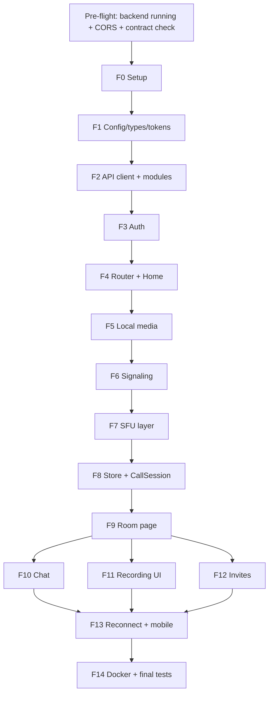
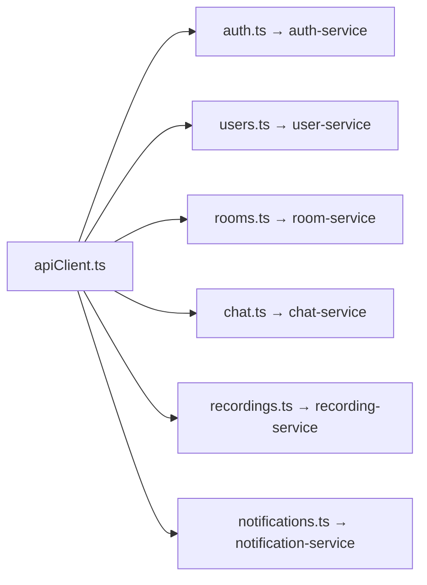

# Phase F — Frontend: File-by-File Implementation Steps & Execution Checklist

> **Format:** same style as `STEP.MD`. Tick each `[ ]` when done. Code for every file is in `PHASE_F_FRONTEND_GUIDE.md` (same phase and file names), so this file is your **to-do order**; the guide is your **code and explanation**.
> **Rule for every file:** (A) create the empty file → (B) paste the code from the guide → (C) run the verify line.
> **App location:** `GOOGLE_MEET/FRONTEND/web/` · **Dev URL:** `http://localhost:5173`

---

## 📌 Status Dashboard

| Phase         | Component                      |   Status   | Files                                                                              | Verify (you must SEE this)                                 |
| :------------ | :----------------------------- | :--------: | :--------------------------------------------------------------------------------- | :--------------------------------------------------------- |
| **F0**  | Project setup                  | ✅ DONE    | `.env`, `.env.example`                                                         | Vite starter page opens                                    |
| **F1**  | Config, types, tokens          | ✅ DONE    | `env.ts`, `types/api.ts`, `tokenStore.ts`                                    | build has 0 errors; missing env crashes with clear message |
| **F2**  | API client + 6 service modules | ✅ DONE    | `apiClient.ts`, `api/{auth,users,rooms,chat,recordings,notifications}.ts`      | curl shapes match types                                    |
| **F3**  | Auth                           | ✅ DONE    | `AuthContext.tsx`, `ProtectedRoute.tsx`, `AuthPage.tsx`                      | signup → refresh page → still logged in                  |
| **F4**  | Router, CSS, Home              | ✅ DONE    | `main.tsx`, `App.tsx`, `global.css`, `HomePage.tsx`, stub `RoomPage.tsx` | New meeting → `/room/<code>`                            |
| **F5**  | Camera/mic + pre-join          | ✅ DONE    | `useLocalMedia.ts`, `VideoTile.tsx`, `PreJoin.tsx`                           | see yourself; camera light off on leave                    |
| **F6**  | Signaling layer                | ✅ DONE    | `signaling.ts`, `iceServers.ts`                                                | build 0 errors                                             |
| **F7**  | SFU layer                      | ✅ DONE    | `sfuClient.ts`                                                                   | `SFU_EVENTS` match your SFU                              |
| **F8**  | Store + CallSession            | ✅ DONE    | `callStore.ts`, `CallSession.ts`                                               | build 0 errors                                             |
| **F9**  | Room page, grid, controls      | ✅ DONE    | `VideoGrid.tsx`, `ControlsBar.tsx`, `RoomPage.tsx`                           | 2 browsers see each other                                  |
| **F10** | Chat                           | ✅ DONE    | `ChatPanel.tsx`                                                                  | message persists after reload                              |
| **F11** | Recording UI                   | ✅ DONE    | `RecordingPanel.tsx`                                                             | record → play → download                                 |
| **F12** | Invites                        | ✅ DONE    | `InvitePanel.tsx`                                                                | mail visible in Mailpit                                    |
| **F13** | Reconnect + mobile             | ✅ DONE    | `vite.config.ts` (optional)                                                      | offline 10 s → auto recovery                              |
| **F14** | Docker + test matrix           | ✅ DONE    | `Dockerfile`, `nginx.conf`, `.dockerignore`, compose service                 | 16-scenario matrix passes                                  |

---

## 🔗 Dependency Order (do not skip ahead)

F10, F11 and F12 are independent of each other once F9 works.

---

## ✅ Pre-flight (do before F0)

- [x] `docker compose up -d` and all services healthy (`http://localhost:4000/health`, `/ready`)
- [x] Gateway, Signaling (and SFU if used directly) CORS allow `http://localhost:5173`
- [x] Gateway CORS `exposedHeaders` includes `x-request-id` and `retry-after`
- [x] Open the SFU socket handler (or `Phase_9_sfu_frontend_guide.md`) and **write down the real event names** for: router capabilities, create transport, connect transport, produce, closeProducer, getProducers, consume, resumeConsumer, newProducer, producerClosed
- [x] Decide **A5**: browser talks to SFU directly (`:4006`) or via signaling (`:4004`)
- [x] Run the README curl sequence and save the JSON of: login, `/auth/turn-credentials`, `GET /rooms/:code`, chat messages, recordings list

---

## Phase F0 — Project Setup `[✅ COMPLETED]`

**Goal:** an empty React + TypeScript app that talks to nothing yet.

- [x] **F0.1** Create the app: `npm create vite@latest web -- --template react-ts` inside `FRONTEND/`, then `npm install`
- [x] **F0.2** Install: `npm install react-router-dom axios socket.io-client mediasoup-client zustand`
- [x] **F0.3** Create empty `.env` and `.env.example`, then fill `VITE_API_URL`, `VITE_SIGNALING_URL`, `VITE_SFU_URL`, `VITE_TURN_URL`
- [x] **F0.4** `npm run dev` → page opens on `:5173`

**Deliverable:** running starter app.

---

## Phase F1 — Config, Types, Token Store `[✅ COMPLETED]`

**Goal:** the three foundations everything imports.

- [x] **F1.1** `src/config/env.ts`: validated env, fail-fast
- [x] **F1.2** `src/types/api.ts`: backend shapes
- [x] **F1.3** `src/lib/tokenStore.ts`: access token in memory, refresh in localStorage, `msUntilExpiry()`
- [x] **F1.4** Verify: rename one `VITE_` var → page shows `Missing env var …` → rename back

**Deliverable:** 3 files, no TypeScript errors.

---

## Phase F2 — API Client + Service Modules `[✅ COMPLETED]`

**Goal:** one HTTP client; one small file per backend service.

- [x] **F2.1** `src/lib/apiClient.ts`: Bearer header, single-flight refresh on 401, `ApiError` (status, requestId, retryAfter)
- [x] **F2.2** `src/api/auth.ts`: signup, login, logout, getMe, getTurnCredentials
- [x] **F2.3** `src/api/users.ts`: getProfile, updateProfile
- [x] **F2.4** `src/api/rooms.ts`: createRoom, getRoom, joinRoom, leaveRoom, endRoom
- [x] **F2.5** `src/api/chat.ts`: getMessages
- [x] **F2.6** `src/api/recordings.ts`: start, stop, list, get, download (Blob)
- [x] **F2.7** `src/api/notifications.ts`: sendInvites
- [x] **F2.8** **Contract check:** compare saved curl JSON with `types/api.ts` and fix the one line in the matching `api/*.ts` file if different (assumptions A1, A2, A6, A8)

**Deliverable:** 7 files; shapes confirmed.

---

## Phase F3 — Authentication `[✅ COMPLETED]`

**Goal:** login/signup, session restore on reload, protected routes.

- [x] **F3.1** `src/auth/AuthContext.tsx`: status `loading | anonymous | authenticated`, `login`, `signup` (auto-login), `logout`, session-expired handler
- [x] **F3.2** `src/auth/ProtectedRoute.tsx`: spinner while loading, redirect when anonymous
- [x] **F3.3** `src/pages/AuthPage.tsx`: one form for both modes, 429 countdown message
- [x] **F3.4** Verify (after F4): signup → Home → **refresh browser** → still logged in

**Deliverable:** working auth flow.

---

## Phase F4 — Router, CSS, Home `[✅ COMPLETED]`

**Goal:** app skeleton and the first real screen.

- [x] **F4.1** Replace `src/main.tsx` (StrictMode → BrowserRouter → AuthProvider → App)
- [x] **F4.2** Replace `src/App.tsx` (routes `/login`, `/signup`, `/`, `/room/:code`, fallback)
- [x] **F4.3** `src/styles/global.css`: tokens, grid, panel, mobile `100dvh`
- [x] **F4.4** `src/pages/HomePage.tsx`: New meeting (optional schedule), join by code/link, sign out
- [x] **F4.5** Temporary stub `src/pages/RoomPage.tsx` (so imports resolve)
- [x] **F4.6** Verify: New meeting → URL `/room/<code>`; wrong password ×11 → friendly 429

**Deliverable:** login → home → room URL.

---

## Phase F5 — Camera & Mic `[✅ COMPLETED]`

**Goal:** preview yourself before joining; reuse the same stream in the call.

- [x] **F5.1** `src/media/useLocalMedia.ts`: start/stop, mic/cam toggle, flip camera, readable errors, StrictMode-safe request counter
- [x] **F5.2** `src/components/VideoTile.tsx`: `<video playsInline>`, avatar placeholder
- [x] **F5.3** `src/components/PreJoin.tsx`: preview, toggles, Join button
- [x] **F5.4** Verify: deny permission → readable message; close tab → camera light off

**Deliverable:** pre-join screen.

---

## Phase F6 — Signaling Layer `[✅ COMPLETED]`

- [x] **F6.1** `src/call/signaling.ts`: `createSocket` (fresh JWT per handshake), `waitForConnect`, `request` (ack + timeout)
- [x] **F6.2** `src/call/iceServers.ts`: STUN + TURN from credentials
- [x] **F6.3** Verify: `npm run build` → 0 errors

---

## Phase F7 — SFU Layer `[✅ COMPLETED]`

- [x] **F7.1** `src/call/sfuClient.ts`: Device load, send/recv transports, produce, consume + resume, replaceTrack, close
- [x] **F7.2** **Edit `SFU_EVENTS`** to the real names from the pre-flight list (this is the only place they appear)
- [x] **F7.3** Verify: build 0 errors (if `types` is missing, `npm i mediasoup-client@latest`)

---

## Phase F8 — Store + CallSession `[✅ COMPLETED]`

**Goal:** the brain that joins and keeps the call alive.

| Join order | Action                                                                                      |
| :--------: | :------------------------------------------------------------------------------------------ |
|     1     | REST `POST /rooms/:code/join` (409 is fine)                                               |
|     2     | bind listeners, then connect sockets                                                        |
|     3     | `join-room` → wait for `joined`                                                        |
|     4     | TURN creds → SFU init → produce mic/cam → consume existing (queue early `newProducer`) |
|     5     | load chat history                                                                           |

- [x] **F8.1** `src/call/callStore.ts`: phase, peers, tracks (new MediaStream per change), messages, recording state
- [x] **F8.2** `src/call/CallSession.ts`: join, listeners, rejoin on reconnect, chat, screen share, leave
- [x] **F8.3** Verify the listener payload shapes once with `socket.onAny(console.log)` and tighten `MemberLike` / `JoinedPayload`
- [x] **F8.4** Build 0 errors

---

## Phase F9 — Room Page `[✅ COMPLETED]`

- [x] **F9.1** `src/components/VideoGrid.tsx`
- [x] **F9.2** `src/components/ControlsBar.tsx`
- [x] **F9.3** Create the three panel files so imports compile: `ChatPanel.tsx`, `RecordingPanel.tsx`, `InvitePanel.tsx`
- [x] **F9.4** Replace `src/pages/RoomPage.tsx` with the full page
- [x] **F9.5** **First live test:** two browsers, two accounts, join the same code → each sees the other; close one tab → tile disappears

**If remote video is black:** wrong `SFU_EVENTS` string, missing `resumeConsumer`, or SFU `announcedIp` (see guide Appendix A).

---

## Phase F10 — Chat `[✅ COMPLETED]`

- [x] **F10.1** `src/components/ChatPanel.tsx`
- [x] **F10.2** Verify: message appears once for both; reload and rejoin → still there (MongoDB)

## Phase F11 — Recording UI `[✅ COMPLETED]`

- [x] **F11.1** `src/components/RecordingPanel.tsx`
- [x] **F11.2** Verify: host Start → 🔴 for everyone → Stop → Processing → Completed → ▶ plays → ⬇ downloads
- [x] **F11.3** Verify: non-host Start returns 403 message

## Phase F12 — Invites `[✅ COMPLETED]`

- [x] **F12.1** `src/components/InvitePanel.tsx`
- [x] **F12.2** Check the invite email join link points to `http://localhost:5173/room/<code>` (not the old test client)
- [x] **F12.3** Verify in Mailpit (`:8025`); scheduled room reminder flips to `CANCELLED` when the room ends

---

## Phase F13 — Reconnect, Mobile, Android `[✅ COMPLETED]`

- [x] **F13.1** Backend media check: mediasoup `announcedIp` = PC LAN IP; UDP `20000–20050` open in Docker and Windows Firewall; Coturn `external-ip` set
- [x] **F13.2** Pick a phone-testing option: Chrome flag (Android) or Vite HTTPS + proxy (`vite.config.ts`)
- [x] **F13.3** Test: DevTools offline 10 s → "Reconnecting…" banner → video resumes
- [x] **F13.4** Test: Android + laptop call; phone on mobile data (proves TURN); rotate phone

---

## Phase F14 — Docker + Final Tests `[✅ COMPLETED]`

- [x] **F14.1** Create `Dockerfile`, `nginx.conf`, `.dockerignore`
- [x] **F14.2** Add the `frontend` service to the root `docker-compose.yml` (use your real gateway service name in `depends_on`)
- [x] **F14.3** `docker compose up --build -d frontend` → open `:5173/room/abc` and refresh (no 404)
- [x] **F14.4** Run the **16-scenario matrix** from the guide
- [x] **F14.5** Watch Grafana during a 4-person call: `signaling_connected_sockets`, SFU producers/consumers, no `ProxyErrorsSpike`

---

## 🏁 Definition of Done

- [x] All F0–F14 boxes ticked
- [x] 16-scenario matrix passed & verified
- [x] `npm run build` → 0 TypeScript errors
- [x] `STEP.MD` dashboard: Phase F → ✅ COMPLETED
- [x] Status report updated: remove "frontend pending"
- [x] Next: **Phase 14 — CI/CD** (add `npm run lint && npm run build` and frontend Docker image build)
