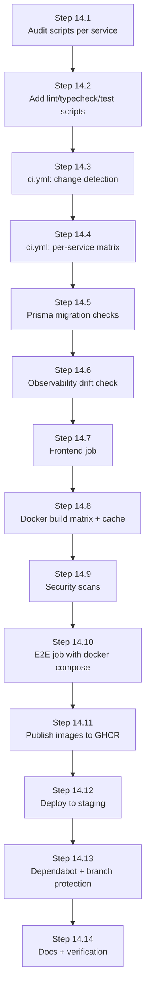

# Phase 14 — CI/CD Pipeline [✅ COMPLETED]

**Goal:** Every push and pull request is automatically linted, type-checked, tested, and built into Docker images. Merges to `main` publish versioned images and run the full E2E suite, so a broken change never reaches Phase 15 (Kubernetes).
**Tech:** GitHub Actions, GitHub Container Registry (GHCR), Docker Buildx (layer cache), Trivy, Gitleaks, Dependabot, PowerShell (`pwsh`) on runners.



---

## Target Pipeline Overview

| Workflow | Trigger | Jobs | Blocks merge? |
| :-- | :-- | :-- | :---: |
| `ci.yml` | PR + push to any branch | detect-changes → lint/typecheck/test (matrix) → prisma-check → observability-drift → frontend | ✅ |
| `docker.yml` | PR (build only) + push to `main` (build + push) | build matrix of 10 images, Trivy scan | ✅ (build/scan) |
| `e2e.yml` | push to `main`, nightly, manual | `docker compose up`, run E2E scripts, upload logs | ✅ on main |
| `security.yml` | PR + weekly | `npm audit`, Gitleaks, Trivy fs scan | ⚠️ high/critical only |
| `release.yml` | tag `v*.*.*` | retag images, GitHub Release notes, optional deploy | — |
| `deploy-staging.yml` | after successful `e2e.yml` on `main` | SSH + `docker compose pull && up -d` (replaced by Helm in Phase 15) | — |

**Services in the matrix (9 backend + 1 frontend):** `api-gateway`, `auth-service`, `user-service`, `room-service`, `signaling-service`, `chat-service`, `sfu-service`, `recording-service`, `notification-service`, `frontend`.

---

## Step 14.1 — Audit Existing Scripts

**Goal:** Know exactly what each service can already do before writing workflows.

- In every `services/*/package.json` and `FRONTEND/web/package.json`, list which of these scripts exist: `lint`, `typecheck` (`tsc --noEmit`), `test`, `build`.
- Record Node version per Dockerfile (gateway uses `node:22-alpine`; confirm others) and standardize on **Node 22** in CI.
- Confirm every service has a committed `package-lock.json` (needed for `npm ci` and cache keys).

**Deliverable:** a short table in this file (service → missing scripts).

**Audit Results Table:**

| Service | `lint` | `typecheck` | `test` | `build` | `package-lock.json` | Base Node Image | Status |
| :--- | :---: | :---: | :---: | :---: | :---: | :---: | :---: |
| `api-gateway` | ✅ `oxlint` | ✅ `tsc --noEmit` | ✅ `node:test` (smoke) | ✅ `tsc` | Committed | `node:22-alpine` | Standardized |
| `auth-service` | ✅ `oxlint` | ✅ `tsc --noEmit` | ✅ `node:test` (smoke) | ✅ `tsc` | Committed | `node:20-alpine` | Standardized |
| `user-service` | ✅ `oxlint` | ✅ `tsc --noEmit` | ✅ `node:test` (smoke) | ✅ `tsc` | Committed | `node:20-alpine` | Standardized |
| `room-service` | ✅ `oxlint` | ✅ `tsc --noEmit` | ✅ `node:test` (smoke) | ✅ `tsc` | Committed | `node:20-alpine` | Standardized |
| `signaling-service` | ✅ `oxlint` | ✅ `tsc --noEmit` | ✅ `node:test` (smoke) | ✅ `tsc` | Committed | `node:20-alpine` | Standardized |
| `chat-service` | ✅ `oxlint` | ✅ `tsc --noEmit` | ✅ `node:test` (smoke) | ✅ `tsc` | Committed | `node:20-alpine` | Standardized |
| `sfu-service` | ✅ `oxlint` | ✅ `tsc --noEmit` | ✅ `node:test` (smoke) | ✅ `tsc` | Committed | `node:22-bookworm-slim` | Standardized |
| `recording-service` | ✅ `oxlint` | ✅ `tsc --noEmit` | ✅ `node:test` (smoke) | ✅ `tsc` | Committed | `node:20-bookworm-slim` | Standardized |
| `notification-service` | ✅ `oxlint` | ✅ `tsc --noEmit` | ✅ `node:test` (smoke) | ✅ `tsc` | Committed | `node:20-alpine` | Standardized |
| `FRONTEND/web` | ✅ `oxlint` | ✅ `tsc -b --noEmit`| ✅ (smoke/unit) | ✅ `tsc -b && vite build` | Committed | `node:22-alpine` / `nginx` | Standardized |

---

## Step 14.2 — Standardize npm Scripts

Add the missing scripts to every service so CI can call them uniformly:

```json
{
  "scripts": {
    "lint": "eslint . --max-warnings=0",
    "typecheck": "tsc --noEmit",
    "test": "vitest run",
    "build": "tsc -p tsconfig.json"
  }
}
```

- Add a root-level or per-service ESLint flat config (`eslint.config.js`) with `typescript-eslint`.
- For services with no tests yet, add at least a smoke test (app boots, `/health` returns `{ status: "ok" }`) using Vitest + Supertest.
- Unit-test candidates that give the best value first: gateway `gatewayAuth` and rate-limit config, auth password/JWT helpers, notification email deduping, recording state transitions, signaling event handlers.

**Deliverable:** `npm run lint && npm run typecheck && npm test && npm run build` passes locally in every service.

---

## Step 14.3 — `ci.yml`: Change Detection

**File:** `.github/workflows/ci.yml`

Avoid rebuilding all 10 services on every change. Use `dorny/paths-filter` to emit a JSON list of changed services.

```yaml
name: CI
on:
  pull_request:
  push:
    branches: [main]

concurrency:
  group: ci-${{ github.ref }}
  cancel-in-progress: true

jobs:
  changes:
    runs-on: ubuntu-latest
    outputs:
      services: ${{ steps.filter.outputs.changes }}
    steps:
      - uses: actions/checkout@v4
      - id: filter
        uses: dorny/paths-filter@v3
        with:
          filters: |
            api-gateway:          ['services/api-gateway/**', 'shared/observability/**']
            auth-service:         ['services/auth-service/**', 'shared/observability/**']
            user-service:         ['services/user-service/**', 'shared/observability/**']
            room-service:         ['services/room-service/**', 'shared/observability/**']
            signaling-service:    ['services/signaling-service/**', 'shared/observability/**']
            chat-service:         ['services/chat-service/**', 'shared/observability/**']
            sfu-service:          ['services/sfu-service/**', 'shared/observability/**']
            recording-service:    ['services/recording-service/**', 'shared/observability/**']
            notification-service: ['services/notification-service/**', 'shared/observability/**']
```

Changes to `shared/observability/**` intentionally trigger **all** services.

---

## Step 14.4 — `ci.yml`: Per-Service Matrix Job

```yaml
  backend:
    needs: changes
    if: ${{ needs.changes.outputs.services != '[]' }}
    runs-on: ubuntu-latest
    strategy:
      fail-fast: false
      matrix:
        service: ${{ fromJSON(needs.changes.outputs.services) }}
    defaults:
      run:
        working-directory: services/${{ matrix.service }}
    steps:
      - uses: actions/checkout@v4
      - uses: actions/setup-node@v4
        with:
          node-version: 22
          cache: npm
          cache-dependency-path: services/${{ matrix.service }}/package-lock.json
      - run: npm ci
      - run: npx prisma generate
        if: ${{ contains(fromJSON('["auth-service","user-service","room-service","recording-service","notification-service"]'), matrix.service) }}
      - run: npm run lint
      - run: npm run typecheck
      - run: npm test
      - run: npm run build
```

**Notes**
- `sfu-service` and `recording-service` depend on `mediasoup`, which compiles a native C++ worker during `npm ci`. Keep the default `ubuntu-latest` image (has `python3`, `make`, `g++`) and expect 2–4 min installs; the npm cache helps.
- Services needing Redis/Postgres/Mongo in tests: add `services:` containers (`redis:7`, `postgres:16`, `mongo:7`) to the job, or mock at the client layer for unit tests and leave integration to the E2E job.

---

## Step 14.5 — Prisma Migration Checks

**Goal:** Catch schema drift and broken migrations before merge.

For `auth-service`, `user-service`, `room-service`, `recording-service`, `notification-service`:

1. Start a throwaway `postgres:16` service container.
2. Run `npx prisma migrate deploy` against an empty DB (proves the full migration history applies cleanly).
3. Run `npx prisma migrate diff --from-migrations prisma/migrations --to-schema-datamodel prisma/schema.prisma --exit-code` (fails if `schema.prisma` has changes without a migration).
4. Run `npx prisma validate`.

**Deliverable:** `prisma-check` matrix job, required for merge.

---

## Step 14.6 — Observability Drift Check

Your shared observability modules are copied into 9 services by `scripts/sync-observability.ps1`. CI should fail if any copy drifts.

```yaml
  observability-drift:
    runs-on: ubuntu-latest   # pwsh is preinstalled on GitHub-hosted runners
    steps:
      - uses: actions/checkout@v4
      - run: pwsh -File scripts/sync-observability.ps1 -CheckOnly
```

Also validate monitoring config:

- `promtool check config infra/prometheus/prometheus.yml`
- `promtool check rules infra/prometheus/alerts.yml`
- `jq empty infra/grafana/dashboards/video-meet-overview.json` (valid JSON)

---

## Step 14.7 — Frontend Job

**Location:** `FRONTEND/web/`

```yaml
  frontend:
    runs-on: ubuntu-latest
    defaults:
      run:
        working-directory: FRONTEND/web
    steps:
      - uses: actions/checkout@v4
      - uses: actions/setup-node@v4
        with:
          node-version: 22
          cache: npm
          cache-dependency-path: FRONTEND/web/package-lock.json
      - run: npm ci
      - run: npm run lint
      - run: npx tsc -b --noEmit
      - run: npm test --if-present
      - run: npm run build
      - uses: actions/upload-artifact@v4
        with:
          name: frontend-dist
          path: FRONTEND/web/dist
          retention-days: 7
```

Build-time `VITE_*` variables (API URL, signaling URL) must come from CI env, not from a committed `.env`.

---

## Step 14.8 — `docker.yml`: Image Build Matrix with Cache

**Goal:** Every Dockerfile builds on every PR; images are pushed only from `main`.

```yaml
name: Docker
on:
  pull_request:
  push:
    branches: [main]
    tags: ['v*.*.*']

permissions:
  contents: read
  packages: write

jobs:
  build:
    runs-on: ubuntu-latest
    strategy:
      fail-fast: false
      matrix:
        include:
          - { name: api-gateway,          context: services/api-gateway }
          - { name: auth-service,         context: services/auth-service }
          - { name: user-service,         context: services/user-service }
          - { name: room-service,         context: services/room-service }
          - { name: signaling-service,    context: services/signaling-service }
          - { name: chat-service,         context: services/chat-service }
          - { name: sfu-service,          context: services/sfu-service }
          - { name: recording-service,    context: services/recording-service }
          - { name: notification-service, context: services/notification-service }
          - { name: frontend,             context: FRONTEND/web }
    steps:
      - uses: actions/checkout@v4
      - uses: docker/setup-buildx-action@v3
      - uses: docker/login-action@v3
        if: github.event_name != 'pull_request'
        with:
          registry: ghcr.io
          username: ${{ github.actor }}
          password: ${{ secrets.GITHUB_TOKEN }}
      - id: meta
        uses: docker/metadata-action@v5
        with:
          images: ghcr.io/${{ github.repository_owner }}/videomeet-${{ matrix.name }}
          tags: |
            type=sha,format=short
            type=ref,event=branch
            type=semver,pattern={{version}}
            type=raw,value=latest,enable={{is_default_branch}}
      - uses: docker/build-push-action@v6
        with:
          context: ${{ matrix.context }}
          push: ${{ github.event_name != 'pull_request' }}
          tags: ${{ steps.meta.outputs.tags }}
          labels: ${{ steps.meta.outputs.labels }}
          cache-from: type=gha,scope=${{ matrix.name }}
          cache-to: type=gha,mode=max,scope=${{ matrix.name }}
```

**Checklist**
- If a Dockerfile copies `shared/observability`, set the build `context` to the repo root and pass `file:` instead, or confirm the sync script already copied the files into each service folder (current design).
- Tag convention: `sha-<short>`, branch name, `latest` (main only), semver on tags.
- Keep images non-root (gateway already is) and pin base image tags.

---

## Step 14.9 — Security Scans (`security.yml`)

| Check | Tool | Fail on |
| :-- | :-- | :-- |
| Secret leakage | `gitleaks/gitleaks-action` | any finding |
| Dependency vulns | `npm audit --omit=dev --audit-level=high` per service | high / critical |
| Image vulns | `aquasecurity/trivy-action` against each built image | HIGH / CRITICAL with fix available |
| Filesystem / IaC | `trivy fs --scanners vuln,secret,config .` | HIGH / CRITICAL |
| Dockerfile lint | `hadolint/hadolint-action` | error |

- Upload Trivy results as SARIF to the GitHub Security tab.
- Make sure `infra/prometheus/metrics_token`, `.env`, and `.env.docker` files with real values are **not** committed. Commit only `.env.example`. Rotate any value that has ever been committed.

---

## Step 14.10 — `e2e.yml`: Full-Stack E2E in CI

**Goal:** Run the scripts you already have against a real `docker compose` stack.

Steps:

1. Create CI-only env files from GitHub Secrets (`JWT_ACCESS_SECRET`, `JWT_REFRESH_SECRET`, `TURN_SECRET`, `METRICS_TOKEN`, `GRAFANA_ADMIN_PASSWORD`).
2. `docker compose up -d --build --wait` (use healthchecks; `/ready` on gateway, recording, notification).
3. Run in order, failing fast:
   - `node scripts/e2e-all-services.mjs` (15 REST checks)
   - `node scripts/e2e-gateway.mjs`
   - `node scripts/e2e-notification.mjs`
   - `node scripts/e2e-recording.mjs`
   - `node scripts/e2e-observability.mjs` (44 assertions)
   - `node scripts/test-first-time-join.mjs` (headless Chrome)
   - `node scripts/e2e-full-meet-call.mjs` (multi-party WebRTC)
4. On failure, always upload `docker compose logs` and Playwright/Puppeteer screenshots as artifacts (`if: always()`).
5. `docker compose down -v` in an `if: always()` step.

**WebRTC-in-CI caveats**
- Headless Chrome needs `--use-fake-ui-for-media-stream --use-fake-device-for-media-stream` so no real camera/mic is required.
- mediasoup's UDP range `20000-20050` must be reachable from the browser on the same runner; set `MEDIASOUP_ANNOUNCED_IP=127.0.0.1` for CI.
- GitHub-hosted runners have 2–4 vCPUs and limited RAM; the 18-container stack is heavy. Options: disable Grafana/Jaeger for the non-observability steps, or use a larger runner. Keep a 25–30 min job timeout.
- Run E2E on `main`, nightly, and via `workflow_dispatch`; on PRs run it only when a label like `run-e2e` is present (saves minutes).

---

## Step 14.11 — Publish & Release (`release.yml`)

- On tag `vX.Y.Z`: images are already built by `docker.yml` with the semver tag.
- Create a GitHub Release with auto-generated notes (`softprops/action-gh-release`, `generate_release_notes: true`).
- Attach a `docker-compose.release.yml` that references the published GHCR image tags (so someone can run the release without building).
- Adopt Conventional Commits (`feat:`, `fix:`, `docs:`; you already use `docs:`) and optionally `release-please` to automate version bumps and changelogs.

---

## Step 14.12 — Staging Deployment (`deploy-staging.yml`)

Phase 15 will replace this with Helm, so keep it simple.

- Trigger: `workflow_run` completed successfully for `E2E` on `main`.
- Method: SSH to a single VM (`appleboy/ssh-action`), then `docker compose -f docker-compose.release.yml pull && docker compose ... up -d`.
- Run `prisma migrate deploy` for the five Postgres services **before** starting new containers (one-shot migrate container or init command).
- Post-deploy smoke: `curl -f https://staging.<domain>/api/health` and `/ready`; roll back to the previous image tag on failure.
- Use GitHub **Environments** (`staging`, later `production`) with required reviewers for production.
- Coturn and mediasoup need a public IP and open UDP ports (`3478`, relay range, `20000-20050`); the deploy VM firewall must allow them.

---

## Step 14.13 — Repo Hygiene & Protection

- **Dependabot** (`.github/dependabot.yml`): weekly updates for `npm` in each service folder + `FRONTEND/web`, `github-actions`, and `docker`. Group minor/patch updates to reduce PR noise.
- **Branch protection on `main`:** require PR, 1 review, and these status checks: `backend`, `prisma-check`, `observability-drift`, `frontend`, `docker / build`, `security`.
- Add `CODEOWNERS`, a PR template (checklist: tests, migration, docs updated), and a `.github/workflows` README.
- Pin third-party actions by major version at minimum (SHA pinning for production-grade).
- Add a CI status badge to the root `README.MD`.

---

## Step 14.14 — Documentation & Verification

**Update:** `STEP.MD`, `README.MD`, `SERVICES_DETAIL.md`, `MD/update/update.md` with Phase 14 status and a "How CI works" section.

**Definition of done**

- [x] A PR touching only `services/chat-service/**` runs only the chat-service jobs (change detection works).
- [x] A PR touching `shared/observability/**` runs all 9 backend jobs.
- [x] A deliberate lint error, type error, failing test, and a stale Prisma migration each turn the PR red.
- [x] `sync-observability.ps1 -CheckOnly` fails CI when a service copy is edited by hand.
- [x] All 10 images build on PRs and are pushed to GHCR from `main` with `sha-*` and `latest` tags.
- [x] Trivy/Gitleaks run and block on high/critical findings.
- [x] `e2e.yml` passes end-to-end on `main` with artifacts uploaded on failure.
- [x] Tag `v0.1.0` produces a GitHub Release with images tagged `0.1.0`.
- [x] Staging deploys automatically after green E2E and passes `/ready`.
- [x] Branch protection enforces all required checks.
- [x] Typical PR CI time under ~10 minutes (with caching and change detection).

---

## Suggested Build Order Inside Phase 14

1. **Day 1:** Steps 14.1–14.2 (scripts + smoke tests) and 14.3–14.4 (core `ci.yml`).
2. **Day 2:** Steps 14.5–14.7 (Prisma, observability drift, frontend).
3. **Day 3:** Steps 14.8–14.9 (Docker matrix, GHCR, security scans).
4. **Day 4:** Step 14.10 (E2E in CI, the trickiest because of WebRTC and resources).
5. **Day 5:** Steps 14.11–14.14 (release, staging deploy, protection, docs).

## Handoff to Phase 15 (Kubernetes)

Phase 14 produces what Phase 15 consumes: versioned images in GHCR, a validated Prometheus rules file (reusable as `PrometheusRule`), and a tested migration flow (becomes a Helm pre-upgrade Job).

---

## Housekeeping Notes Found While Reviewing the Docs

- `STEP.MD` says Auth's `/internal/verify-token` is used by Room and Signaling, while the README says every service verifies JWTs locally and nothing calls that endpoint. Pick one and align both documents.
- `SERVICES_DETAIL.md` numbers the frontend as "11" while the Notification Service is also 11. Renumber to 14 (or similar) to avoid duplicate section numbers.
- `SERVICES_DETAIL.md` documents the Grafana password inline; replace it with "set via `GRAFANA_ADMIN_PASSWORD`" as in the README.
- The Phase 10 migration folder is dated `20261017…` while the report says Sept 23, 2026; confirm dates in the status report.