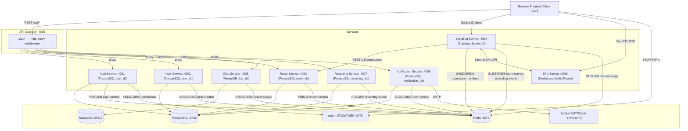

# Google Meet Clone — Microservices Video Calling App

A Node.js/TypeScript microservices application for real-time video calling. Clients connect to a single API Gateway for HTTP; the Signaling Service is accessed directly (bypasses the Gateway) via WebSocket for WebRTC signaling.

---

## Architecture



> **Redis pub/sub flows:**
> - `auth-service` PUBLISHes `user-created { userId }` → `user-service` SUBSCRIBEs and auto-creates a `Profile` row
> - `signaling-service` PUBLISHes `chat-message { roomId, senderId, senderName, text }` → `chat-service` SUBSCRIBEs and persists to MongoDB
> - `room-service` PUBLISHes `room-events { type: 'room-ended', roomCode }` → `signaling-service` terminates socket rooms & `notification-service` cancels pending reminders
> - `recording-service` PUBLISHes `recording-events { type, roomCode, recordingId }` → `signaling-service` broadcasts status changes to meeting participants

---

## Service Overview

| Service | Port | Database | Status |
|---|---|---|---|
| frontend | 5173 | React 19 SPA + mediasoup-client | ✅ Active |
| api-gateway | 4000 | None (Rate limit in Redis) | ✅ Active |
| auth-service | 4001 | PostgreSQL (`auth_db`) | ✅ Active |
| user-service | 4002 | PostgreSQL (`user_db`) | ✅ Active |
| room-service | 4003 | PostgreSQL (`room_db`) | ✅ Active |
| signaling-service | 4004 | None (Redis for presence) | ✅ Active |
| chat-service | 4005 | MongoDB (`chat_db`) | ✅ Active |
| sfu-service | 4006 | None (mediasoup) | ✅ Active |
| recording-service | 4007 | PostgreSQL (`recording_db`) | ✅ Active |
| notification-service | 4008 | PostgreSQL (`notification_db`) | ✅ Active |
| mailpit | 1025 / 8025 | In-memory | ✅ Active |
| coturn | 3478 UDP | — | ✅ Active |
| prometheus | 9090 | Time-series volume | ✅ Active |
| grafana | 3001 | SQLite (`grafana_data`) | ✅ Active |
| jaeger | 16686 | In-memory / OTLP | ✅ Active |

---

## Client-Facing Route Map (through the Gateway)

All client URLs are prefixed `/api`. Source: `services/api-gateway/src/routes/proxyRoutes.ts`.

### Auth Service → :4001

| Client URL | `gatewayAuth`? | Forwards to (auth-service) |
|---|---|---|
| `POST /api/auth/signup` | ❌ No | `POST /api/v1/auth/signup` |
| `POST /api/auth/login` | ❌ No | `POST /api/v1/auth/login` |
| `POST /api/auth/refresh` | ❌ No | `POST /api/v1/auth/refresh` |
| `POST /api/auth/logout` | ✅ Yes | `POST /api/v1/auth/logout` |
| `GET  /api/auth/me` | ✅ Yes | `GET  /api/v1/auth/me` |
| `GET  /api/auth/turn-credentials` | ✅ Yes | `GET  /api/v1/auth/turn-credentials` |

Rewrite rule: `^/auth` → `/api/v1/auth`

### User Service → :4002

| Client URL | `gatewayAuth`? | Forwards to (user-service) |
|---|---|---|
| `GET   /api/users/me` | ✅ Yes | `GET   /me` |
| `PATCH /api/users/me` | ✅ Yes | `PATCH /me` |

Rewrite rule: `^/users` → `''` (strips `/users`; user-service mounts routes at `/`)

### Room Service → :4003

| Client URL | `gatewayAuth`? | Forwards to (room-service) |
|---|---|---|
| `POST /api/v1/rooms` | ✅ Yes | `POST /v1/rooms` |
| `GET  /api/v1/rooms/:code` | ✅ Yes | `GET  /v1/rooms/:code` |
| `POST /api/v1/rooms/:code/join` | ✅ Yes | `POST /v1/rooms/:code/join` |
| `POST /api/v1/rooms/:code/leave` | ✅ Yes | `POST /v1/rooms/:code/leave` |
| `POST /api/v1/rooms/:code/end` | ✅ Yes | `POST /v1/rooms/:code/end` |

Rewrite rule: `^/v1/rooms` → `/v1/rooms` (no-op — path forwarded unchanged)

### Chat Service → :4005

| Client URL | `gatewayAuth`? | Forwards to (chat-service) |
|---|---|---|
| `GET /api/v1/chat/:roomId/messages` | ✅ Yes | `GET /api/v1/chat/:roomId/messages` |

Rewrite rule: `^/v1/chat` → `/api/v1/chat` (no-op rewrite to service mount)

### Recording Service → :4007

| Client URL | `gatewayAuth`? | Forwards to (recording-service) |
|---|---|---|
| `POST /api/v1/recordings/start` | ✅ Yes | `POST /v1/recordings/start` |
| `POST /api/v1/recordings/stop` | ✅ Yes | `POST /v1/recordings/stop` |
| `GET  /api/v1/recordings/room/:roomId` | ✅ Yes | `GET  /v1/recordings/room/:roomId` |
| `GET  /api/v1/recordings/:recordingId` | ✅ Yes | `GET  /v1/recordings/:recordingId` |
| `GET  /api/v1/recordings/:recordingId/download` | ✅ Yes | `GET  /v1/recordings/:recordingId/download` |

Rewrite rule: `^/v1/recordings` → `/v1/recordings` (no-op — path forwarded unchanged)

### Notification Service → :4008

| Client URL | `gatewayAuth`? | Forwards to (notification-service) |
|---|---|---|
| `POST /api/v1/notifications/invites` | ✅ Yes | `POST /v1/notifications/invites` |

Rewrite rule: `^/v1/notifications` → `/v1/notifications` (no-op — path forwarded unchanged)

### Signaling Service — Direct WebSocket (bypasses Gateway)

```js
io("http://localhost:4004", { auth: { token: accessToken } })
```

---

## JWT Authentication Pattern

Every service verifies JWTs **locally** using the shared `JWT_ACCESS_SECRET`. No service calls another service's `/internal/verify-token` endpoint for its own route guards.

| Service | Mechanism | Notes |
|---|---|---|
| API Gateway (`gatewayAuth.ts`) | `jwt.verify` local | Sets `x-user-id` header forwarded downstream |
| Auth Service (`authGuard.ts`) | `jwt.verify` local | Guards `/me` and `/turn-credentials` |
| User Service (`authGuard.ts`) | `jwt.verify` local | Double-verifies (Gateway already checked) |
| Room Service (`authGuard.ts`) | `jwt.verify` local | Double-verifies |
| Chat Service (`authGuard.ts`) | `jwt.verify` local | Double-verifies |
| Recording Service (`authGuard.ts`) | `jwt.verify` local | Double-verifies |
| Notification Service (`authGuard.ts`) | `jwt.verify` local | Double-verifies |
| Signaling Service (`socketAuth.ts`) | `jwt.verify` local | Reads token from `handshake.auth.token` or `handshake.query.token` |
| Auth Service `/api/v1/internal/verify-token` | `jwt.verify` local | Exists but **not called by any other service** currently |
| All Services (`GET /metrics`) | Bearer `METRICS_BEARER_TOKEN` (constant-time check) | Telemetry scraping only; not client-accessible or JWT-based |

---

## Known Inconsistencies

### 1. Services where `/v1` is visible in the client URL

| Service | Client path prefix | `/v1` visible to client? |
|---|---|---|
| auth-service | `/api/auth/...` | No — injected by Gateway rewrite |
| user-service | `/api/users/...` | No — no version prefix anywhere |
| room-service | `/api/v1/rooms/...` | **Yes** — must be in the client URL |
| chat-service | `/api/v1/chat/...` | **Yes** — must be in the client URL |
| recording-service | `/api/v1/recordings/...` | **Yes** — must be in the client URL |
| notification-service | `/api/v1/notifications/...` | **Yes** — must be in the client URL |

**Why:** `room-service`, `chat-service`, `recording-service`, and `notification-service` mount their routes under `/v1` internally. The Gateway's pathRewrite rules forward `/v1/...` directly, making `/v1` part of the client API surface.

### 2. `GET /api/auth/me` returns only `{ userId }`, not a full user object

`auth-service`'s `meController` returns `{ userId: req.userId }` only. For a full profile (displayName, avatarUrl, etc.) use `GET /api/users/me` (user-service).

### 3. `​.env.example` in api-gateway is resolved in Phase 12

`​.env.example` in `services/api-gateway` now contains all required variables (`REDIS_URL`, `TRUST_PROXY`, `BODY_LIMIT`, etc.).

### 4. Chat-service `.env.docker` has unused variables

`GATEWAY_SECRET`, `AUTH_SERVICE_URL`, and `JWT_REFRESH_SECRET` appear in `.env.docker` but no active code path in chat-service reads them. Only `JWT_ACCESS_SECRET`, `MONGO_URI`, `REDIS_URL`, `PORT`, and `NODE_ENV` are consumed.

---

## Local Development

All services use `tsx watch --env-file=.env server.ts` (configured under `npm run dev`). Do **not** run `node server.ts` directly on `.ts` files.

```bash
cd services/api-gateway          && npm install && npm run dev   # :4000
cd services/auth-service         && npm install && npm run dev   # :4001
cd services/user-service         && npm install && npm run dev   # :4002
cd services/room-service         && npm install && npm run dev   # :4003
cd services/signaling-service    && npm install && npm run dev   # :4004
cd services/chat-service         && npm install && npm run dev   # :4005
cd services/sfu-service          && npm install && npm run dev   # :4006
cd services/recording-service    && npm install && npm run dev   # :4007
cd services/notification-service && npm install && npm run dev   # :4008
```

Each service reads its own `.env`. Copy `.env.docker` (or `.env.example`) to `.env` and replace Docker hostnames with `localhost`. Also provide `METRICS_TOKEN` and `OTEL_EXPORTER_OTLP_ENDPOINT` for observability if testing telemetry locally.

Run Prisma migrations before first start for services with PostgreSQL schemas:
```bash
# auth-service, user-service, room-service, recording-service, notification-service:
npx prisma migrate deploy
```

---

## Docker

```bash
docker compose up --build    # start all
docker compose down          # stop (keeps volumes)
docker compose down -v       # stop and delete all data
```

---

## Manual Test Sequence

```bash
# 1. Signup
curl -s -X POST http://localhost:4000/api/auth/signup \
  -H "Content-Type: application/json" \
  -d '{"email":"test@example.com","password":"password123"}' | jq

# 2. Login — capture token
TOKEN=$(curl -s -X POST http://localhost:4000/api/auth/login \
  -H "Content-Type: application/json" \
  -d '{"email":"test@example.com","password":"password123"}' | jq -r '.data.accessToken')

# 3. Get profile (user-service)
curl -s http://localhost:4000/api/users/me \
  -H "Authorization: Bearer $TOKEN" | jq

# 4. Create room — capture room code
ROOM_CODE=$(curl -s -X POST http://localhost:4000/api/v1/rooms \
  -H "Authorization: Bearer $TOKEN" \
  -H "Content-Type: application/json" \
  -d '{"title":"Test Room"}' | jq -r '.data.room.code')

# 5. Join room
curl -s -X POST "http://localhost:4000/api/v1/rooms/$ROOM_CODE/join" \
  -H "Authorization: Bearer $TOKEN" | jq

# 6. Get TURN credentials
curl -s http://localhost:4000/api/auth/turn-credentials \
  -H "Authorization: Bearer $TOKEN" | jq

# 7. Get chat messages
curl -s "http://localhost:4000/api/v1/chat/$ROOM_CODE/messages?limit=20" \
  -H "Authorization: Bearer $TOKEN" | jq

# 8. Send meeting invite email (notification-service)
curl -s -X POST http://localhost:4000/api/v1/notifications/invites \
  -H "Authorization: Bearer $TOKEN" \
  -H "Content-Type: application/json" \
  -d '{"roomCode":"'"$ROOM_CODE"'","guestEmails":["guest@example.com"]}' | jq
```

---

## Folder Structure

```
GOOGLE_MEET/
├── docker-compose.yml
├── infra/
│   ├── coturn/turnserver.conf
│   ├── postgres-init/           # SQL init scripts (creates separate DBs)
│   ├── observability.env        # Shared metrics token & OpenTelemetry settings
│   ├── prometheus/              # prometheus.yml, alerts.yml, metrics_token
│   └── grafana/                 # Provisioning datasources, dashboards, overview JSON
├── services/
│   ├── api-gateway/             # :4000 — reverse proxy + JWT gate + rate limits
│   ├── auth-service/            # :4001 — signup/login/tokens/TURN creds
│   ├── user-service/            # :4002 — profile CRUD
│   ├── room-service/            # :4003 — room lifecycle
│   ├── signaling-service/       # :4004 — Socket.io WebRTC relay
│   ├── chat-service/            # :4005 — chat history (MongoDB)
│   ├── sfu-service/             # :4006 — mediasoup SFU router
│   ├── recording-service/       # :4007 — PlainTransport capture + BullMQ MP4 transcode
│   └── notification-service/    # :4008 — BullMQ + Nodemailer email invites & reminders
├── shared/
│   └── observability/           # config, metrics, tracing, logContext (synced to services)
├── FRONTEND/
│   └── web/                     # :5173 — React 19 + mediasoup-client web application
├── scripts/
│   ├── sync-observability.ps1   # Syncs shared observability files & checks drift
│   ├── e2e-observability.mjs    # End-to-end observability test suite
│   ├── e2e-all-services.mjs     # Complete REST health & probe suite across 9 microservices
│   ├── test-first-time-join.mjs # Pre-join lobby & first-time join test (0 reloads)
│   ├── e2e-full-meet-call.mjs   # Headless browser multi-party call (WebRTC, chat, invites, recording)
│   ├── peer-join-test.mjs       # Live AI peer joining socket & SFU transports
│   ├── test-recording-stop.mjs  # Tests recording start and stop by UUID and roomCode
│   └── generate_docx_report.py  # Generates styled Word (.docx) test verification report
└── test-client/
    ├── index.html
    └── app.js
```

---

## Frontend & End-to-End Verification (Phase F)

The web client is built with React 19, TypeScript, and Vite, served in production through Nginx on port `5173`:
- **Web App URL:** `http://localhost:5173`
- **Mailpit Web Inbox:** `http://localhost:8025` (local SMTP email catcher)
- **Word (.docx) Report:** `GOOGLE_MEET_E2E_TEST_RESULTS.docx`

### Running the Test Automation Suites

```powershell
# 1. Probe all backend microservices & frontend container via REST
node scripts/e2e-all-services.mjs

# 2. Test pre-join lobby and first-attempt join without page reload
node scripts/test-first-time-join.mjs

# 3. Complete multi-party browser E2E test (Host + Guest WebRTC, chat, invites, recording, room end)
node scripts/e2e-full-meet-call.mjs

# 4. Join any room as an active automated peer
node scripts/peer-join-test.mjs <room-code>

# 5. Compile the comprehensive test results into a Microsoft Word document (.docx)
python scripts/generate_docx_report.py
```

---

## Observability (Phase 13)

Phase 13 introduces comprehensive platform-wide telemetry, metrics scraping, distributed tracing, alerting rules, and Grafana dashboard visualization:

- **Prometheus UI:** `http://localhost:9090` (Scrapes `/metrics` across all 9 services every 15s using Bearer credentials; loaded with 7 alert rules from `infra/prometheus/alerts.yml`).
- **Grafana Dashboard:** `http://localhost:3001` (User: `admin`, Password: set via `GRAFANA_ADMIN_PASSWORD` in root `.env`; pre-provisioned with Prometheus & Jaeger datasources and the 10-panel *Video Meet — Overview* dashboard).
- **Jaeger UI:** `http://localhost:16686` (Distributed tracing across API Gateway and backend microservices via OpenTelemetry W3C TraceContext propagation).
- **Protected `/metrics`:** Every service exposes `GET /metrics` on its port, protected with Bearer `METRICS_TOKEN` (constant-time timing-safe comparison; not routed through API Gateway for clients).
- **Infrastructure Directories:**
  - `infra/prometheus/` — `prometheus.yml` scrape configuration, `alerts.yml` alerting rules, `metrics_token`.
  - `infra/grafana/` — Provisioning datasources, dashboard providers, and `dashboards/video-meet-overview.json`.
  - `shared/observability/` — Canonical source of truth for config, metrics, tracing, and logContext.
- **Verification Suite & Automation:**
  - `powershell -ExecutionPolicy Bypass -File scripts/sync-observability.ps1 -CheckOnly` — Asserts zero code drift across service observability modules.
  - `node scripts/e2e-observability.mjs` — Automated 44-assertion test verifying Bearer security, Prometheus targets, Jaeger trace correlation, Grafana provisioning, and chaos recovery.
  - Complete operational testing guide available in [`docs/Phase_13_Verification_Guide.md`](file:///c:/Users/swaru/OneDrive/Desktop/PROJECT/GOOGLE_MEET/docs/Phase_13_Verification_Guide.md).
