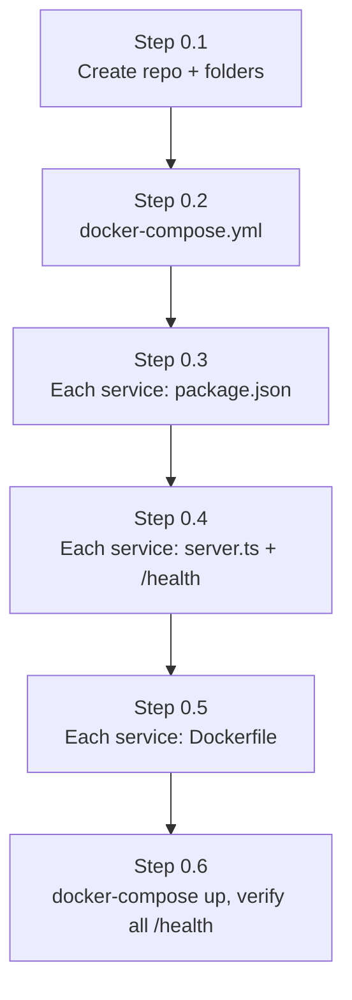
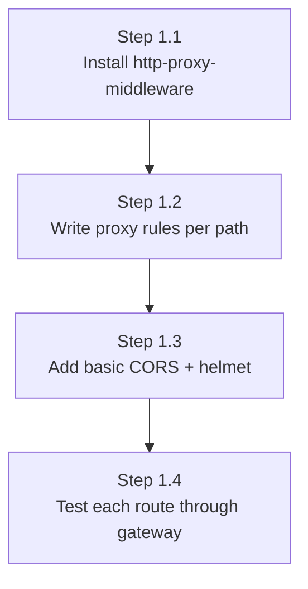
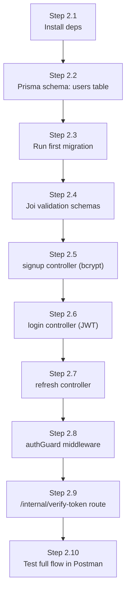
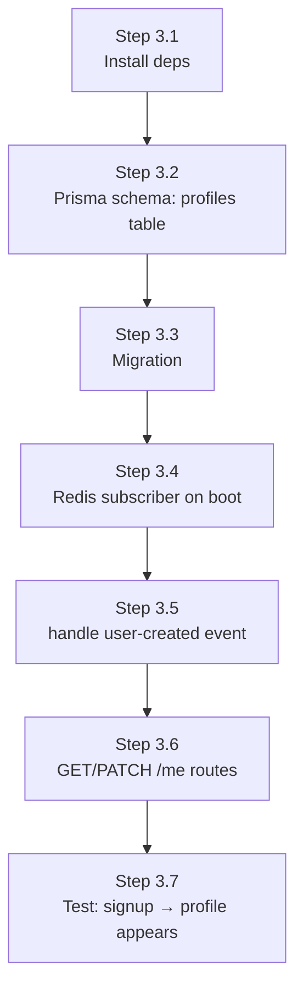
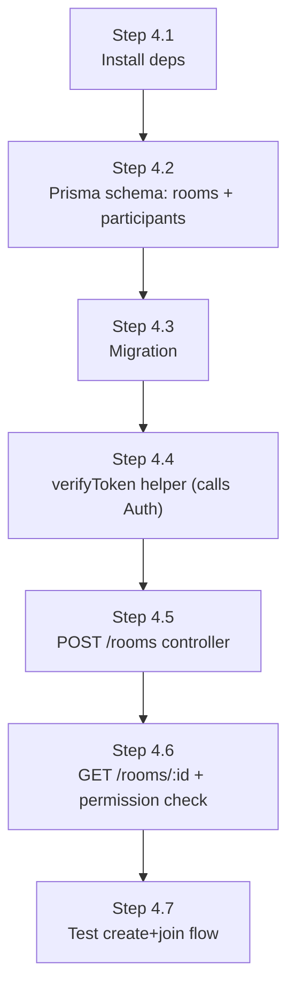
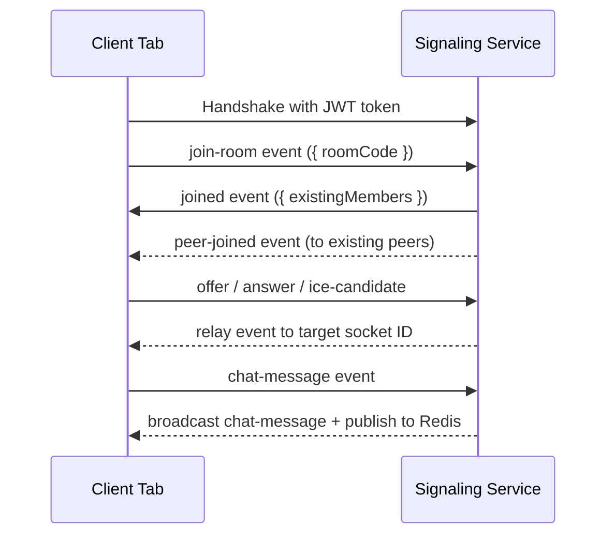
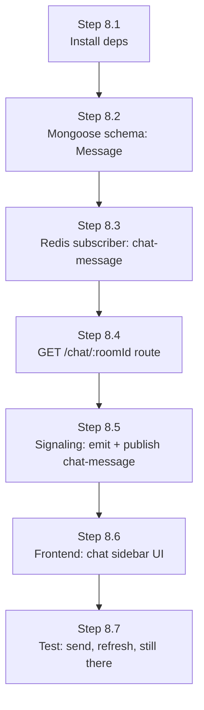
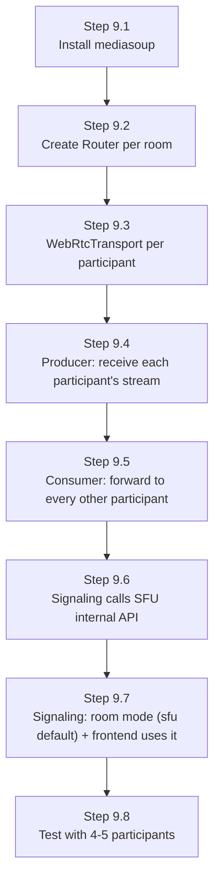

# Video Meet App — Detailed File-by-File Build Steps & Execution Checklist

> **Current Implementation Status:** Phases 0 through 13 are **✅ COMPLETED**.
> Phases 14 through 16 and Phase F are **⏳ NEXT / PENDING**.

---

## 📌 Implementation Status Dashboard

| Phase              | Service / Component            |    Status    | Details & Verification                                                                                   |
| :----------------- | :----------------------------- | :----------: | :------------------------------------------------------------------------------------------------------- |
| **Phase 0**  | **Infra Skeleton**       | ✅ COMPLETED | Docker Compose, Postgres (`auth_db`, `user_db`, `room_db`), Mongo (`chat_db`), Redis (`6379`). |
| **Phase 1**  | **API Gateway**          | ✅ COMPLETED | Port 4000. Express,`http-proxy-middleware`, `gatewayAuth` JWT validation, CORS & Helmet.             |
| **Phase 2**  | **Auth Service**         | ✅ COMPLETED | Port 4001. Postgres, Prisma, bcrypt, JWT access/refresh tokens, HMAC TURN secret generator.              |
| **Phase 3**  | **User Service**         | ✅ COMPLETED | Port 4002. Postgres, Prisma, Redis subscriber for`user-created` auto-profile creation.                 |
| **Phase 4**  | **Room Service**         | ✅ COMPLETED | Port 4003. Postgres, Prisma, NanoID room codes, host/participant creation & room teardown.               |
| **Phase 5**  | **Signaling Service**    | ✅ COMPLETED | Port 4004. Socket.io, Redis presence set tracking, WebRTC offer/answer/ICE candidate relay.              |
| **Phase 6**  | **WebRTC Verification**  | ✅ COMPLETED | `test-client/` standalone client for 1:1 video/audio WebRTC call verification.                         |
| **Phase 7**  | **TURN/STUN**            | ✅ COMPLETED | Coturn container (`infra/coturn/turnserver.conf`) & HMAC credentials endpoint.                         |
| **Phase 8**  | **Chat Service**         | ✅ COMPLETED | Port 4005. MongoDB Mongoose schema, Redis subscriber to`chat-message`, history REST API.               |
| **Phase 9**  | **SFU Service**          | ✅ COMPLETED | Backend service complete: mediasoup workers, routers, transports, producers, consumers, auth, signaling integration & room mode. Frontend in Phase F. |
| **Phase 10** | **Recording Service**    | ✅ COMPLETED | Port 4007, `recording_db`. SFU captures per-peer RTP with FFmpeg (copy mode), BullMQ worker converts to MP4, REST API, Redis events to signaling, auto stop, recovery. Frontend part in Phase F. |
| **Phase 11** | **Notification Service** | ✅ COMPLETED | Port 4008, `notification_db`. Nodemailer + Mailpit, BullMQ async email queue for room invites & scheduled reminders, Redis room-events subscriber, cancellation on room-end, Gateway proxy (`/api/v1/notifications/*`). Verified via `e2e-notification.mjs`. |
| **Phase 12** | **Gateway Hardening**    | ✅ COMPLETED | Port 4000. Express 5 + http-proxy-middleware v4. Tiered Redis rate limiting, proxy error trap (sanitized 502/504), x-request-id tracing, anti-spoofing header cleanup, slowloris timeouts, graceful shutdown, /health & /ready probes. Verified via `e2e-gateway.mjs`. |
| **Phase 13** | **Observability**        | ✅ COMPLETED | `/metrics` on all 9 services (prom-client), Prometheus + alert rules, Grafana provisioned dashboard, OpenTelemetry → Jaeger, Pino `trace_id`. Verified via `e2e-observability.mjs`. |
| **Phase 14** | **CI/CD**                |  ⏳ PENDING  | GitHub Actions automated workflows for linting, testing, and Docker builds.                              |
| **Phase 15** | **Kubernetes (K8s)**     |  ⏳ PENDING  | K8s deployments, ingress routing, HPA for signaling/SFU, Coturn StatefulSet.                             |
| **Phase 16** | **Load Testing**         |  ⏳ PENDING  | Artillery load tests & PgBouncer database connection pooling.                                            |
| **Phase F**  | **Frontend (React app)** |  ⏳ PENDING  | Call screen with mediasoup-client, chat sidebar, auth pages. Guide: `phase-9-sfu-frontend-guide.md`. |

---

## Table of Contents

- [Phase 0 — Infra Skeleton [✅ COMPLETED]](#phase-0--infra-skeleton--completed)
- [Phase 1 — API Gateway [✅ COMPLETED]](#phase-1--api-gateway--completed)
- [Phase 2 — Auth Service [✅ COMPLETED]](#phase-2--auth-service--completed)
- [Phase 3 — User Service [✅ COMPLETED]](#phase-3--user-service--completed)
- [Phase 4 — Room Service [✅ COMPLETED]](#phase-4--room-service--completed)
- [Phase 5 — Signaling Service [✅ COMPLETED]](#phase-5--signaling-service--completed)
- [Phase 6 — WebRTC Client Verification [✅ COMPLETED]](#phase-6--webrtc-client-verification--completed)
- [Phase 7 — TURN/STUN Infrastructure [✅ COMPLETED]](#phase-7--turnstun-infrastructure--completed)
- [Phase 8 — Chat Service [✅ COMPLETED]](#phase-8--chat-service--completed)
- [Phase 9 — SFU Service (Group Calls) [✅ COMPLETED]](#phase-9--sfu-service-group-calls--completed)
- [Phase 10 — Recording Service [✅ COMPLETED]](#phase-10--recording-service--completed)
- [Phase 11 — Notification Service [✅ COMPLETED]](#phase-11--notification-service--completed)
- [Phase 12 — Gateway Hardening [✅ COMPLETED]](#phase-12--gateway-hardening--completed)
- [Phase 13 — Observability [⏳ PENDING]](#phase-13--observability--pending)
- [Phase 14 — CI/CD [⏳ PENDING]](#phase-14--cicd--pending)
- [Phase 15 — Kubernetes Deployment [⏳ PENDING]](#phase-15--kubernetes-deployment--pending)
- [Phase 16 — Load Testing &amp; Security [⏳ PENDING]](#phase-16--load-testing--security--pending)
- [Phase F — Frontend (React App) [⏳ PENDING]](#phase-f--frontend-react-app--pending)
- [Full Build Order — Architectural Diagram](#full-build-order--architectural-diagram)

---

## Phase 0 — Infra Skeleton [✅ COMPLETED]

**Goal:** Empty services that boot, connected to real databases, before any actual feature exists.
**Tech:** Docker Compose, Node.js 20, Express, Postgres, MongoDB, Redis.

### Verification & Deliverable

- `docker-compose.yml` configures Postgres (`auth_db`, `user_db`, `room_db`), MongoDB (`chat_db`), Redis (`6379`), Coturn (`3478`), and service containers.
- All microservices expose a `/health` REST endpoint returning `{ status: "ok" }`.

---

## Phase 1 — API Gateway [✅ COMPLETED]

**Goal:** Central entry point forwarding client HTTP requests to appropriate backend services.
**Tech:** Express, TypeScript, `http-proxy-middleware`, CORS, Helmet, Pino.

### Verification & Deliverable

- Running on Port `4000`.
- Proxies `/api/auth/*` → Auth Service (`4001`)
- Proxies `/api/users/*` → User Service (`4002`)
- Proxies `/api/v1/rooms/*` → Room Service (`4003`)
- Proxies `/api/v1/chat/*` → Chat Service (`4005`)
- Validates JWT tokens on protected routes via `gatewayAuth` middleware.

---

## Phase 2 — Auth Service [✅ COMPLETED]

**Goal:** Real signup/login with hashed passwords and JWTs, backed by Postgres.
**Tech:** PostgreSQL (`auth_db`), Prisma ORM, Bcrypt, JWT, Joi, Redis.

### Verification & Deliverable

- Running on Port `4001`.
- Endpoints: `POST /auth/signup`, `POST /auth/login`, `POST /auth/refresh`, `GET /auth/me`, `GET /auth/turn-credentials`, `GET /internal/verify-token`.
- Publishes `user-created` event to Redis on successful registration.
- Generates dynamic HMAC-SHA1 signed STUN/TURN credentials.

---

## Phase 3 — User Service [✅ COMPLETED]

**Goal:** Profile auto-created the moment someone signs up, via an event — not a direct call.
**Tech:** PostgreSQL (`user_db`), Prisma ORM, Redis Pub/Sub, Express.

### Verification & Deliverable

- Running on Port `4002`.
- Listens to Redis `user-created` channel to create a default `Profile` row automatically.
- Endpoints: `GET /me` (fetch profile) and `PATCH /me` (update displayName, avatarUrl, preferences).

---

## Phase 4 — Room Service [✅ COMPLETED]

**Goal:** Authenticated users can create and join rooms, with real relational data.
**Tech:** PostgreSQL (`room_db`), Prisma ORM, NanoID, Axios.

### Verification & Deliverable

- Running on Port `4003`.
- Endpoints: `POST /v1/rooms`, `GET /v1/rooms/:code`, `POST /v1/rooms/:code/join`, `POST /v1/rooms/:code/leave`, `POST /v1/rooms/:code/end`.
- Manages transactional creation of room codes and participant tracking.

---

## Phase 5 — Signaling Service [✅ COMPLETED]

**Goal:** Real-time WebRTC offer/answer/ICE candidate relay between peers via WebSocket.
**Tech:** Socket.io, TypeScript, Redis Sets for Presence.

### Verification & Deliverable

- Running on Port `4004`.
- Validates room state with Room Service via REST.
- Handlers for `join-room`, `offer`, `answer`, `ice-candidate`, `chat-message`, `leave-room`.
- Publishes `chat-message` events to Redis Pub/Sub for persistent chat storage.

---

## Phase 6 — WebRTC Client Verification [✅ COMPLETED]

**Goal:** Verification of real 1:1 audio/video calling using WebRTC standards.
**Tech:** Vanilla JS, HTML5, `getUserMedia`, `RTCPeerConnection`.

### Verification & Deliverable

- Located in `/test-client`.
- Verifies real camera/microphone stream exchange over Socket.io signaling.
- Run via `npx serve .` inside `/test-client`.

---

## Phase 7 — TURN/STUN Infrastructure [✅ COMPLETED]

**Goal:** Ensure WebRTC connections succeed across restrictive NATs and firewalls.
**Tech:** Coturn Docker Container, HMAC-SHA1 dynamic secret generation.

### Verification & Deliverable

- Coturn configuration at `infra/coturn/turnserver.conf`.
- Auth Service endpoint `GET /auth/turn-credentials` issues temporary TURN credentials.

---

## Phase 8 — Chat Service [✅ COMPLETED]

**Goal:** Persistent in-meeting chat storage and historical retrieval.
**Tech:** MongoDB (`chat_db`), Mongoose, Redis Pub/Sub, Express.

### Verification & Deliverable

- Running on Port `4005`.
- Subscribes to Redis `chat-message` channel to store chat logs asynchronously.
- Endpoint: `GET /api/v1/chat/:roomId/messages` returns paginated message history.

---

## Phase 9 — SFU Service (Group Calls) [✅ COMPLETED]

**Goal:** Support 3+ participants in group calls without client bandwidth overload.
**New concept:** mediasoup (Router, Producer, Consumer, Transport).

### Step 9.1 — Install

- `npm install mediasoup` in `/services/sfu-service`

### Step 9.2 — `/src/mediasoup/router.ts`

- One `mediasoup.Worker` per CPU core, one `Router` per active room created when the 3rd participant joins.

---

## Phase 10 — Recording Service [✅ COMPLETED]

**Goal:** Downloadable video recordings produced asynchronously post-call.

- **Step 10.1 — Infrastructure:** ✅ Done (`recording_db` in `init.sql`, FFmpeg in SFU Dockerfile, `/recordings` volume mounted).
- **Step 10.2 — Forward `userId`:** ✅ Done (Signaling & SFU producer appData forwarding).
- **Step 10.3 — SFU Recorder Module:** ✅ Done (`ports.ts`, `sdp.ts`, `segmentRecorder.ts`, `manifest.ts`, `recordingManager.ts`, routes & controller).
- **Step 10.4 — Isolated SFU Test:** ✅ Done (`test-client/sfu-oneClick.html` recording test suite and `/status` route verified).
- **Step 10.5 — Recording Service Core & Webhooks:** ✅ Done
  - [x] Service scaffolding & dependencies installed (`services/recording-service`).
  - [x] Prisma models (`Recording` & `RecordingSegment`) created and migrated to `recording_db` (`20261017171008_init`).
  - [x] Env, clients (Redis, Room Service, SFU), middleware (authGuard, internalGuard), validation, controllers, routes.
  - [x] All 8 test scenarios verified: Health check (200), No token (401), Unknown room (404), Non-host token (403), Empty room (409), Start recording (201), Duplicate start (409), Stop recording (202), Webhook updates status to `PROCESSING` with segments and queues BullMQ job.
- **Step 10.6 — BullMQ Finalize Worker (MKV to MP4):** ✅ Done
  - [x] Implemented safe FFmpeg/ffprobe runners (`ffmpeg.ts`).
  - [x] Finalize recording logic (`finalizeRecording.ts`) with thumbnail generation, atomic rename, and failure reporting.
  - [x] BullMQ queue and worker (`queues.ts`, `finalizeWorker.ts`) with retry and progress reporting.
  - [x] Operator requeue CLI tool (`requeueFinalize.ts`), Dockerfile, and docker-compose setup.
- **Step 10.7 — Storage Driver and Query APIs:** ✅ Done
  - [x] Storage abstraction interface and local filesystem driver (`LocalStorageDriver`) with path traversal protection.
  - [x] Express middleware updated for query schema validation (`res.locals.query`).
  - [x] REST endpoints for listing, viewing, downloading with HTTP 206 Range seeking, and deleting recordings.
- **Step 10.8 — Gateway Proxy:** ✅ Done
  - [x] Reverse proxy configuration for `/api/v1/recordings` in API Gateway with JWT auth check and 10-minute timeout for streaming downloads.
- **Step 10.9 — Signaling Recording Events:** ✅ Done
  - [x] Dedicated Redis subscriber for `recording-events` channel in Signaling Service.
  - [x] Room-scoped event dispatching (`recording-started`, `recording-stopped`, `recording-ready`, `recording-failed`) with deduplication.
  - [x] Late joiner recording state synchronization in `joined` socket event.
- **Step 10.10 — Docker Compose & E2E Test Suite:** ✅ Done
  - [x] Container orchestration with shared `recordings_data` volume and environment configs.
  - [x] End-to-end automated recording verification script (`scripts/e2e-recording.mjs`).
- **Step 10.11 — Production Hardening:** ✅ Done
  - [x] Prisma schema migration for `rawCleanedAt`.
  - [x] Delayed BullMQ auto-stop worker for maximum duration enforcement (`recording-autostop`).
  - [x] Storage disk guard with `statfs`, 503 capacity protection, and emergency stop policy.
  - [x] Stale recording recovery engine for `STARTING`, `RECORDING`, `STOPPING`, and `PROCESSING` states.
  - [x] Scheduled cleanup of retained raw files and abandoned temporary parts.
  - [x] Distributed lock scheduler (`runExclusive`) and service readiness health endpoint (`/ready`).

---

## Phase 11 — Notification Service [✅ COMPLETED]

**Goal:** Async email invitations and scheduled meeting reminders via BullMQ and Nodemailer (Mailpit in dev).

- **Step 11.1 — Infrastructure:** ✅ Done (`notification_db` in PostgreSQL init, `mailpit` container on ports 1025/8025, and `notification-service` on port 4008 in `docker-compose.yml`).
- **Step 11.2 — Service Scaffolding:** ✅ Done (`services/notification-service` package.json, tsconfig.json with NodeNext & types, .env.docker, Dockerfile with openssl).
- **Step 11.3 — Configuration & Utilities:** ✅ Done (Joi `env.ts`, PrismaPg client, dual Redis connections for BullMQ & general, `roomServiceClient.ts`, `AppError.ts`, `asyncHandler.ts`, `logger.ts`).
- **Step 11.4 — Database Schema & Migration:** ✅ Done (`Notification` model with `NotificationType` / `NotificationStatus` enums, `prisma.config.ts`, migration `20261024080318_init` applied to `notification_db`).
- **Step 11.5 — Middleware & Validation:** ✅ Done (JWT `authGuard.ts`, `errorHandler.ts`, `validate.ts`, Joi `notificationSchemas.ts`, Express Request typing).
- **Step 11.6 — Email Pipeline & Templates:** ✅ Done (Nodemailer transporter for Mailpit/SMTP, HTML/plain-text templates for invites and reminders, safe email sender).
- **Step 11.7 — BullMQ Queue & Worker:** ✅ Done (`emailQueue` with exponential backoff and `emailWorker` with concurrency and retries).
- **Step 11.8 — Notification Business Logic:** ✅ Done (`createInvites` with email deduping, immediate invite dispatch, scheduled reminders, idempotency on jobId, and `cancelRemindersForRoom`).
- **Step 11.9 — HTTP REST API:** ✅ Done (`POST /v1/notifications/invites`, `GET /health`, `GET /ready`, Express app, server boot with graceful shutdown).
- **Step 11.10 — Room Service Scheduled Meetings & Events:** ✅ Done (`scheduledAt` field on `Room` model in `room_db`, validation, persistence, and `publishRoomEvent('room-ended')` via Redis).
- **Step 11.11 — Room Lifecycle Event Subscriber:** ✅ Done (`roomEventsSubscriber.ts` listening to `room-events` Redis channel to cancel pending reminders and update DB rows on room teardown).
- **Step 11.12 — API Gateway Reverse Proxy:** ✅ Done (`/v1/notifications` route with `gatewayAuth` proxying to `http://notification-service:4008`).
- **Step 11.13 — Automated E2E Test Suite:** ✅ Done (`scripts/e2e-notification.mjs` verifying signup, scheduled room, non-host rejection, Mailpit delivery, reminder deduplication, and cancellation).
- **Step 11.14 — Production Verification:** ✅ Done (Docker image built, containers running, `/health` and `/ready` 200, E2E tests passed).

---

## Phase 12 — Gateway Hardening [✅ COMPLETED]

**Goal:** Transform the API Gateway into a resilient, abuse-resistant, and secure edge router with tiered rate limiting, proxy error trapping, request tracing, and liveness/readiness probes.

- **Step 12.1 — Packages & Configuration:** ✅ Done (`express-rate-limit`, `rate-limit-redis`, `ioredis`, `.env.docker`, `.env.example`).
- **Step 12.2 — Validated Environment Schema:** ✅ Done (`src/config/env.ts` with fail-fast parsing and rate limit bounds).
- **Step 12.3 — Shared Redis Client:** ✅ Done (`src/config/redis.ts` with exponential backoff and health probe).
- **Step 12.4 — Request Context & Anti-Spoofing:** ✅ Done (`src/middleware/requestContext.ts` generating/echoing `x-request-id` and stripping client-supplied `x-user-id`).
- **Step 12.5 — Centralized Error & 404 Handlers:** ✅ Done (`errorHandler.ts` sanitizing stack traces and `notFound.ts` returning JSON 404 with requestId).
- **Step 12.6 — Service Proxy Factory & Error Trap:** ✅ Done (`createServiceProxy.ts` wrapping `http-proxy-middleware` v4 to catch upstream network drops into clean 502/504 JSON).
- **Step 12.7 — Tiered Rate Limiters:** ✅ Done (`rateLimiters.ts` with Global 300/min, Auth strict 10/15m, Refresh 30/15m, Standard API 100/min per user, and Download 120/h).
- **Step 12.8 — Health & Readiness Probes:** ✅ Done (`healthRoutes.ts` with `/health` liveness and `/ready` Redis dependency check).
- **Step 12.9 — Proxy Routes Refactor:** ✅ Done (`proxyRoutes.ts` routing to all 6 microservices through `createServiceProxy`).
- **Step 12.10 — Hardened Express Pipeline:** ✅ Done (`src/app.ts` with trust proxy, CORS with exposed headers, Helmet, limiters, JSON limit).
- **Step 12.11 — Server Hardening & Shutdown:** ✅ Done (`server.ts` with slowloris timeouts and graceful `SIGTERM`/`SIGINT` cleanup).
- **Step 12.12 — Docker & Compose:** ✅ Done (Multi-stage `node:22-alpine` Dockerfile with non-root user, `docker-compose.yml` with readiness healthcheck and `redis` dependency).
- **Step 12.13 — Automated E2E Test Suite:** ✅ Done (`scripts/e2e-gateway.mjs` verifying probes, 404, request ID, body limit, offline 502/504 sanitization, standard/auth rate limits, and Redis outage behavior).
- **Step 12.14 — Documentation & Verification:** ✅ Done (TypeScript typecheck 0 errors, READMEs and tracking documents updated).

---

## Phase 13 — Observability [✅ COMPLETED]

- **Step 13.1 — Package Installation:** ✅ Done (`prom-client`, `@opentelemetry/api`, `@opentelemetry/sdk-node`, `@opentelemetry/auto-instrumentations-node`, `@opentelemetry/exporter-trace-otlp-http` in all 9 services).
- **Step 13.2 — Fail-Fast Config:** ✅ Done (`shared/observability/config.ts` enforcing `OTEL_SERVICE_NAME` and production `METRICS_TOKEN`).
- **Step 13.3 — Metrics Module:** ✅ Done (`shared/observability/metrics.ts` with low-cardinality route labels, constant-time token comparison, `/metrics` endpoint).
- **Step 13.4 — Tracing Bootstrap:** ✅ Done (`shared/observability/tracing.ts` with OTLP/HTTP export to Jaeger, probe filtering, graceful flush).
- **Step 13.5 — Log Correlation:** ✅ Done (`shared/observability/logContext.ts` traceMixin adding `trace_id` and `span_id` to Pino logs).
- **Step 13.6 — Automated Sync:** ✅ Done (`scripts/sync-observability.ps1` with drift detection copying shared modules to all 9 services).
- **Step 13.7 — Express Integration:** ✅ Done (Tracing first import in `server.ts`, timing middleware & `/metrics` in `src/app.ts`, trace mixin in logger, dev `--env-file`).
- **Step 13.8 — API Gateway Metrics:** ✅ Done (`gatewayMetrics.ts`, fixed prefix resolution, `gateway_proxy_errors_total` on 502/504, `gateway_rate_limit_hits_total` on 429).
- **Step 13.9 — Signaling Metrics:** ✅ Done (`signalingMetrics.ts`, `signaling_connected_sockets` gauge, `signaling_events_total` counter).
- **Step 13.10 — SFU Metrics:** ✅ Done (`sfuMetrics.ts`, dynamic gauges for workers, routers, transports, producers, consumers via scrape-time collector).
- **Step 13.11 — Queue Metrics:** ✅ Done (`queueMetrics.ts` for BullMQ jobs across waiting/active/delayed/failed states, plus `emailMetrics.ts` sent/failed counters).
- **Step 13.12 — Prometheus Config & Alert Rules:** ✅ Done (`infra/prometheus/prometheus.yml`, `alerts.yml` with 7 production alert rules, `metrics_token`).
- **Step 13.13 — Grafana Provisioning & Dashboard:** ✅ Done (Prometheus & Jaeger datasources, dashboard provider, `video-meet-overview.json` with 10 monitoring panels).
- **Step 13.14 — Docker Compose Integration:** ✅ Done (Prometheus, Grafana, Jaeger services, volumes, shared `infra/observability.env`, root `.env`).
- **Step 13.15 — E2E Test Suite:** ✅ Done (`scripts/e2e-observability.mjs` verifying metrics, auth, Prometheus scrape, Jaeger traces, Grafana API, and service failure recovery).

---

## Phase 14 — CI/CD [⏳ PENDING]

- GitHub Actions workflows for automated testing, linting, Docker image creation, and deployment.

---

## Phase 15 — Kubernetes Deployment [⏳ PENDING]

- Create K8s deployments, services, ingress controllers, HPAs, and Coturn StatefulSets.

---

## Phase 16 — Load Testing & Security [⏳ PENDING]

- Conduct Artillery load tests and security stress tests.

---

## Phase F — Frontend (React App) [⏳ PENDING]

**Goal:** Full interactive React frontend with mediasoup-client video grid, auth flows, chat panel, room controls, and audio/video settings.
**Guide:** `FRONTEND/Phase_9_sfu_frontend_guide.md`

---

## Full Build Order — Architectural Diagram

```mermaid
flowchart TD
    P0["Phase 0<br/>Skeleton"] --> P1["Phase 1<br/>Gateway"]
    P1 --> P2["Phase 2<br/>Auth"]
    P2 --> P3["Phase 3<br/>User"]
    P3 --> P4["Phase 4<br/>Room"]
    P4 --> P5["Phase 5<br/>Signaling"]
    P5 --> P6["Phase 6<br/>Frontend Verification"]
    P6 --> P7["Phase 7<br/>TURN/STUN"]
    P7 --> P8["Phase 8<br/>Chat"]
    P8 --> P9["Phase 9<br/>SFU (Mediasoup)"]
    P9 --> P10["Phase 10<br/>Recording"]
    P10 --> P11["Phase 11<br/>Notifications"]
    P11 --> P12["Phase 12<br/>Gateway Hardening"]
    P12 --> PF["Phase F<br/>Frontend (React)"]
    PF --> P13["Phase 13<br/>Observability"]
    P13 --> P14["Phase 14<br/>CI/CD"]
    P14 --> P15["Phase 15<br/>Kubernetes"]
    P15 --> P16["Phase 16<br/>Load Test & Security"]
    P16 --> Launch(["🚀 Production Launch"])

    style P0 fill:#e8ffe8,stroke:#3fae3f
    style P1 fill:#e8ffe8,stroke:#3fae3f
    style P2 fill:#e8ffe8,stroke:#3fae3f
    style P3 fill:#e8ffe8,stroke:#3fae3f
    style P4 fill:#e8ffe8,stroke:#3fae3f
    style P5 fill:#e8ffe8,stroke:#3fae3f
    style P6 fill:#e8ffe8,stroke:#3fae3f
    style P7 fill:#e8ffe8,stroke:#3fae3f
    style P8 fill:#e8ffe8,stroke:#3fae3f
    style P9 fill:#e8ffe8,stroke:#3fae3f
    style P10 fill:#e8ffe8,stroke:#3fae3f
    style P11 fill:#e8ffe8,stroke:#3fae3f
    style P12 fill:#e8ffe8,stroke:#3fae3f
    style PF fill:#fff4e0,stroke:#d99a2b
    style P13 fill:#e8ffe8,stroke:#3fae3f
    style P14 fill:#fff4e0,stroke:#d99a2b
    style P15 fill:#fff4e0,stroke:#d99a2b
    style P16 fill:#fff4e0,stroke:#d99a2b
    style Launch fill:#eef3ff,stroke:#5b7fff
```

