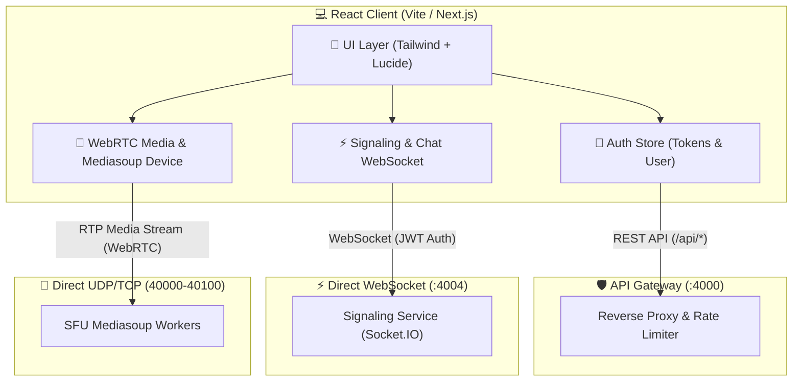
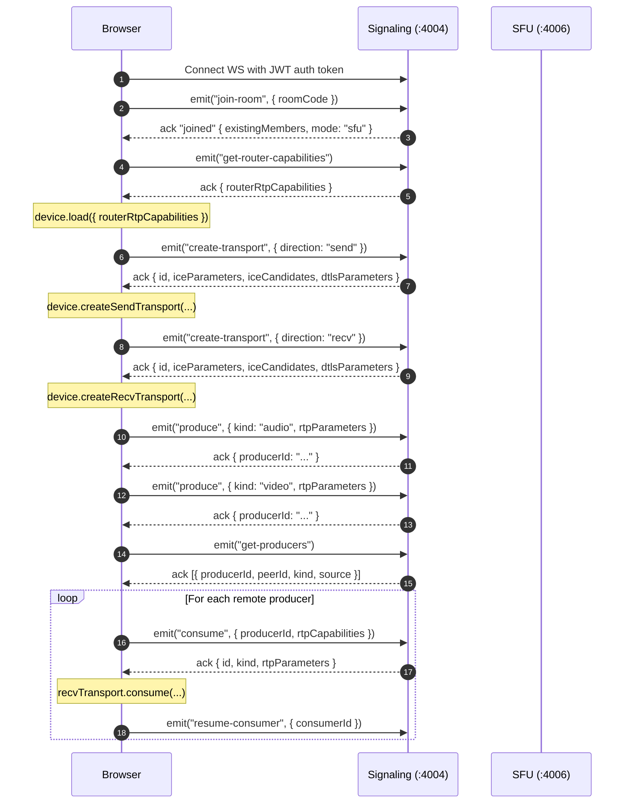

# Phase F — Full Frontend Client Implementation Guide

> **Phase:** Phase F (Frontend Application)  
> **Status:** 🚀 In Development (Branch: `phase-f-frontend`)  
> **Tech Stack:** React (Vite / Next.js), TypeScript, Tailwind CSS, `mediasoup-client` (v3), `socket.io-client` (v4), Zustand / React Context, Lucide React  
> **Backend Stack Dependencies:** API Gateway (`:4000`), Auth (`:4001`), User (`:4002`), Room (`:4003`), Signaling (`:4004`), Chat (`:4005`), SFU (`:4006`), Recording (`:4007`), Notification (`:4008`)

---

## 1. Executive Summary & Objective

Phase F delivers the complete user-facing Google Meet clone web application. While previous phases built the backend microservices, signaling fabric, mediasoup SFU engine, background recording transcoders, and telemetry stack, Phase F unites them into a responsive, real-time video conferencing application.

### Key Capabilities in Scope:
1. **User Authentication & Profile**: Signup, login, JWT token lifecycle management, silent refresh, and user profile customization.
2. **Dashboard & Lobby**: Instant meeting creation, joining via room code, and a pre-join media preview room (mic & camera check).
3. **Multi-Party WebRTC Video Grid**: Mediasoup SFU client integration for publishing and consuming audio, video, and screen share streams with responsive grid layouts.
4. **Interactive In-Call Controls**: Mic/camera toggles, screen sharing, audio device selection, participant list, and host management.
5. **Real-Time In-Meeting Chat**: Persistent meeting chat with instant WebSocket broadcasting and REST history retrieval.
6. **Server-Side Recording Controls**: Host-triggered MP4 recording start/stop with live status and download playback.
7. **Email Invitations**: Direct email dispatch for meeting invitations and automated calendar reminders.

---

## 2. System Architecture & Client Integration Map



### Network Communication Rules:
1. **HTTP REST Traffic**: ALL HTTP requests (`/api/auth/*`, `/api/users/*`, `/api/v1/rooms/*`, `/api/v1/chat/*`, `/api/v1/recordings/*`, `/api/v1/notifications/*`) go through **API Gateway** (`http://localhost:4000`).
2. **Signaling & Chat Events**: Connect directly via **Socket.io** to `http://localhost:4004` (bypasses Gateway).
3. **Audio/Video Media (RTP)**: Sent directly between the browser's `RTCPeerConnection` and the SFU on UDP/TCP ports `40000-40100`.

---

## 3. Recommended Frontend Directory Structure

```text
frontend/
├── public/
│   ├── favicon.ico
│   └── sounds/              # Join/leave and chat chime sounds
├── src/
│   ├── assets/
│   ├── components/
│   │   ├── auth/            # LoginForm, SignupForm, ProtectedRoute
│   │   ├── chat/            # ChatDrawer, ChatMessageList, ChatInput
│   │   ├── common/          # Button, Modal, Dropdown, Spinner, Avatar
│   │   ├── meeting/
│   │   │   ├── ControlBar.tsx      # Mic, cam, screen, chat, leave buttons
│   │   │   ├── DeviceSettings.tsx  # Audio input/output & video dropdowns
│   │   │   ├── InviteModal.tsx     # Email invite dispatcher
│   │   │   ├── ParticipantList.tsx # Roster drawer with host badges
│   │   │   ├── RecordingModal.tsx  # Recording start/stop & downloads
│   │   │   ├── ScreenShareView.tsx # Focused screen share view
│   │   │   ├── VideoGrid.tsx       # Dynamic CSS Grid layout
│   │   │   └── VideoTile.tsx       # Single peer video tile with audio bars
│   │   └── prejoin/
│   │       ├── DevicePreview.tsx   # Camera/mic testing box
│   │       └── JoinRoomCard.tsx
│   ├── hooks/
│   │   ├── useAuth.ts
│   │   ├── useChat.ts
│   │   ├── useMediasoup.ts         # Core SFU publishing & consuming logic
│   │   └── useSignaling.ts        # Socket.io connection & event dispatcher
│   ├── services/
│   │   ├── api.ts                  # Axios / Fetch client with token refresh
│   │   ├── authService.ts
│   │   ├── roomService.ts
│   │   ├── recordingService.ts
│   │   └── notificationService.ts
│   ├── stores/
│   │   ├── authStore.ts            # Zustand store for user & access token
│   │   ├── meetingStore.ts         # Room state, participants, tracks
│   │   └── chatStore.ts            # Messages, unread count
│   ├── types/
│   │   ├── api.ts
│   │   ├── meeting.ts
│   │   └── mediasoup.ts
│   ├── utils/
│   │   ├── mediaDevices.ts         # Audio/video track helpers
│   │   └── formatters.ts           # Time & date utilities
│   ├── views/
│   │   ├── HomeView.tsx            # Dashboard: start or join meeting
│   │   ├── LobbyView.tsx           # Pre-join audio/video preview
│   │   ├── LoginView.tsx
│   │   ├── MeetingView.tsx         # Active in-call screen
│   │   └── SignupView.tsx
│   ├── App.tsx
│   └── main.tsx
├── .env.example
├── package.json
├── tailwind.config.js
├── tsconfig.json
└── vite.config.ts
```

---

## 4. Detailed Component & Feature Specifications

### 4.1 Authentication & Token Lifecycle (`authStore.ts` & `api.ts`)

The backend issues **short-lived access tokens (15-minute TTL)** and stores refresh tokens in an HTTP-only cookie.

#### Requirements:
- Store the access token in memory (or Zustand state) — never store raw JWTs in `localStorage` for security.
- Create an API client interceptor (`api.ts`):
  - Injects `Authorization: Bearer <accessToken>` on requests.
  - Intercepts `401 Unauthorized` responses and automatically triggers `POST /api/auth/refresh`.
  - Retries failed requests seamlessly once a new token is acquired.
  - Redirects to `/login` if token refresh fails.

```typescript
// Sample Silent Refresh Interceptor
api.interceptors.response.use(
  (response) => response,
  async (error) => {
    const originalRequest = error.config;
    if (error.response?.status === 401 && !originalRequest._retry) {
      originalRequest._retry = true;
      try {
        const { data } = await axios.post('/api/auth/refresh', {}, { withCredentials: true });
        useAuthStore.getState().setAccessToken(data.data.accessToken);
        originalRequest.headers['Authorization'] = `Bearer ${data.data.accessToken}`;
        return api(originalRequest);
      } catch (refreshErr) {
        useAuthStore.getState().logout();
        window.location.href = '/login';
        return Promise.reject(refreshErr);
      }
    }
    return Promise.reject(error);
  }
);
```

---

### 4.2 Pre-Join Lobby & Device Selection (`LobbyView.tsx`)

Before entering a live call, participants must be able to test their camera and microphone:

1. **Local Media Initialization**:
   - Call `navigator.mediaDevices.getUserMedia({ video: true, audio: true })`.
   - Render the camera track in a local `<video autoPlay muted playsInline>` preview element.
2. **Audio Level Indicator**:
   - Connect the mic `MediaStreamTrack` to an `AudioContext` and `AnalyserNode` to display a live volume meter.
3. **Hardware Selection**:
   - Enumerate devices using `navigator.mediaDevices.enumerateDevices()`.
   - Provide dropdowns for:
     - Microphone (Audio Input)
     - Camera (Video Input)
     - Speaker (Audio Output via `HTMLMediaElement.setSinkId()`)
4. **Initial State Preferences**:
   - Allow user to toggle camera off or mic muted *before* entering the room.

---

### 4.3 Mediasoup WebRTC Call Engine (`useMediasoup.ts`)

The SFU engine follows the strict backend contract defined in `signaling-service` and `sfu-service`:

#### Step-by-Step SFU Protocol Flow:


#### Mediasoup Producer & Consumer Handling:
- **Send Transport `connect` Event**: Fires when first stream is produced. Must send DTLS parameters to `connect-transport`.
- **Send Transport `produce` Event**: Sends RTP parameters to `produce`.
- **Handling New Remote Producers**: Listen to `socket.on("new-producer")` and trigger `consume`.
- **Handling Closed Producers**: Listen to `socket.on("producer-closed")` and close the corresponding consumer.
- **Handling Disconnected Peers**: Listen to `socket.on("peer-left")` and clean up peer tiles.

---

### 4.4 Dynamic Video Grid Layout (`VideoGrid.tsx`)

A Google Meet style CSS Grid layout that adapts automatically based on participant count:

| Participant Count | Layout Structure | Tile Aspect Ratio |
| :---: | :--- | :---: |
| **1 (Solo)** | Single centered card | 16:9 widescreen |
| **2 (1:1 Call)** | 2 equal side-by-side columns | 16:9 |
| **3 - 4** | 2x2 grid layout | 16:9 |
| **5 - 6** | 3x2 grid layout | 16:9 |
| **7 - 12** | 4x3 grid layout | 16:9 |
| **Screen Share Active** | Screen share takes 75% width; participants in vertical strip | Dynamic |

#### Video Tile Features (`VideoTile.tsx`):
- `<video>` tag with `playsInline`, `autoPlay`. Remote videos must have `muted={false}`, local video `muted={true}`.
- Overlay badge showing user display name / ID.
- Mic status icon (green when speaking, red when muted).
- Camera off fallback: Renders user avatar or initials with animated background.
- Pin button to spotlight a specific tile.

---

### 4.5 In-Meeting Chat Drawer (`ChatDrawer.tsx`)

Real-time meeting chat integrated with `chat-service` and `signaling-service`:
1. **On Mount**: Fetch message history from `GET /api/v1/chat/:roomId/messages?limit=100`.
2. **Real-time Receiving**: Listen for `socket.on("chat-message", (msg) => addMessage(msg))`.
3. **Sending**: Emit `socket.emit("chat-message", { roomId, text })`.
4. **Unread Counter**: Display an unread pill badge on the chat button when drawer is closed.
5. **Auto-scroll**: Automatically scroll to newest message on arrival unless user has scrolled up.

---

### 4.6 Meeting Recording Management (`RecordingModal.tsx`)

Allows meeting hosts to record calls directly to the server:
- **Start Recording**: Call `POST /api/v1/recordings/start` with `{ roomId }`.
  - Shows an animated red "REC" badge across all participant screens.
- **Stop Recording**: Call `POST /api/v1/recordings/stop` with `{ roomId }`.
  - Transcoding job is enqueued to BullMQ on the backend.
- **Recordings List & Download**:
  - Fetch room recordings via `GET /api/v1/recordings/room/:roomId`.
  - If status is `COMPLETED`, provide direct download button linked to `GET /api/v1/recordings/:recordingId/download`.

---

### 4.7 Meeting Email Invitations (`InviteModal.tsx`)

Enables quick dispatch of invitation emails:
- Modal allows adding comma-separated guest email addresses.
- Dispatches `POST /api/v1/notifications/invites` with `{ roomId, guests: [...] }`.
- Backend queues emails via BullMQ and delivers via Nodemailer.
- Includes a "Copy Meeting Link" button with toast notification.

---

## 5. Environment Variables (`.env.example`)

Create the frontend environment configuration:

```env
# API Gateway Base URL (All REST traffic)
VITE_API_GATEWAY_URL=http://localhost:4000

# Signaling Service WebSocket URL (Direct Socket.IO)
VITE_SIGNALING_URL=http://localhost:4004

# Application Configuration
VITE_APP_NAME="Google Meet Clone"
VITE_DEFAULT_LANGUAGE="en"
```

---

## 6. Implementation Phase Checklist

### Milestone 1: Foundation & Authentication
- [ ] Initialize frontend repository with Vite, React 19, TypeScript, and Tailwind CSS.
- [ ] Install dependencies (`mediasoup-client`, `socket.io-client`, `lucide-react`, `zustand`, `axios`).
- [ ] Build `authStore.ts` and `api.ts` with silent refresh interceptors.
- [ ] Create Login, Signup, and Protected Route views.

### Milestone 2: Lobby & Device Testing
- [ ] Build Home View with Create Room (`POST /api/v1/rooms`) and Join Room input.
- [ ] Build Lobby View with camera preview and live microphone audio meter.
- [ ] Implement audio/video input device selector dropdowns.

### Milestone 3: Mediasoup SFU & Media Engine
- [ ] Implement `useSignaling` hook for WebSocket authentication and event handling.
- [ ] Implement `useMediasoup` hook for device loading, transport creation, producing, and consuming.
- [ ] Support dynamic screen sharing via `navigator.mediaDevices.getDisplayMedia()`.
- [ ] Handle late joiners (`new-producer`) and member departures (`peer-left`).

### Milestone 4: Call UI & Video Grid
- [ ] Create adaptive responsive `VideoGrid` component.
- [ ] Build `VideoTile` with avatar fallback, display name label, and audio active status.
- [ ] Build bottom `ControlBar` with mic, cam, screen share, and leave buttons.

### Milestone 5: Chat, Recordings & Invitations
- [ ] Implement real-time `ChatDrawer` with history loading and unread badge.
- [ ] Implement host `RecordingModal` with start/stop and download capabilities.
- [ ] Implement `InviteModal` to trigger notification email dispatch.
- [ ] Implement meeting termination and redirect to call summary screen.

---

## 7. Verification & Manual Testing Procedure

1. **Multi-User Verification**:
   - Open two distinct browser sessions (e.g., Chrome normal + Chrome Incognito).
   - Sign up two users (`user1@example.com`, `user2@example.com`).
   - User 1 creates a room and joins.
   - User 2 joins with the room code from User 1.
   - Verify that both video streams appear simultaneously and audio flows.
2. **Screen Share Verification**:
   - User 1 clicks "Share Screen" -> Select a window or entire screen.
   - User 2 sees the screen share tile smoothly update in high resolution.
3. **Chat Broadcast Verification**:
   - Send messages back and forth in the chat drawer.
   - Verify immediate broadcast and message order.
4. **Recording Flow Verification**:
   - User 1 clicks "Start Recording". Verify red recording badge displays.
   - Wait 15 seconds, then click "Stop Recording".
   - Open recordings list -> wait for transcode -> Download `.mp4` file and play locally.
