# Phase 12: API Gateway Hardening (Detailed Build Guide)

> **Service:** `services/api-gateway`  |  **Port:** `4000`  |  **Database:** none (uses Redis only for rate-limit counters)
> **Status:** ✅ **COMPLETED** (Steps 12.1 – 12.14 implemented & verified)
> **Tech:** Express 5, TypeScript, `http-proxy-middleware` v4, `express-rate-limit`, `rate-limit-redis`, `ioredis`, Helmet, pino
> **Depends on:** Phases 0-11 complete, Redis container running
> **Result:** the gateway can survive abuse, hides internal details, and tells you exactly which request failed.

---

## Table of Contents

1. [ ] [A. Problems we are solving](#a-problems-we-are-solving)
1. [ ] [0. Read this first](#0-read-this-first)
1. [ ] [Final folder structure](#final-folder-structure)
1. [ ] [Step 12.1: Fix the small problems and install packages](#step-121-fix-the-small-problems-and-install-packages)
1. [ ] [Step 12.2: `env.ts` (validated config)](#step-122-envts-validated-config)
1. [ ] [Step 12.3: `redis.ts` (one shared Redis client)](#step-123-redists-one-shared-redis-client)
1. [ ] [Step 12.4: `requestContext.ts` (request ID + header cleaning)](#step-124-requestcontextts-request-id--header-cleaning)
1. [ ] [Step 12.5: Error handler and 404 handler](#step-125-error-handler-and-404-handler)
1. [ ] [Step 12.6: `createServiceProxy.ts` (proxy with error trapping)](#step-126-createserviceproxyts-proxy-with-error-trapping)
1. [ ] [Step 12.7: `rateLimiters.ts` (tiered rate limiting)](#step-127-ratelimitersts-tiered-rate-limiting)
1. [ ] [Step 12.8: `healthRoutes.ts` (`/health` and `/ready`)](#step-128-healthroutests-health-and-ready)
1. [ ] [Step 12.9: `proxyRoutes.ts` (rewrite using the factory)](#step-129-proxyroutests-rewrite-using-the-factory)
1. [ ] [Step 12.10: `app.ts` (the final pipeline)](#step-1210-appts-the-final-pipeline)
1. [ ] [Step 12.11: `server.ts` (timeouts + graceful shutdown)](#step-1211-serverts-timeouts--graceful-shutdown)
1. [ ] [Step 12.12: Docker and docker-compose](#step-1212-docker-and-docker-compose)
1. [ ] [Step 12.13: E2E test script](#step-1213-e2e-test-script)
1. [ ] [Step 12.14: Verification checklist](#step-1214-verification-checklist)
1. [ ] [Troubleshooting](#troubleshooting)
1. [ ] [Update the docs after it passes](#update-the-docs-after-it-passes)

---

## A. Problems we are solving

This is the most important section. Every step below exists because of one of these problems. Right now your gateway works, but it is **not safe to put on the internet**.

| #  | Problem today                                       | What can go wrong (real example)                                                                                                                                                    | How this phase fixes it                                                          | Step        |
| -- | --------------------------------------------------- | ----------------------------------------------------------------------------------------------------------------------------------------------------------------------------------- | -------------------------------------------------------------------------------- | ----------- |
| 1  | **No rate limiting**                          | Someone runs a script that tries 10,000 passwords on `/api/auth/login` (credential stuffing). Nothing stops them.                                                                 | Strict limit on login/signup/refresh, normal limit on other APIs                 | 12.7        |
| 2  | **Proxy errors are not handled**              | If `chat-service` is down, the user may get a hanging request or an ugly error that can contain `http://chat-service:4005`. That tells an attacker your internal network names. | Catch proxy errors, return a clean `502` / `504` JSON with no internal names | 12.6        |
| 3  | **Unknown routes return HTML**                | `GET /api/xyz` returns Express's default HTML page, which also reveals the framework.                                                                                             | JSON `404` handler                                                             | 12.5        |
| 4  | **Bad JSON becomes a `500`**                | A broken body like `{bad` is the client's mistake, but the gateway says "Internal server error". Very large bodies are not limited.                                               | Map to `400` and `413`, add a body size limit                                | 12.5, 12.10 |
| 5  | **No request ID**                             | A user says "my call failed at 10:42". You have 8 services and thousands of log lines. You cannot follow one request across them.                                                   | One `x-request-id` per request, sent to every service and back to the user     | 12.4        |
| 6  | **Client can fake `x-user-id`**             | The gateway sets `x-user-id` after checking the JWT, but on public routes a client can send its own `x-user-id` and it is forwarded as is.                                      | Delete that header from every incoming request before anything else              | 12.4        |
| 7  | **No readiness probe, health logs are noisy** | Kubernetes (Phase 15) cannot tell "process alive" from "can serve traffic". Every health check spams the logs.                                                                      | `/health` (alive) and `/ready` (Redis OK), and skip logging them             | 12.8, 12.10 |
| 8  | **Slow-connection attacks (slowloris)**       | An attacker opens many connections and sends data very slowly. Your server waits forever and runs out of sockets.                                                                   | Server timeouts                                                                  | 12.11       |
| 9  | **No graceful shutdown**                      | `docker stop` kills the process while requests are in progress. Users get random errors during deploys.                                                                           | Handle `SIGTERM`: stop new requests, finish old ones, close Redis              | 12.11       |
| 10 | **Env values can be `undefined`**           | `process.env.X as string` hides a missing variable. The gateway starts, then crashes later in a confusing way.                                                                    | Validate at startup and crash early with a clear message                         | 12.2        |
| 11 | **Dockerfile uses Node 20**                   | Your lockfile says `http-proxy-middleware@4.2.0` needs Node `^22.15`, `^24`, or `>=26`.                                                                                     | Use `node:22-alpine` and run as non-root                                       | 12.12       |
| 12 | **Repeated proxy config (7 copies)**          | Every fix must be copied 7 times, and one will be forgotten.                                                                                                                        | One `createServiceProxy()` factory                                             | 12.6        |

**One sentence summary:** *before this phase the gateway only forwards traffic; after this phase it also protects, limits, hides, and explains.*

---

## 0. Read this first

### 0.1 What this phase builds

- **Tiered rate limiting** stored in Redis (so it still works with many gateway copies in Kubernetes).
- **Proxy error trapping**: clean `502`/`504` responses, no leaked internals.
- **Request ID** (`x-request-id`) passed through all services.
- **Header cleaning** (remove fake `x-user-id`).
- **Health and readiness** endpoints.
- **Centralized error handler** and a JSON `404`.
- **Server hardening**: timeouts, graceful shutdown, Helmet and CORS tuning.
- **Validated env config** and a safer Dockerfile.
- **E2E test script** that proves all of it.

### 0.2 Assumptions (checked against your code)

| # | Assumption                                                                                           | Where I checked                                           |
| - | ---------------------------------------------------------------------------------------------------- | --------------------------------------------------------- |
| 1 | Express **5.2.1** (async errors go to the error handler automatically)                         | `package.json`                                          |
| 2 | `http-proxy-middleware` **4.2.0**, needs **Node 22.15+**                               | `package-lock.json` `engines`                         |
| 3 | ESM project: `"type": "module"`, imports end with `.js`                                          | `package.json`, existing files                          |
| 4 | `gatewayAuth` sets `req.userId` and `x-user-id`                                                | `gatewayAuth.ts`                                        |
| 5 | Login response is `{ data: { accessToken } }`                                                      | `README` manual test                                    |
| 6 | Redis container is named `redis`, URL `redis://redis:6379`                                       | `docker-compose.yml`                                    |
| 7 | Proxy pattern in use: `router.use(path, gatewayAuth)` then an un-mounted proxy with `pathFilter` | `proxyRoutes.ts` (works today, so we **keep it**) |
| 8 | No WebSocket proxying (signaling is direct on `4004`)                                              | README                                                    |

### 0.3 The hardened request pipeline

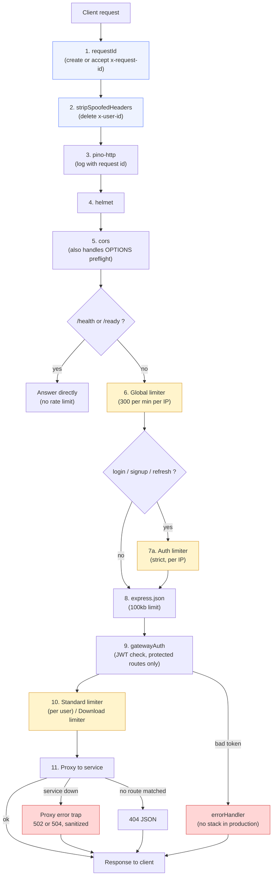

**Why this order?** Cheap checks first, expensive checks later:

1. Request ID first, so even rejected requests have an ID in the logs.
2. CORS before rate limiting, so a `429` response still carries CORS headers (otherwise the browser hides the `429` from your frontend and shows a vague "CORS error").
3. Rate limit **before** parsing the body, so attackers cannot make you spend CPU parsing JSON.
4. Per-user limits go **after** `gatewayAuth`, because before it we do not know who the user is.

### 0.4 Build order

| Step  | What                           | Files touched                                                            |
| ----- | ------------------------------ | ------------------------------------------------------------------------ |
| 12.1  | Small fixes + install packages | `package.json`, env files                                              |
| 12.2  | Validated config               | `src/config/env.ts`                                                    |
| 12.3  | Redis client                   | `src/config/redis.ts` (new)                                            |
| 12.4  | Request ID + header cleaning   | `src/middleware/requestContext.ts` (new)                               |
| 12.5  | Error handler + 404            | `src/middleware/errorHandler.ts`, `src/middleware/notFound.ts` (new) |
| 12.6  | Proxy factory with error trap  | `src/routes/createServiceProxy.ts` (new)                               |
| 12.7  | Rate limiters                  | `src/middleware/rateLimiters.ts` (new)                                 |
| 12.8  | Health routes                  | `src/routes/healthRoutes.ts` (new)                                     |
| 12.9  | Rewrite proxy routes           | `src/routes/proxyRoutes.ts`                                            |
| 12.10 | Final app pipeline             | `src/app.ts`                                                           |
| 12.11 | Server hardening               | `server.ts`                                                            |
| 12.12 | Docker                         | `Dockerfile`, `docker-compose.yml`, `.env.docker`                  |
| 12.13 | E2E test                       | `scripts/e2e-gateway.mjs` (new)                                        |
| 12.14 | Verify + docs                  | checklist                                                                |

> **Why this order and not 12.4 = rate limiters?** The error handler (12.5) and proxy factory (12.6) come before the limiters (12.7) so that `429`, `502`, and `500` responses all use the same JSON shape from the very first test.

---

## Final folder structure

```
services/api-gateway/
├── scripts/
│   └── e2e-gateway.mjs               NEW   automated tests
├── src/
│   ├── app.ts                        CHANGED  final pipeline
│   ├── config/
│   │   ├── env.ts                    CHANGED  validated config
│   │   └── redis.ts                  NEW      shared Redis client
│   ├── middleware/
│   │   ├── errorHandler.ts           CHANGED  safe errors
│   │   ├── gatewayAuth.ts            same
│   │   ├── notFound.ts               NEW      JSON 404
│   │   ├── rateLimiters.ts           NEW      all limiter tiers
│   │   └── requestContext.ts         NEW      request id + strip headers
│   ├── routes/
│   │   ├── createServiceProxy.ts     NEW      proxy factory + error trap
│   │   ├── healthRoutes.ts           NEW      /health /ready
│   │   └── proxyRoutes.ts            CHANGED  uses the factory
│   └── utils/
│       ├── AppError.ts               same
│       └── logger.ts                 same
├── types/express/index.d.ts          same
├── server.ts                         CHANGED  timeouts + shutdown
├── Dockerfile                        CHANGED  node 22, non-root
├── .env.example                      CHANGED
└── .env.docker                       CHANGED
```

---

## Step 12.1: Fix the small problems and install packages

### What and why

Before writing new code, we fix the small things that would break the new code.

| Small problem                                                              | Why it matters                                                      |
| -------------------------------------------------------------------------- | ------------------------------------------------------------------- |
| Node 20 in Dockerfile                                                      | `http-proxy-middleware@4` needs Node 22.15+. Fixed in Step 12.12. |
| No `REDIS_URL` for the gateway                                           | Rate-limit counters live in Redis. Fixed below.                     |
| `.env.example` is missing variables                                      | New developers get a crash. Fixed below.                            |
| `README` says `/api/chat/...` but the code serves `/api/v1/chat/...` | Our E2E test uses the real path. Docs fixed in the last step.       |

### Install packages

```powershell
cd services\api-gateway
npm install express-rate-limit rate-limit-redis ioredis
```

> **Check versions after install** (`npm ls express-rate-limit rate-limit-redis ioredis`).
>
> - `express-rate-limit` must be **8.0.0 or newer**. We use `ipKeyGenerator` (added in v8) to handle IPv6 users correctly. If you got v7, run `npm install express-rate-limit@latest`.
> - `rate-limit-redis` must be **v4+** (the `sendCommand` option).

### Environment variables

Add these to **`.env.docker`** (container) and **`.env`** (local). The local file uses `localhost`, the docker file uses container names.

```env
# .env.docker  (add these lines)
REDIS_URL=redis://redis:6379
TRUST_PROXY=0
BODY_LIMIT=100kb
```

```env
# .env  (local development, add these lines)
REDIS_URL=redis://localhost:6379
TRUST_PROXY=0
BODY_LIMIT=100kb
```

Also make **`.env.example`** complete (today it is missing 5 variables):

```env
PORT=4000
NODE_ENV=development
FRONTEND_URL=http://localhost:3000
JWT_ACCESS_SECRET=change_me_same_value_as_auth_service

AUTH_SERVICE_URL=http://localhost:4001
USER_SERVICE_URL=http://localhost:4002
ROOM_SERVICE_URL=http://localhost:4003
CHAT_SERVICE_URL=http://localhost:4005
RECORDING_SERVICE_URL=http://localhost:4007
NOTIFICATION_SERVICE_URL=http://localhost:4008

REDIS_URL=redis://localhost:6379
TRUST_PROXY=0
BODY_LIMIT=100kb

# Optional: override rate limits (defaults are in env.ts)
# RATE_LIMIT_GLOBAL_MAX=300
# RATE_LIMIT_LOGIN_MAX=10
# RATE_LIMIT_SIGNUP_MAX=10
# RATE_LIMIT_REFRESH_MAX=30
# RATE_LIMIT_STANDARD_MAX=100
# RATE_LIMIT_DOWNLOAD_MAX=120
```

### Why `TRUST_PROXY=0` (this is a security decision)

`TRUST_PROXY` tells Express "how many proxies stand in front of me". Rate limiting uses the client IP, and behind a proxy the real IP is in the `X-Forwarded-For` header.

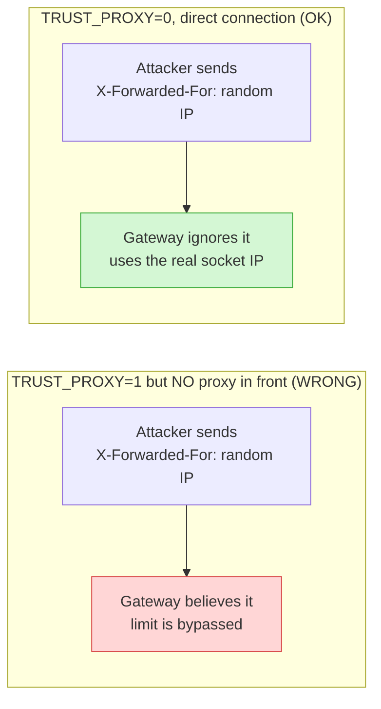

- **Local / plain Docker (no load balancer):** keep `0`.
- **Behind exactly one load balancer or ingress (Phase 15):** set `1`.

> **Note:** this is different from my earlier outline, which suggested a default of `1`. `0` is the safe default because a wrong `1` lets attackers skip rate limits.

---

## Step 12.2: `env.ts` (validated config)

### What and why

Today every value is `process.env.X as string`. TypeScript believes it, but if the variable is missing the real value is `undefined`, and the gateway fails later in a strange place (for example `jwt.verify(token, undefined)`).

The new `env.ts`:

- **crashes at startup** with a clear message if something important is missing (fail fast),
- converts numbers once (so limits are real numbers, not strings),
- keeps **all rate-limit numbers in one place**, with env overrides (the E2E test and Kubernetes can change them without code changes).

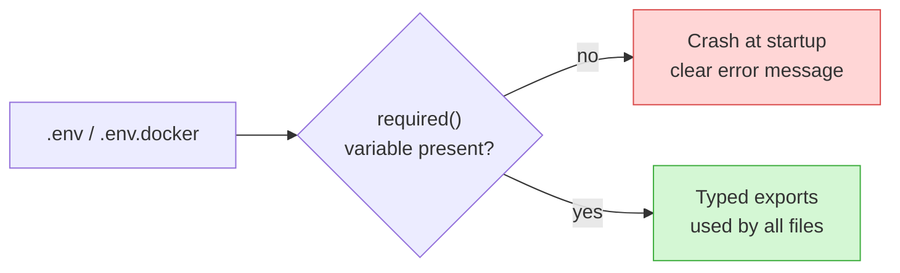

### Code: `src/config/env.ts` (replace the whole file)

```typescript
import 'dotenv/config';

/**
 * Reads a REQUIRED string variable from the environment.
 *
 * @param name - Name of the environment variable, for example `"JWT_ACCESS_SECRET"`.
 * @returns The non-empty value.
 * @throws {Error} If the variable is missing or empty. The gateway then refuses to start,
 *                 which is better than failing later in a confusing place.
 */
function required(name: string): string {
  const value = process.env[name];
  if (!value || value.trim() === '') {
    throw new Error(`[env] Missing required environment variable: ${name}`);
  }
  return value.trim();
}

/**
 * Reads an OPTIONAL non-negative integer from the environment.
 *
 * @param name     - Name of the environment variable.
 * @param fallback - Value used when the variable is not set.
 * @returns The parsed integer, or `fallback`.
 * @throws {Error} If the variable is set but is not a non-negative integer.
 */
function int(name: string, fallback: number): number {
  const raw = process.env[name];
  if (raw === undefined || raw.trim() === '') return fallback;
  const parsed = Number(raw);
  if (!Number.isInteger(parsed) || parsed < 0) {
    throw new Error(`[env] ${name} must be a non-negative integer, got "${raw}"`);
  }
  return parsed;
}

/** Port the gateway listens on. */
export const PORT: string = process.env.PORT || '4000';

/** `development` | `production` | `test`. Defaults to `development`. */
export const NODE_ENV: string = process.env.NODE_ENV || 'development';

/** True when running in production. Used to hide stack traces and debug info. */
export const IS_PRODUCTION: boolean = NODE_ENV === 'production';

/**
 * Secret used to verify access tokens.
 * MUST be exactly the same value as in auth-service and the other services.
 */
export const JWT_ACCESS_SECRET: string = required('JWT_ACCESS_SECRET');

if (IS_PRODUCTION && JWT_ACCESS_SECRET.startsWith('change_this')) {
  // We only warn (not crash) so your local docker setup keeps working.
  // Before a real deployment, replace the placeholder secret in every service.
  console.warn('[env] WARNING: JWT_ACCESS_SECRET is still the placeholder value.');
}

/**
 * Allowed browser origins for CORS.
 * `FRONTEND_URL` can hold several origins separated by commas,
 * for example: `http://localhost:3000,https://meet.example.com`.
 */
export const FRONTEND_ORIGINS: string[] = required('FRONTEND_URL')
  .split(',')
  .map((origin) => origin.trim())
  .filter(Boolean);

// ---- Downstream service URLs ---------------------------------------------
/** auth-service base URL, for example `http://auth-service:4001`. */
export const AUTH_SERVICE_URL: string = required('AUTH_SERVICE_URL');
/** user-service base URL. */
export const USER_SERVICE_URL: string = required('USER_SERVICE_URL');
/** room-service base URL. */
export const ROOM_SERVICE_URL: string = required('ROOM_SERVICE_URL');
/** chat-service base URL. */
export const CHAT_SERVICE_URL: string = required('CHAT_SERVICE_URL');
/** recording-service base URL (has a local default for non-docker development). */
export const RECORDING_SERVICE_URL: string =
  process.env.RECORDING_SERVICE_URL || 'http://localhost:4007';
/** notification-service base URL (has a local default for non-docker development). */
export const NOTIFICATION_SERVICE_URL: string =
  process.env.NOTIFICATION_SERVICE_URL || 'http://localhost:4008';

// ---- Hardening settings ---------------------------------------------------
/** Redis connection string used by the rate limiter and the readiness probe. */
export const REDIS_URL: string = required('REDIS_URL');

/**
 * Number of reverse proxies in front of the gateway.
 * 0 = none (direct connection). 1 = one load balancer or ingress.
 * A wrong value lets attackers fake their IP and skip rate limits.
 */
export const TRUST_PROXY: number = int('TRUST_PROXY', 0);

/** Maximum JSON body size accepted by the gateway, for example `100kb`. */
export const BODY_LIMIT: string = process.env.BODY_LIMIT || '100kb';

/**
 * All rate-limit numbers in one place.
 * Windows are fixed in code (they are part of the policy), counts can be changed by env.
 */
export const RATE_LIMITS = {
  /** Cheap flood protection for everything, per IP, per minute. */
  global: { windowMs: 60_000, limit: int('RATE_LIMIT_GLOBAL_MAX', 300) },
  /** Failed logins only (successful logins are not counted), per IP, 15 minutes. */
  login: { windowMs: 15 * 60_000, limit: int('RATE_LIMIT_LOGIN_MAX', 10) },
  /** Signups, per IP, 15 minutes. */
  signup: { windowMs: 15 * 60_000, limit: int('RATE_LIMIT_SIGNUP_MAX', 10) },
  /** Token refresh, per IP, 15 minutes. Higher, because real apps refresh regularly. */
  refresh: { windowMs: 15 * 60_000, limit: int('RATE_LIMIT_REFRESH_MAX', 30) },
  /** Normal API calls, per logged-in user, per minute. */
  standard: { windowMs: 60_000, limit: int('RATE_LIMIT_STANDARD_MAX', 100) },
  /** Recording downloads, per user AND per recording, per hour. */
  download: { windowMs: 60 * 60_000, limit: int('RATE_LIMIT_DOWNLOAD_MAX', 120) },
} as const;
```

---

## Step 12.3: `redis.ts` (one shared Redis client)

### What and why

Rate-limit counters must be in a place **all gateway copies can see**. If you keep counters in memory and run 3 gateway pods, an attacker gets 3x the limit (each pod counts separately). Redis solves that.

We create **one** client and share it between the limiter and the `/ready` probe.

Important settings, and the reason for each:

| Setting                  | Value        | Reason                                                              |
| ------------------------ | ------------ | ------------------------------------------------------------------- |
| `maxRetriesPerRequest` | `1`        | If Redis is down, a command fails fast instead of waiting forever.  |
| `commandTimeout`       | `2000` ms  | A request is never delayed by more than 2 seconds because of Redis. |
| `retryStrategy`        | grows to 2s  | Reconnects automatically when Redis comes back.                     |
| error log throttle       | once per 10s | A stopped Redis would otherwise print thousands of identical lines. |

### Code: `src/config/redis.ts` (new file)

```typescript
import { Redis } from 'ioredis';
import { REDIS_URL } from './env.js';
import logger from '../utils/logger.js';

/** Time of the last logged Redis error (ms since epoch), used to avoid log spam. */
let lastErrorLogAt = 0;

/**
 * Shared Redis client for the gateway.
 *
 * Used by:
 *  - `rate-limit-redis` (rate-limit counters)
 *  - `/ready` probe (PING)
 *
 * The client reconnects automatically. While Redis is down, commands fail within 2 seconds,
 * and the callers decide what to do (rate limiters fail open, auth limiters fail closed).
 */
const redis = new Redis(REDIS_URL, {
  maxRetriesPerRequest: 1,
  commandTimeout: 2000,
  retryStrategy: (attempt: number) => Math.min(attempt * 200, 2000),
});

redis.on('connect', () => logger.info('Redis connected'));
redis.on('close', () => logger.warn('Redis connection closed'));
redis.on('error', (err: Error) => {
  // Log at most once every 10 seconds.
  const now = Date.now();
  if (now - lastErrorLogAt > 10_000) {
    lastErrorLogAt = now;
    logger.error({ err: err.message }, 'Redis error');
  }
});

export default redis;
```

---

## Step 12.4: `requestContext.ts` (request ID + header cleaning)

### What and why

**Request ID (problem 5).** Imagine 8 services and a failed call. With one ID that travels through every service, you search the logs for that ID and see the full story.

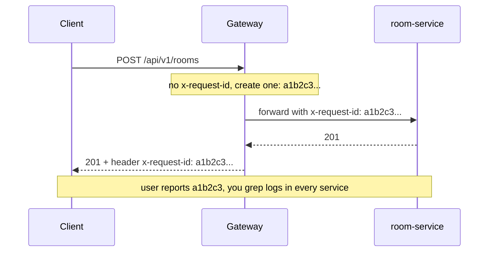

**Why we validate an incoming ID instead of trusting it.** A client could send `x-request-id: fake\n{"level":"error"...}` to inject fake lines into logs (log injection). We only accept IDs that are 8-64 characters of `A-Z a-z 0-9 -`. Anything else is replaced with a fresh UUID.

**Header cleaning (problem 6).** `x-user-id` must come only from the gateway after a verified JWT. If a client sends it themselves, we delete it first. Then `gatewayAuth` sets the real value on protected routes.

### Code: `src/middleware/requestContext.ts` (new file)

```typescript
import { randomUUID } from 'node:crypto';
import type { Request, Response, NextFunction } from 'express';

/**
 * Allowed shape for a client-supplied request ID: 8 to 64 characters,
 * only letters, digits and dashes. Prevents log injection and huge headers.
 */
const VALID_REQUEST_ID = /^[A-Za-z0-9-]{8,64}$/;

/**
 * Ensures every request has a safe `x-request-id`.
 *
 * - Accepts the client's ID only if it matches {@link VALID_REQUEST_ID}.
 * - Otherwise generates a UUID v4.
 * - Writes the ID to `req.headers` (so the proxy forwards it to the service)
 *   and to the response header (so the client can quote it in a bug report).
 *
 * Must be the FIRST middleware, so even rejected requests have an ID.
 *
 * @param req  - Express request.
 * @param res  - Express response.
 * @param next - Continues to the next middleware. This middleware never fails.
 */
export const requestId = (req: Request, res: Response, next: NextFunction): void => {
  const incoming = req.headers['x-request-id'];
  const candidate = Array.isArray(incoming) ? incoming[0] : incoming;
  const id = candidate && VALID_REQUEST_ID.test(candidate) ? candidate : randomUUID();

  req.headers['x-request-id'] = id;
  res.setHeader('X-Request-Id', id);
  next();
};

/**
 * Removes identity headers that only the gateway is allowed to set.
 *
 * Without this, a client could send `x-user-id: <someone else>` on a public route
 * (for example /api/auth/login) and the proxy would forward it to the service.
 * `gatewayAuth` sets the real `x-user-id` later, after the JWT is verified.
 *
 * @param req  - Express request.
 * @param _res - Unused.
 * @param next - Continues to the next middleware.
 */
export const stripSpoofedHeaders = (req: Request, _res: Response, next: NextFunction): void => {
  delete req.headers['x-user-id'];
  delete req.headers['x-forwarded-user'];
  next();
};
```

---

## Step 12.5: Error handler and 404 handler

### What and why

Two jobs:

1. **Give every error the same JSON shape**, so the frontend writes one error handler.
2. **Never leak internals in production**: no stack traces, no raw `err.message` from unexpected errors.

Where do the different errors come from?

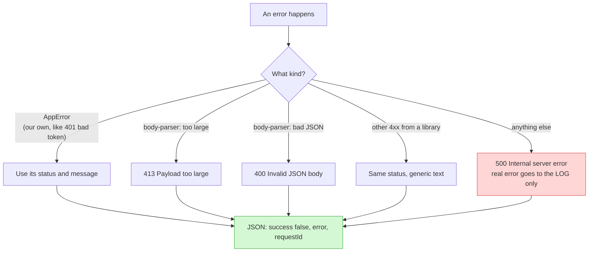

Why include `requestId` in the body? So a user can copy it from the error screen and send it to you.

Why the `res.headersSent` check? If the response already started streaming (for example a big download) we can no longer send a JSON error. We pass the error to Express's default handler, which closes the connection safely.

### Code: `src/middleware/errorHandler.ts` (replace the whole file)

```typescript
import type { Request, Response, NextFunction } from 'express';
import AppError from '../utils/AppError.js';
import logger from '../utils/logger.js';
import { IS_PRODUCTION } from '../config/env.js';

/**
 * Shape of errors thrown by body-parser and other Express/Node libraries.
 * They carry an HTTP status and sometimes a `type` string such as `entity.too.large`.
 */
interface HttpLikeError extends Error {
  status?: number;
  statusCode?: number;
  type?: string;
}

/**
 * Reads the request ID that `requestId` middleware set.
 *
 * @param req - Express request.
 * @returns The request ID, or `undefined` if the middleware did not run.
 */
const getRequestId = (req: Request): string | undefined => {
  const value = req.headers['x-request-id'];
  return Array.isArray(value) ? value[0] : value;
};

/**
 * Central Express error handler. MUST be registered after all routes.
 *
 * Rules:
 *  1. `AppError` -> use its own status and message (we wrote that message, it is safe).
 *  2. Known body-parser errors -> 413 / 400 / 415 with a fixed message.
 *  3. Other 4xx errors -> same status, generic message.
 *  4. Everything else -> 500 and a generic message. The real error is only LOGGED.
 *  5. In production nothing internal is ever returned. In development a `debug` field
 *     with the real message and stack is added to help you.
 *
 * @param err  - The error that was thrown or passed to `next(err)`.
 * @param req  - Express request.
 * @param res  - Express response.
 * @param next - Used only when the response already started (we cannot write JSON anymore).
 */
export const errorHandler = (
  err: HttpLikeError,
  req: Request,
  res: Response,
  next: NextFunction,
): void => {
  // Response already started (for example a download): let Express close the socket.
  if (res.headersSent) {
    return next(err);
  }

  const requestId = getRequestId(req);

  // 1. Our own errors.
  if (err instanceof AppError) {
    res.status(err.statusCode).json({ success: false, error: err.message, requestId });
    return;
  }

  // 2. Known body-parser errors.
  if (err.type === 'entity.too.large') {
    res.status(413).json({ success: false, error: 'Request body is too large', requestId });
    return;
  }
  if (err.type === 'entity.parse.failed') {
    res.status(400).json({ success: false, error: 'Invalid JSON body', requestId });
    return;
  }
  if (err.type === 'encoding.unsupported' || err.type === 'charset.unsupported') {
    res.status(415).json({ success: false, error: 'Unsupported content encoding', requestId });
    return;
  }

  // 3. Any other client error (4xx) raised by a library.
  const status = err.status ?? err.statusCode;
  if (typeof status === 'number' && status >= 400 && status < 500) {
    res.status(status).json({ success: false, error: 'Bad request', requestId });
    return;
  }

  // 4. Unknown error: log everything, tell the client nothing.
  logger.error({ err, path: req.path, method: req.method, requestId }, 'Unhandled error');

  const body: Record<string, unknown> = {
    success: false,
    error: 'Internal server error',
    requestId,
  };

  // 5. Only in development: help the developer.
  if (!IS_PRODUCTION) {
    body.debug = { message: err.message, stack: err.stack };
  }

  res.status(500).json(body);
};
```

### Code: `src/middleware/notFound.ts` (new file)

```typescript
import type { Request, Response } from 'express';

/**
 * Handles any request that no route matched.
 * Returns JSON instead of Express's default HTML page (which also reveals the framework).
 *
 * Must be registered after all routes and before `errorHandler`.
 *
 * @param req - Express request.
 * @param res - Express response.
 */
export const notFound = (req: Request, res: Response): void => {
  const value = req.headers['x-request-id'];
  const requestId = Array.isArray(value) ? value[0] : value;
  res.status(404).json({ success: false, error: 'Route not found', requestId });
};
```

---

## Step 12.6: `createServiceProxy.ts` (proxy with error trapping)

### What and why

**Problem:** your 7 proxies repeat the same options, and none handles errors.

**Solution:** one function `createServiceProxy()` that every route uses. Change it once, all routes change.

What happens when a service is down?

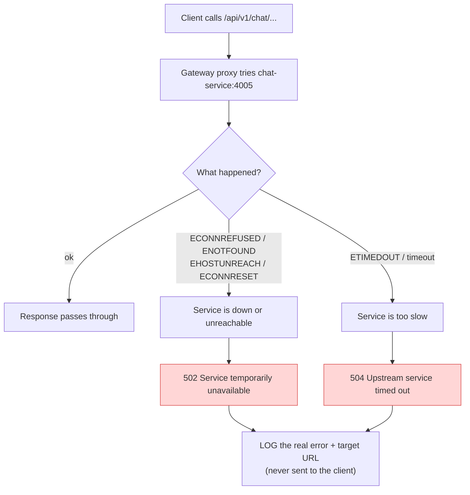

Design choices, with reasons:

| Choice                                                 | Reason                                                                                                                                        |
| ------------------------------------------------------ | --------------------------------------------------------------------------------------------------------------------------------------------- |
| Real error and target URL go to the **log only** | The client never sees `http://chat-service:4005`.                                                                                           |
| `Retry-After: 5` header on 502/504                   | Tells well-behaved clients when to retry.                                                                                                     |
| Response is written with raw `res.writeHead`         | In the proxy error callback `res` is a plain Node `ServerResponse`, not an Express response, so `res.status().json()` is not available. |
| CORS headers still appear                              | `cors` ran earlier and already set them on the same response object.                                                                        |
| Check `'writeHead' in res`                           | For WebSocket upgrades `res` is a `Socket`. We just destroy it.                                                                           |
| Check `res.headersSent`                              | If streaming already started we cannot send JSON, so we end the stream.                                                                       |
| Default timeout 15s, recordings 10 min                 | Normal APIs should answer fast. Recording downloads can be long (same as your current config).                                                |
| Keep `fixRequestBody`                                | Needed because `express.json()` already consumed the body. Without it, POST bodies are lost.                                                |

> **Heads-up about timeouts:** when the proxy times out, Node often reports it as `ECONNRESET` ("socket hang up"), not `ETIMEDOUT`. So a timeout may show up as `502` instead of `504`. That is fine and still safe. The E2E test accepts both.

### Code: `src/routes/createServiceProxy.ts` (new file)

```typescript
import type { ServerResponse } from 'node:http';
import type { Socket } from 'node:net';
import { createProxyMiddleware, fixRequestBody } from 'http-proxy-middleware';
import logger from '../utils/logger.js';

/** Node error codes that mean "the service cannot be reached". -> 502 */
const UNREACHABLE_CODES = new Set([
  'ECONNREFUSED',
  'ENOTFOUND',
  'EHOSTUNREACH',
  'ECONNRESET',
  'EAI_AGAIN',
  'EPIPE',
]);

/** Node/undici error codes that mean "the service took too long". -> 504 */
const TIMEOUT_CODES = new Set([
  'ETIMEDOUT',
  'ESOCKETTIMEDOUT',
  'UND_ERR_CONNECT_TIMEOUT',
  'UND_ERR_HEADERS_TIMEOUT',
  'UND_ERR_BODY_TIMEOUT',
]);

/** Result of {@link classifyProxyError}. */
export interface ProxyFailure {
  /** HTTP status to send to the client. */
  status: 502 | 504;
  /** Safe, generic message for the client. Contains no internal details. */
  message: string;
}

/**
 * Converts a low-level network error into a safe HTTP response description.
 *
 * @param err - Error from the proxy library (usually has a Node `code`).
 * @returns Status and a client-safe message. Unknown errors become 502.
 */
export function classifyProxyError(err: NodeJS.ErrnoException): ProxyFailure {
  const code = err.code ?? '';
  const looksLikeTimeout = TIMEOUT_CODES.has(code) || /timed? ?out/i.test(err.message ?? '');

  if (looksLikeTimeout) {
    return { status: 504, message: 'Upstream service timed out' };
  }
  if (UNREACHABLE_CODES.has(code)) {
    return { status: 502, message: 'Service temporarily unavailable' };
  }
  return { status: 502, message: 'Service temporarily unavailable' };
}

/** Options for {@link createServiceProxy}. */
export interface ServiceProxyOptions {
  /** Short name used only in logs, for example `"chat-service"`. */
  name: string;
  /** Base URL of the service, for example `http://chat-service:4005`. */
  target: string;
  /** Which incoming paths this proxy handles (relative to the `/api` mount). */
  pathFilter?: string | string[];
  /** Regex -> replacement map that changes the path before forwarding. */
  pathRewrite?: Record<string, string>;
  /** Maximum time to wait for the service, in milliseconds. Default 15000. */
  timeoutMs?: number;
}

/**
 * Creates a reverse proxy to one downstream service with the gateway's standard settings:
 *  - `changeOrigin` (Host header matches the target)
 *  - `fixRequestBody` (re-sends the JSON body that `express.json()` already read)
 *  - timeouts
 *  - a shared error trap that returns sanitized 502/504 JSON
 *
 * @param options - See {@link ServiceProxyOptions}.
 * @returns An Express-compatible middleware.
 */
export function createServiceProxy(options: ServiceProxyOptions) {
  const { name, target, pathFilter, pathRewrite, timeoutMs = 15_000 } = options;

  return createProxyMiddleware({
    target,
    changeOrigin: true,
    pathFilter,
    pathRewrite,
    timeout: timeoutMs,
    proxyTimeout: timeoutMs,
    on: {
      proxyReq: fixRequestBody,

      /**
       * Called by the proxy when the request to the service fails.
       *
       * @param err - The network error.
       * @param req - Incoming request (Node IncomingMessage).
       * @param res - Normally a ServerResponse. It can be a Socket for WebSocket upgrades.
       */
      error: (err: Error, req, res: ServerResponse | Socket) => {
        const requestId = req.headers['x-request-id'];

        // The REAL error and target go to the log only.
        logger.error(
          { err: err.message, code: (err as NodeJS.ErrnoException).code, service: name, target, path: req.url, requestId },
          'Proxy error',
        );

        // WebSocket upgrade: no HTTP response is possible.
        if (!('writeHead' in res)) {
          res.destroy();
          return;
        }

        // Response already started (streaming): cannot send JSON, just end it.
        if (res.headersSent) {
          res.end();
          return;
        }

        const failure = classifyProxyError(err as NodeJS.ErrnoException);

        res.writeHead(failure.status, {
          'Content-Type': 'application/json',
          'Retry-After': '5',
        });
        res.end(JSON.stringify({ success: false, error: failure.message, requestId }));
      },
    },
  });
}
```

> **If TypeScript complains about the `error` callback types** (v4 typings can differ slightly): keep the logic, and only adjust the parameter types to what the compiler suggests (for example `req: import('node:http').IncomingMessage`). The logic does not change.

---

## Step 12.7: `rateLimiters.ts` (tiered rate limiting)

### What and why

One limit for everything is wrong: login needs to be strict, but a normal API call must not be punished like a login attempt. So we use **tiers**.

| Tier               | Applies to                                    | Limit                              | Counted by                       | Why this key                                                                                       |
| ------------------ | --------------------------------------------- | ---------------------------------- | -------------------------------- | -------------------------------------------------------------------------------------------------- |
| **Global**   | everything except health                      | 300 / min                          | IP                               | Cheap flood protection before we do any work                                                       |
| **Login**    | `POST /api/auth/login`                      | 10 / 15 min, **failed only** | IP                               | Stops password guessing. Successful logins do not use up the quota, so real users are not punished |
| **Signup**   | `POST /api/auth/signup`                     | 10 / 15 min                        | IP                               | Stops mass fake accounts                                                                           |
| **Refresh**  | `POST /api/auth/refresh`                    | 30 / 15 min                        | IP                               | Apps refresh tokens regularly, so a bit higher                                                     |
| **Standard** | users, rooms, chat, notifications, recordings | 100 / min                          | **user ID**                | Fair per person, even if 50 people share one office IP                                             |
| **Download** | `/api/v1/recordings/:id/download`           | 120 / hour                         | **user ID + recording ID** | Protects bandwidth (see warning below)                                                             |

### Warning: why not 20 downloads per hour

Your download endpoint supports HTTP `206` range requests (Step 10.7). A browser `<video>` player sends **many** small range requests while one person watches and seeks. With a limit of 20/hour, normal playback would hit `429` after a few minutes. So we count **per user per recording** with a higher number (120/hour). A scraper downloading many different recordings is still blocked by the per-recording keys plus the standard tier.

### How the counting works (fixed window)

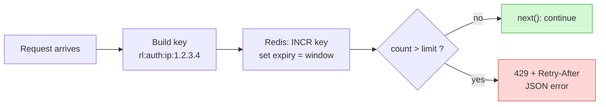

### What if Redis is down? (fail open vs fail closed)

| Tier                       | Behavior                                      | Reason                                                                                                  |
| -------------------------- | --------------------------------------------- | ------------------------------------------------------------------------------------------------------- |
| Global, Standard, Download | **Fail open** (let the request through) | A Redis outage must not take down video calls.                                                          |
| Login, Signup, Refresh     | **Fail closed** (`503`)               | Abuse of login is exactly what an attacker wants during an outage. Better to pause logins for a minute. |

### Other details

- `standardHeaders: 'draft-7'` adds modern `RateLimit` and `RateLimit-Policy` headers and a standard `Retry-After` on `429`.
- `ipKeyGenerator` groups IPv6 addresses by `/56` subnet. Without it, one IPv6 user can change the last digits and get unlimited new keys.
- Each tier has its own Redis prefix (`rl:login:`, `rl:api:` ...), so you can inspect or reset one tier.
- `userOrIp` falls back to IP if there is no user (should not happen after `gatewayAuth`, but is a safe default).

### Code: `src/middleware/rateLimiters.ts` (new file)

```typescript
import type { Request, Response, NextFunction, RequestHandler } from 'express';
import rateLimit, { ipKeyGenerator, type Options } from 'express-rate-limit';
import RedisStore, { type RedisReply } from 'rate-limit-redis';
import redis from '../config/redis.js';
import { RATE_LIMITS } from '../config/env.js';
import AppError from '../utils/AppError.js';
import logger from '../utils/logger.js';

/** Body returned for every 429, exactly as required by the project. */
const TOO_MANY_REQUESTS = {
  success: false,
  error: 'Too many requests. Please try again later.',
} as const;

/**
 * Builds a key from the client's IP address.
 * `ipKeyGenerator` handles IPv6 correctly (groups by subnet).
 *
 * @param req - Express request.
 * @returns A string like `ip:203.0.113.5`.
 */
const ipKey = (req: Request): string => `ip:${ipKeyGenerator(req.ip ?? '0.0.0.0')}`;

/**
 * Builds a key from the logged-in user (set by `gatewayAuth`), or the IP as a fallback.
 *
 * @param req - Express request.
 * @returns A string like `user:abc123`.
 */
const userKey = (req: Request): string => (req.userId ? `user:${req.userId}` : ipKey(req));

/** Options for {@link buildLimiter}. */
interface LimiterConfig {
  /** Redis key prefix, becomes `rl:<prefix>:`. Used to separate tiers. */
  prefix: string;
  /** Window length in milliseconds. */
  windowMs: number;
  /** Maximum requests allowed in one window. */
  limit: number;
  /** How to identify the caller. */
  keyGenerator: (req: Request) => string;
  /** If true, a request is NOT counted when it finishes with status < 400. */
  skipSuccessfulRequests?: boolean;
  /** If true, a Redis failure lets the request through. If false, the error is passed on. */
  failOpen: boolean;
  /** Optional: return true to exclude a request from this limiter. */
  skip?: (req: Request) => boolean;
}

/**
 * Creates one rate limiter backed by Redis, with the project's standard 429 response.
 *
 * @param config - See {@link LimiterConfig}.
 * @returns An Express middleware.
 */
function buildLimiter(config: LimiterConfig): RequestHandler {
  const options: Partial<Options> = {
    windowMs: config.windowMs,
    limit: config.limit,
    standardHeaders: 'draft-7', // RateLimit + RateLimit-Policy + Retry-After
    legacyHeaders: false, // no old X-RateLimit-* headers
    keyGenerator: config.keyGenerator,
    skipSuccessfulRequests: config.skipSuccessfulRequests ?? false,
    skip: config.skip,
    passOnStoreError: config.failOpen,
    store: new RedisStore({
      prefix: `rl:${config.prefix}:`,
      // rate-limit-redis sends raw Redis commands through ioredis.
      sendCommand: (...args: string[]) => redis.call(args[0], ...args.slice(1)) as Promise<RedisReply>,
    }),
    handler: (req, res, _next, optionsUsed) => {
      logger.warn(
        { tier: config.prefix, key: config.keyGenerator(req as Request), path: req.originalUrl, requestId: req.headers['x-request-id'] },
        'Rate limit exceeded',
      );
      res.status(optionsUsed.statusCode).json(TOO_MANY_REQUESTS);
    },
  };

  return rateLimit(options);
}

/**
 * Wraps a limiter so that a Redis failure becomes a clean 503 instead of a 500.
 * Used for the auth tiers (fail closed).
 *
 * @param limiter - A limiter built with `failOpen: false`.
 * @returns A middleware that converts store errors into `AppError(503)`.
 */
function failClosed(limiter: RequestHandler): RequestHandler {
  return (req: Request, res: Response, next: NextFunction) => {
    limiter(req, res, (err?: unknown) => {
      if (err) {
        logger.error({ err }, 'Rate limit store unavailable (auth tier failing closed)');
        return next(new AppError('Service temporarily unavailable', 503));
      }
      next();
    });
  };
}

/** Tier 0: flood protection for everything, per IP. Fails open. */
export const globalLimiter: RequestHandler = buildLimiter({
  prefix: 'global',
  ...RATE_LIMITS.global,
  keyGenerator: ipKey,
  failOpen: true,
});

/** Tier 1a: login. Only FAILED attempts count. Per IP. Fails closed. */
export const loginLimiter: RequestHandler = failClosed(
  buildLimiter({
    prefix: 'login',
    ...RATE_LIMITS.login,
    keyGenerator: ipKey,
    skipSuccessfulRequests: true,
    failOpen: false,
  }),
);

/** Tier 1b: signup. Every request counts. Per IP. Fails closed. */
export const signupLimiter: RequestHandler = failClosed(
  buildLimiter({
    prefix: 'signup',
    ...RATE_LIMITS.signup,
    keyGenerator: ipKey,
    failOpen: false,
  }),
);

/** Tier 1c: token refresh. Every request counts. Per IP. Fails closed. */
export const refreshLimiter: RequestHandler = failClosed(
  buildLimiter({
    prefix: 'refresh',
    ...RATE_LIMITS.refresh,
    keyGenerator: ipKey,
    failOpen: false,
  }),
);

/**
 * Tier 2: normal API calls, per logged-in user. Fails open.
 * MUST run after `gatewayAuth` (needs `req.userId`).
 */
export const standardLimiter: RequestHandler = buildLimiter({
  prefix: 'api',
  ...RATE_LIMITS.standard,
  keyGenerator: userKey,
  failOpen: true,
});

/**
 * Tier 2 variant for /v1/recordings: same counter as `standardLimiter`,
 * but download requests are skipped here because they have their own tier.
 * (Otherwise a download would be counted twice.)
 */
export const recordingsLimiter: RequestHandler = buildLimiter({
  prefix: 'api',
  ...RATE_LIMITS.standard,
  keyGenerator: userKey,
  failOpen: true,
  skip: (req) => req.originalUrl.split('?')[0].endsWith('/download'),
});

/**
 * Tier 3: heavy resource. Recording downloads.
 * Counted per user AND per recording, so video seeking on one recording does not
 * block the same user from watching another recording.
 * MUST be mounted on a path that contains `:recordingId`.
 */
export const downloadLimiter: RequestHandler = buildLimiter({
  prefix: 'download',
  ...RATE_LIMITS.download,
  keyGenerator: (req) => `${userKey(req)}:rec:${req.params.recordingId ?? 'unknown'}`,
  failOpen: true,
});
```

---

## Step 12.8: `healthRoutes.ts` (`/health` and `/ready`)

### What and why

Two different questions, two different endpoints:

| Endpoint                   | Question                          | Checks                | If it fails                                              |
| -------------------------- | --------------------------------- | --------------------- | -------------------------------------------------------- |
| `GET /health` (liveness) | "Is the process alive?"           | nothing, just answers | Orchestrator **restarts** the container            |
| `GET /ready` (readiness) | "Can it serve traffic right now?" | Redis `PING`        | Orchestrator **stops sending traffic**, no restart |

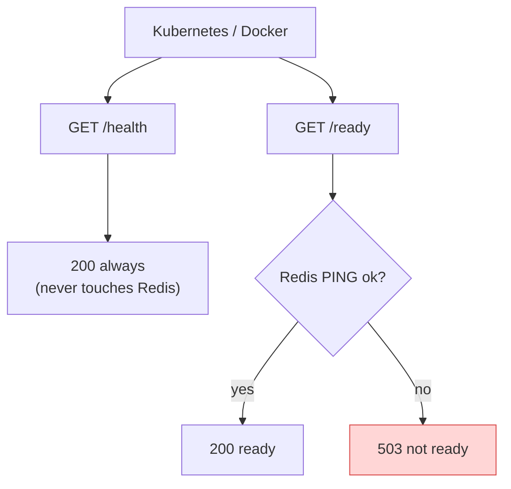

**Why `/health` must not check Redis:** if Redis has a short outage and `/health` fails, the orchestrator restarts your gateway in a loop. A restart does not fix Redis, it only makes things worse.

**Why `/ready` does not ping the other services:** if one service (say chat) is down, the gateway should still serve auth and rooms. Readiness only checks what the gateway itself needs to work correctly.

### Code: `src/routes/healthRoutes.ts` (new file)

```typescript
import { Router } from 'express';
import redis from '../config/redis.js';
import logger from '../utils/logger.js';

const router = Router();

/**
 * Liveness probe.
 * Only proves the Node process is running and the event loop answers.
 * Does NOT check Redis or other services (see the "why" in the guide).
 *
 * @returns 200 `{ status: "ok", service: "api-gateway" }`
 */
router.get('/health', (_req, res) => {
  res.json({ status: 'ok', service: 'api-gateway' });
});

/**
 * Readiness probe.
 * Checks that Redis (needed by the rate limiter) answers a PING.
 *
 * @returns 200 `{ status: "ready" }` or 503 `{ status: "not-ready", reason: "redis" }`
 */
router.get('/ready', async (_req, res) => {
  try {
    const pong = await redis.ping();
    if (pong !== 'PONG') throw new Error(`Unexpected PING reply: ${pong}`);
    res.json({ status: 'ready', service: 'api-gateway' });
  } catch (err) {
    logger.warn({ err: (err as Error).message }, 'Readiness check failed');
    res.status(503).json({ status: 'not-ready', reason: 'redis' });
  }
});

export default router;
```

---

## Step 12.9: `proxyRoutes.ts` (rewrite using the factory)

### What and why

Same routes and same behavior as today, with three changes:

1. Each proxy now uses `createServiceProxy()` (error trap, timeouts).
2. The **standard limiter is added right after `gatewayAuth`** (needs the user ID).
3. Recordings get the extra download limiter.

> **Why we keep the old structure** (`router.use(path, gatewayAuth)` then an un-mounted proxy with `pathFilter`): it already works in your tests. If we changed how paths are mounted, Express would strip the prefix and `pathRewrite` would behave differently. We do not touch what works.

### Order on one protected route

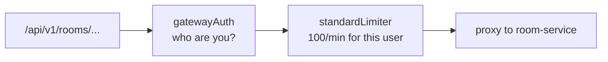

Recording download is special:

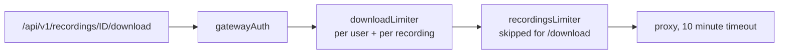

### Code: `src/routes/proxyRoutes.ts` (replace the whole file)

```typescript
import { Router } from 'express';
import { gatewayAuth } from '../middleware/gatewayAuth.js';
import { standardLimiter, recordingsLimiter, downloadLimiter } from '../middleware/rateLimiters.js';
import { createServiceProxy } from './createServiceProxy.js';
import {
  AUTH_SERVICE_URL,
  USER_SERVICE_URL,
  ROOM_SERVICE_URL,
  CHAT_SERVICE_URL,
  RECORDING_SERVICE_URL,
  NOTIFICATION_SERVICE_URL,
} from '../config/env.js';

/**
 * All proxied HTTP routes. Mounted at `/api` in app.ts.
 *
 * Reminder: login / signup / refresh rate limits are applied in app.ts
 * (they run BEFORE the body is parsed). Everything here that is protected
 * runs: gatewayAuth -> limiter -> proxy.
 */
const router = Router();

// ---------------------------------------------------------------------------
// Auth service: PUBLIC routes (no token yet, user is logging in)
// ---------------------------------------------------------------------------
router.use(
  createServiceProxy({
    name: 'auth-service',
    target: AUTH_SERVICE_URL,
    pathFilter: ['/auth/signup', '/auth/login', '/auth/refresh'],
    pathRewrite: { '^/auth': '/api/v1/auth' },
  }),
);

// ---------------------------------------------------------------------------
// Auth service: PROTECTED routes
// ---------------------------------------------------------------------------
router.use(
  ['/auth/logout', '/auth/me', '/auth/turn-credentials'],
  gatewayAuth,
  standardLimiter,
  createServiceProxy({
    name: 'auth-service',
    target: AUTH_SERVICE_URL,
    pathRewrite: { '^/auth': '/api/v1/auth' },
  }),
);

// ---------------------------------------------------------------------------
// User service: entirely protected. /api/users/me -> /me
// ---------------------------------------------------------------------------
router.use('/users', gatewayAuth, standardLimiter);
router.use(
  createServiceProxy({
    name: 'user-service',
    target: USER_SERVICE_URL,
    pathFilter: '/users',
    pathRewrite: { '^/users': '' },
  }),
);

// ---------------------------------------------------------------------------
// Room service: entirely protected. Path is the same on both sides.
// ---------------------------------------------------------------------------
router.use('/v1/rooms', gatewayAuth, standardLimiter);
router.use(
  createServiceProxy({
    name: 'room-service',
    target: ROOM_SERVICE_URL,
    pathFilter: '/v1/rooms',
    pathRewrite: { '^/v1/rooms': '/v1/rooms' },
  }),
);

// ---------------------------------------------------------------------------
// Chat service: entirely protected. /api/v1/chat/* -> /api/v1/chat/*
// ---------------------------------------------------------------------------
router.use('/v1/chat', gatewayAuth, standardLimiter);
router.use(
  createServiceProxy({
    name: 'chat-service',
    target: CHAT_SERVICE_URL,
    pathFilter: '/v1/chat',
    pathRewrite: { '^/v1/chat': '/api/v1/chat' },
  }),
);

// ---------------------------------------------------------------------------
// Recording service: entirely protected, downloads have their own tier.
// Long timeout (10 minutes) because downloads stream large MP4 files.
// ---------------------------------------------------------------------------
router.use('/v1/recordings', gatewayAuth);
router.use('/v1/recordings/:recordingId/download', downloadLimiter);
router.use('/v1/recordings', recordingsLimiter);
router.use(
  createServiceProxy({
    name: 'recording-service',
    target: RECORDING_SERVICE_URL,
    pathFilter: '/v1/recordings',
    pathRewrite: { '^/v1/recordings': '/v1/recordings' },
    timeoutMs: 10 * 60_000,
  }),
);

// ---------------------------------------------------------------------------
// Notification service: entirely protected.
// ---------------------------------------------------------------------------
router.use('/v1/notifications', gatewayAuth, standardLimiter);
router.use(
  createServiceProxy({
    name: 'notification-service',
    target: NOTIFICATION_SERVICE_URL,
    pathFilter: '/v1/notifications',
    pathRewrite: { '^/v1/notifications': '/v1/notifications' },
  }),
);

export default router;
```

---

## Step 12.10: `app.ts` (the final pipeline)

### What and why

This file is where the **order** from the diagram in section 0.3 becomes real. Order is the whole point, so each line has a comment explaining why it is there.

Details:

- `trust proxy` is set first because the rate limiter reads `req.ip`.
- `pino-http` uses our request ID (`genReqId`), so each log line contains it. Health probes are not logged (`autoLogging.ignore`), which removes the noise (problem 7).
- Helmet: `crossOriginResourcePolicy: 'cross-origin'` is needed because your frontend on `:3000` loads recordings and thumbnails from `:4000`. With Helmet's default `same-origin`, the browser would block them.
- CORS: `exposedHeaders` lets browser JavaScript read `Retry-After`, `RateLimit`, `X-Request-Id`, and the range headers used by video seeking. Without it the frontend cannot show "try again in 30 seconds".
- Login, signup, refresh limiters use `app.post(...)` so only `POST` is counted.
- `express.json({ limit })` comes **after** the limiters (do not parse bodies for blocked clients).
- `notFound` then `errorHandler` are always last.

### Code: `src/app.ts` (replace the whole file)

```typescript
import express from 'express';
import cors from 'cors';
import helmet from 'helmet';
import pinoHttp from 'pino-http';
import proxyRoutes from './routes/proxyRoutes.js';
import healthRoutes from './routes/healthRoutes.js';
import { requestId, stripSpoofedHeaders } from './middleware/requestContext.js';
import {
  globalLimiter,
  loginLimiter,
  signupLimiter,
  refreshLimiter,
} from './middleware/rateLimiters.js';
import { notFound } from './middleware/notFound.js';
import { errorHandler } from './middleware/errorHandler.js';
import { FRONTEND_ORIGINS, TRUST_PROXY, BODY_LIMIT } from './config/env.js';
import logger from './utils/logger.js';

const app = express();

// 0. Tell Express how many proxies are in front (affects req.ip, used by rate limiting).
app.set('trust proxy', TRUST_PROXY);

// 1. Give every request an ID first, so even rejected requests are traceable.
app.use(requestId);

// 2. Delete identity headers a client must never control.
app.use(stripSpoofedHeaders);

// 3. Access logs, tagged with the request ID. Probes are not logged (noise).
app.use(
  pinoHttp({
    logger,
    genReqId: (req) => req.headers['x-request-id'] as string,
    autoLogging: {
      ignore: (req) => req.url === '/health' || req.url === '/ready',
    },
  }),
);

// 4. Security headers.
//    cross-origin: the frontend (:3000) must be able to load recordings/thumbnails from :4000.
app.use(helmet({ crossOriginResourcePolicy: { policy: 'cross-origin' } }));

// 5. CORS BEFORE rate limiting, so 429 responses also carry CORS headers
//    (otherwise the browser hides the 429 and shows a confusing CORS error).
//    The cors middleware also answers OPTIONS preflight requests, so they never reach the limiters.
app.use(
  cors({
    origin: FRONTEND_ORIGINS,
    credentials: true,
    methods: ['GET', 'POST', 'PATCH', 'PUT', 'DELETE', 'OPTIONS'],
    allowedHeaders: ['Authorization', 'Content-Type', 'X-Request-Id', 'Range'],
    exposedHeaders: [
      'Retry-After',
      'RateLimit',
      'RateLimit-Policy',
      'X-Request-Id',
      'Content-Range',
      'Accept-Ranges',
      'Content-Length',
    ],
    maxAge: 600, // browser may cache the preflight answer for 10 minutes
  }),
);

// 6. Health probes: answered here, so they are never rate limited.
app.use(healthRoutes);

// 7. Global flood protection for everything else (per IP).
app.use(globalLimiter);

// 8. Strict auth limiters (per IP). They run BEFORE the body is parsed on purpose.
app.post('/api/auth/login', loginLimiter);
app.post('/api/auth/signup', signupLimiter);
app.post('/api/auth/refresh', refreshLimiter);

// 9. Parse JSON with a size limit.
//    Needed (with fixRequestBody in the proxy) because earlier code relied on it.
//    Too large -> 413, invalid JSON -> 400 (mapped in errorHandler).
app.use(express.json({ limit: BODY_LIMIT }));

// 10. All proxied API routes (gatewayAuth + per-user limiters live inside).
app.use('/api', proxyRoutes);

// 11. Last: unknown routes, then the central error handler.
app.use(notFound);
app.use(errorHandler);

export default app;
```

---

## Step 12.11: `server.ts` (timeouts + graceful shutdown)

### What and why

**Timeouts (problem 8, slowloris).** An attacker opens thousands of connections and sends one byte every few seconds. Without timeouts each connection stays open forever.

| Setting              | Value | Meaning                                                                                                                                                                         |
| -------------------- | ----- | ------------------------------------------------------------------------------------------------------------------------------------------------------------------------------- |
| `headersTimeout`   | 20 s  | Client must finish sending HTTP headers within 20 s                                                                                                                             |
| `requestTimeout`   | 30 s  | Client must finish sending the whole request within 30 s (this is about **receiving** the request, not about sending a long response, so recording downloads are not cut) |
| `keepAliveTimeout` | 65 s  | Keep idle connections a bit longer than typical load balancers (60 s), which avoids random `502`s from the load balancer                                                      |

**Graceful shutdown (problem 9).** When Docker or Kubernetes stops the container it sends `SIGTERM`. We must finish what we are doing, not die in the middle.

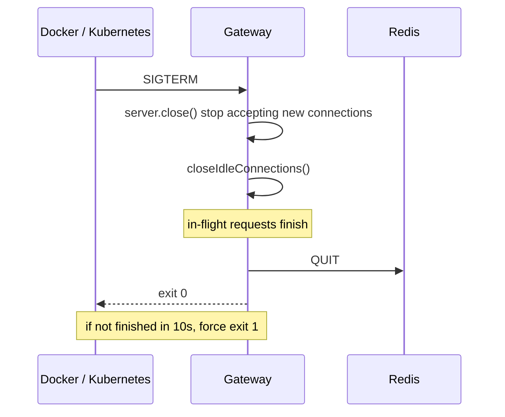

### Code: `server.ts` (replace the whole file)

```typescript
import http from 'node:http';
import app from './src/app.js';
import redis from './src/config/redis.js';
import { PORT } from './src/config/env.js';
import logger from './src/utils/logger.js';

const server = http.createServer(app);

// Protection against slow-connection attacks (slowloris).
server.headersTimeout = 20_000; // time to receive the HTTP headers
server.requestTimeout = 30_000; // time to receive the whole request
server.keepAliveTimeout = 65_000; // longer than common load balancer idle timeouts (60s)

server.listen(Number(PORT), () => {
  logger.info(`API Gateway running on port ${PORT}`);
});

/** Prevents running the shutdown logic twice (for example SIGTERM then SIGINT). */
let shuttingDown = false;

/**
 * Stops the gateway cleanly.
 *  1. Stop accepting new connections.
 *  2. Let running requests finish.
 *  3. Close Redis.
 *  4. Exit. If it takes longer than 10 seconds, force exit.
 *
 * @param reason   - Why we are stopping (signal name or error type), for the log.
 * @param exitCode - Process exit code. 0 = normal, 1 = error.
 */
async function shutdown(reason: string, exitCode = 0): Promise<void> {
  if (shuttingDown) return;
  shuttingDown = true;
  logger.info({ reason }, 'Shutting down');

  const forceTimer = setTimeout(() => {
    logger.error('Shutdown took too long, forcing exit');
    process.exit(1);
  }, 10_000);
  forceTimer.unref(); // do not keep the process alive just for this timer

  server.close(async () => {
    try {
      await redis.quit();
    } catch {
      /* Redis may already be down. Nothing to do. */
    }
    clearTimeout(forceTimer);
    logger.info('Shutdown complete');
    process.exit(exitCode);
  });

  // Close keep-alive connections that have no request in progress.
  server.closeIdleConnections();
}

process.on('SIGTERM', () => void shutdown('SIGTERM'));
process.on('SIGINT', () => void shutdown('SIGINT'));

// A programming error we did not expect: log it, then exit so the orchestrator restarts a clean process.
process.on('unhandledRejection', (reason) => {
  logger.error({ reason }, 'Unhandled promise rejection');
  void shutdown('unhandledRejection', 1);
});
process.on('uncaughtException', (err) => {
  logger.error({ err }, 'Uncaught exception');
  void shutdown('uncaughtException', 1);
});
```

> **Check after building:** start a large recording download and confirm it is **not** cut after 30 s. `requestTimeout` should only apply to receiving the request. If your Node version behaves differently, raise `requestTimeout` or set it to `0` for testing.

---

## Step 12.12: Docker and docker-compose

### What and why

| Change                                | Reason                                                                                                                            |
| ------------------------------------- | --------------------------------------------------------------------------------------------------------------------------------- |
| `node:22-alpine`                    | `http-proxy-middleware@4` needs Node 22.15+                                                                                     |
| `npm ci` instead of `npm install` | Exact versions from the lockfile, reproducible builds                                                                             |
| Multi-stage build                     | The final image has no TypeScript or dev tools, so it is smaller and has fewer things to attack                                   |
| `USER node`                         | If someone breaks into the process, they are not root                                                                             |
| `COPY types ./types`                | `tsconfig.json` includes `types/**/*.d.ts`                                                                                    |
| `redis` in `depends_on`           | Rate limiter needs it at startup                                                                                                  |
| `healthcheck` on `/ready`         | `docker ps` then shows `healthy` only when Redis works. Uses `127.0.0.1` (alpine's `localhost` can resolve to IPv6 first) |

### Code: `Dockerfile` (replace)

```dockerfile
# ---------- Stage 1: build TypeScript ----------
FROM node:22-alpine AS build
WORKDIR /app
COPY package*.json ./
RUN npm ci
COPY tsconfig.json ./
COPY src ./src
COPY types ./types
COPY server.ts ./
RUN npm run build

# ---------- Stage 2: small runtime image ----------
FROM node:22-alpine
WORKDIR /app
ENV NODE_ENV=production
COPY package*.json ./
RUN npm ci --omit=dev
COPY --from=build /app/dist ./dist
USER node
EXPOSE 4000
CMD ["node", "dist/server.js"]
```

### Code: `docker-compose.yml` (replace only the `api-gateway` block)

```yaml
  api-gateway:
    build: ./services/api-gateway
    container_name: api-gateway
    restart: unless-stopped
    ports:
      - "4000:4000"
    env_file:
      - ./services/api-gateway/.env.docker
    healthcheck:
      test: ["CMD", "node", "-e", "fetch('http://127.0.0.1:4000/ready').then(r=>process.exit(r.ok?0:1)).catch(()=>process.exit(1))"]
      interval: 15s
      timeout: 5s
      retries: 5
    depends_on:
      - redis
      - auth-service
      - user-service
      - room-service
      - chat-service
      - recording-service
      - notification-service
```

### Code: final `.env.docker`

```env
PORT=4000
NODE_ENV=production
FRONTEND_URL=http://localhost:3000
JWT_ACCESS_SECRET=change_this_later_to_random_string

AUTH_SERVICE_URL=http://auth-service:4001
USER_SERVICE_URL=http://user-service:4002
ROOM_SERVICE_URL=http://room-service:4003
CHAT_SERVICE_URL=http://chat-service:4005
RECORDING_SERVICE_URL=http://recording-service:4007
NOTIFICATION_SERVICE_URL=http://notification-service:4008

REDIS_URL=redis://redis:6379
TRUST_PROXY=0
BODY_LIMIT=100kb
```

> Replace `JWT_ACCESS_SECRET` with a long random value (the **same** value in every service) before any real deployment.

### Build and start

```powershell
docker compose build api-gateway
docker compose up -d redis api-gateway
docker logs api-gateway
```

Expected log: `Redis connected` and `API Gateway running on port 4000`.

---

## Step 12.13: E2E test script

### What and why

Manual testing does not scale. This script runs every important check automatically, so you can run it after every change.

What it proves:

| # | Test                                                                                                            | Problem it covers |
| - | --------------------------------------------------------------------------------------------------------------- | ----------------- |
| 1 | `/health` and `/ready` return 200                                                                           | 7                 |
| 2 | Unknown route returns JSON `404`                                                                              | 3                 |
| 3 | `x-request-id` is created, a valid one is echoed, an invalid one is replaced                                  | 5                 |
| 4 | Bad JSON gives `400`, a 200 KB body gives `413`                                                             | 4                 |
| 5 | Normal flow: signup, login, `/api/auth/me` works and has `RateLimit` headers                                | pass-through      |
| 6 | Chat service stopped: `502`/`504`, and body has no internal names or stack                                  | 2                 |
| 7 | Standard tier: the request after the limit returns `429` with `Retry-After`                                 | 1                 |
| 8 | Auth tier: 11th failed login returns `429` with the exact JSON                                                | 1                 |
| 9 | Redis stopped: `/ready` is `503`, `/health` is `200`, login fails closed `503`, normal API fails open | 1, 7              |

Important points about how it runs:

- It clears old `rl:*` keys in Redis at the start (otherwise a second run would be blocked by the first run's counters).
- Both users are created and logged in **before** the login limit test, because that test intentionally blocks logins from your IP for 15 minutes.
- It restarts `chat-service` and `redis` in `finally` blocks, even if a test fails.
- It needs the `docker` command and your container names (`chat-service`, `redis`).
- Uses Node 22 built-in `fetch`, no extra packages.

### Code: `scripts/e2e-gateway.mjs` (new file)

```javascript
#!/usr/bin/env node
/**
 * Phase 12 E2E test: API Gateway hardening.
 *
 * Run (gateway + redis + auth + chat services must be running in docker):
 *   node scripts/e2e-gateway.mjs
 *
 * Optional env:
 *   GATEWAY_URL                 default http://localhost:4000
 *   RATE_LIMIT_STANDARD_MAX     default 100 (must match the gateway setting)
 *   RATE_LIMIT_LOGIN_MAX        default 10  (must match the gateway setting)
 */
import { execFileSync } from 'node:child_process';

const BASE = process.env.GATEWAY_URL ?? 'http://localhost:4000';
const STANDARD_MAX = Number(process.env.RATE_LIMIT_STANDARD_MAX ?? 100);
const LOGIN_MAX = Number(process.env.RATE_LIMIT_LOGIN_MAX ?? 10);
const PASSWORD = 'Password123!';

// ---------------------------------------------------------------- helpers ---
const results = [];

/** Runs one test, records and prints PASS/FAIL. A failing test never stops the script. */
async function test(name, fn) {
  try {
    await fn();
    results.push({ name, ok: true });
    console.log(`  PASS  ${name}`);
  } catch (err) {
    results.push({ name, ok: false, error: err.message });
    console.log(`  FAIL  ${name}\n        -> ${err.message}`);
  }
}

/** Throws an Error with `message` when `condition` is false. */
function assert(condition, message) {
  if (!condition) throw new Error(message);
}

const sleep = (ms) => new Promise((resolve) => setTimeout(resolve, ms));

/** Runs a docker command. Uses execFile (no shell), so quoting works on Windows too. */
function docker(...args) {
  return execFileSync('docker', args, { stdio: 'pipe' }).toString();
}

/** Deletes all rate-limit keys so every run starts from zero. */
function flushRateLimits() {
  docker('exec', 'redis', 'sh', '-c', "redis-cli --scan --pattern 'rl:*' | xargs -r redis-cli del");
}

/**
 * Sends one request to the gateway.
 * @returns {{status:number, headers:Headers, text:string, json:any}}
 */
async function call(path, { method = 'GET', token, headers = {}, body, rawBody } = {}) {
  const finalHeaders = { ...headers };
  if (token) finalHeaders.Authorization = `Bearer ${token}`;
  let payload = rawBody;
  if (body !== undefined) {
    finalHeaders['Content-Type'] = 'application/json';
    payload = JSON.stringify(body);
  } else if (rawBody !== undefined) {
    finalHeaders['Content-Type'] = 'application/json';
  }
  const res = await fetch(`${BASE}${path}`, {
    method,
    headers: finalHeaders,
    body: payload,
    signal: AbortSignal.timeout(30_000),
  });
  const text = await res.text();
  let json = null;
  try {
    json = JSON.parse(text);
  } catch {
    /* not JSON */
  }
  return { status: res.status, headers: res.headers, text, json };
}

/** Polls `fn` until it returns true or `timeoutMs` passes. */
async function waitFor(fn, timeoutMs, label) {
  const end = Date.now() + timeoutMs;
  while (Date.now() < end) {
    try {
      if (await fn()) return;
    } catch {
      /* keep waiting */
    }
    await sleep(1000);
  }
  throw new Error(`Timed out waiting for: ${label}`);
}

/** Creates a user and logs in. @returns {Promise<string>} access token */
async function createUser(tag) {
  const email = `e2e-${Date.now()}-${tag}@example.com`;
  const signup = await call('/api/auth/signup', { method: 'POST', body: { email, password: PASSWORD } });
  assert(signup.status === 201, `signup ${tag} expected 201, got ${signup.status}: ${signup.text}`);
  const login = await call('/api/auth/login', { method: 'POST', body: { email, password: PASSWORD } });
  assert(login.status === 200, `login ${tag} expected 200, got ${login.status}: ${login.text}`);
  const token = login.json?.data?.accessToken;
  assert(token, `login ${tag} returned no accessToken`);
  return token;
}

// ------------------------------------------------------------------- run ----
console.log(`\nGateway E2E against ${BASE}\n`);
flushRateLimits();

let tokenA;
let tokenB;

console.log('1. Probes');
await test('GET /health returns 200', async () => {
  const r = await call('/health');
  assert(r.status === 200, `got ${r.status}`);
  assert(r.json?.status === 'ok', 'body.status should be "ok"');
});
await test('GET /ready returns 200 when Redis is up', async () => {
  const r = await call('/ready');
  assert(r.status === 200, `got ${r.status}: ${r.text}`);
});

console.log('\n2. 404 and request id');
await test('Unknown route returns JSON 404 with requestId', async () => {
  const r = await call('/api/does-not-exist');
  assert(r.status === 404, `got ${r.status}`);
  assert(r.json?.success === false && r.json?.error === 'Route not found', `bad body: ${r.text}`);
  assert(r.json?.requestId, 'body.requestId missing');
});
await test('A valid x-request-id is echoed back', async () => {
  const id = 'e2e-request-12345678';
  const r = await call('/api/does-not-exist', { headers: { 'x-request-id': id } });
  assert(r.headers.get('x-request-id') === id, `header was ${r.headers.get('x-request-id')}`);
});
await test('An invalid x-request-id is replaced', async () => {
  const r = await call('/api/does-not-exist', { headers: { 'x-request-id': 'bad id with spaces!!' } });
  const got = r.headers.get('x-request-id');
  assert(got && got !== 'bad id with spaces!!', `header was ${got}`);
});

console.log('\n3. Body handling');
await test('Invalid JSON returns 400 (not 500)', async () => {
  const r = await call('/api/v1/rooms', { method: 'POST', rawBody: '{bad json' });
  assert(r.status === 400, `got ${r.status}: ${r.text}`);
});
await test('Body over the limit returns 413', async () => {
  const r = await call('/api/v1/rooms', { method: 'POST', body: { title: 'x'.repeat(200_000) } });
  assert(r.status === 413, `got ${r.status}: ${r.text}`);
});

console.log('\n4. Normal flow within quota');
await test('Signup + login for two users', async () => {
  tokenA = await createUser('a');
  tokenB = await createUser('b');
});
await test('GET /api/auth/me passes through and has RateLimit headers', async () => {
  const r = await call('/api/auth/me', { token: tokenA });
  assert(r.status === 200, `got ${r.status}: ${r.text}`);
  assert(r.headers.get('ratelimit'), 'RateLimit header missing');
});
await test('Protected route without token returns 401', async () => {
  const r = await call('/api/auth/me');
  assert(r.status === 401, `got ${r.status}`);
});

console.log('\n5. Downstream service offline (chat-service)');
try {
  docker('stop', 'chat-service');
  await test('Offline service gives sanitized 502/504', async () => {
    const r = await call('/api/v1/chat/room1/messages', { token: tokenA });
    assert([502, 504].includes(r.status), `expected 502/504, got ${r.status}: ${r.text}`);
    assert(r.json?.success === false, 'body.success should be false');
    for (const secret of ['chat-service', ':4005', 'ECONNREFUSED', 'ENOTFOUND', 'getaddrinfo']) {
      assert(!r.text.includes(secret), `response leaks "${secret}": ${r.text}`);
    }
    assert(!/\n\s+at /.test(r.text), 'response contains a stack trace');
    assert(r.headers.get('retry-after'), 'Retry-After header missing');
  });
} finally {
  docker('start', 'chat-service');
}

console.log('\n6. Standard tier (per user)');
await test(`Request number ${STANDARD_MAX + 1} gets 429 with Retry-After`, async () => {
  let firstBlocked = null;
  for (let i = 1; i <= STANDARD_MAX + 5; i++) {
    const r = await call('/api/auth/me', { token: tokenB });
    if (r.status === 429) {
      firstBlocked = { index: i, res: r };
      break;
    }
  }
  assert(firstBlocked, `no 429 after ${STANDARD_MAX + 5} requests`);
  assert(firstBlocked.res.headers.get('retry-after'), 'Retry-After header missing');
  assert(
    firstBlocked.res.json?.error === 'Too many requests. Please try again later.',
    `wrong body: ${firstBlocked.res.text}`,
  );
});

console.log('\n7. Auth tier (per IP, failed logins only)');
await test(`Failed login number ${LOGIN_MAX + 1} gets 429`, async () => {
  const statuses = [];
  let last;
  for (let i = 1; i <= LOGIN_MAX + 1; i++) {
    last = await call('/api/auth/login', {
      method: 'POST',
      body: { email: 'nobody@example.com', password: 'wrong-password' },
    });
    statuses.push(last.status);
  }
  assert(statuses.slice(0, LOGIN_MAX).every((s) => s !== 429), `blocked too early: ${statuses.join(',')}`);
  assert(last.status === 429, `last status was ${last.status}`);
  assert(last.headers.get('retry-after'), 'Retry-After header missing');
  assert(
    last.json?.success === false && last.json?.error === 'Too many requests. Please try again later.',
    `wrong body: ${last.text}`,
  );
});

console.log('\n8. Redis offline');
flushRateLimits(); // fresh counters (token A is still valid, the limiter keys are new)
try {
  docker('stop', 'redis');
  await test('/ready returns 503 and /health still returns 200', async () => {
    const ready = await call('/ready');
    const health = await call('/health');
    assert(ready.status === 503, `/ready got ${ready.status}`);
    assert(health.status === 200, `/health got ${health.status}`);
  });
  await test('Login fails CLOSED (503) while Redis is down', async () => {
    const r = await call('/api/auth/login', { method: 'POST', body: { email: 'a@b.com', password: 'x' } });
    assert(r.status === 503, `got ${r.status}: ${r.text}`);
  });
  await test('Normal API fails OPEN (200) while Redis is down', async () => {
    const r = await call('/api/auth/me', { token: tokenA });
    assert(r.status === 200, `got ${r.status}: ${r.text}`);
  });
} finally {
  docker('start', 'redis');
}
await test('Gateway becomes ready again after Redis returns', async () => {
  await waitFor(async () => (await call('/ready')).status === 200, 30_000, '/ready = 200');
});

// ----------------------------------------------------------------- summary --
const failed = results.filter((r) => !r.ok);
console.log(`\n${results.length - failed.length}/${results.length} passed`);
if (failed.length > 0) {
  console.log('\nFailed tests:');
  for (const f of failed) console.log(`  - ${f.name}: ${f.error}`);
  process.exit(1);
}
process.exit(0);
```

### Run it

```powershell
cd services\api-gateway
node scripts\e2e-gateway.mjs
```

---

## Step 12.14: Verification checklist

Run top to bottom. Each row has a command and what you should see.

| #  | Check                   | Command                                                     | Expected                                                           |
| -- | ----------------------- | ----------------------------------------------------------- | ------------------------------------------------------------------ |
| 1  | TypeScript compiles     | `npx tsc --noEmit`                                        | no errors                                                          |
| 2  | Image builds on Node 22 | `docker compose build api-gateway`                        | success                                                            |
| 3  | Gateway starts          | `docker logs api-gateway`                                 | `Redis connected`, `API Gateway running on port 4000`          |
| 4  | Container is healthy    | `docker ps`                                               | `api-gateway` shows `(healthy)`                                |
| 5  | Liveness                | `curl http://localhost:4000/health`                       | `200 {"status":"ok",...}`                                        |
| 6  | Readiness               | `curl http://localhost:4000/ready`                        | `200 {"status":"ready",...}`                                     |
| 7  | Request ID              | `curl -i http://localhost:4000/api/nope`                  | `404` JSON + header `x-request-id`                             |
| 8  | Rate-limit headers      | `curl -i` a protected route with a token                  | headers `RateLimit` and `RateLimit-Policy`                     |
| 9  | Redis keys exist        | `docker exec redis redis-cli --scan --pattern "rl:*"`     | keys like `rl:api:user:...`                                      |
| 10 | Not running as root     | `docker exec api-gateway whoami`                          | `node`                                                           |
| 11 | No leaks when down      | stop a service, call it                                     | `502`/`504`, no internal names                                 |
| 12 | Probes not in logs      | `docker logs api-gateway` after several `/health` calls | no `/health` lines                                               |
| 13 | Video seeking works     | open a recording in `test-client`, seek around            | still plays (download tier is not too strict)                      |
| 14 | Big download not cut    | download a large recording (> 30 s)                         | completes                                                          |
| 15 | Graceful stop           | `docker stop api-gateway`                                 | log shows `Shutting down` then `Shutdown complete`, exits fast |
| 16 | Full E2E                | `node scripts\e2e-gateway.mjs`                            | all tests pass, exit code 0                                        |

### Optional manual check: header spoofing (problem 6)

You cannot see `x-user-id` from outside, so check the log or temporarily point `CHAT_SERVICE_URL` to a tiny echo server:

```powershell
node -e "require('http').createServer((q,s)=>{console.log('x-user-id =',q.headers['x-user-id']);s.end('{}')}).listen(4999)"
```

Then send `GET /api/v1/chat/x/messages` with a valid token **and** `x-user-id: attacker`. The echo server must print your **real** user ID, never `attacker`.

---

## Troubleshooting

| Symptom                                                                        | Likely cause                                                   | Fix                                                                                                                   |
| ------------------------------------------------------------------------------ | -------------------------------------------------------------- | --------------------------------------------------------------------------------------------------------------------- |
| Gateway crashes at start: `Missing required environment variable: REDIS_URL` | `.env.docker` not updated                                    | Add the new variables (Step 12.1)                                                                                     |
| `ERR_ERL_UNEXPECTED_X_FORWARDED_FOR` in logs                                 | Request has `X-Forwarded-For` but `TRUST_PROXY=0`          | If a proxy really is in front, set `TRUST_PROXY=1`. If not, ignore the warning (it is correct to ignore the header) |
| `ipKeyGenerator` is not exported                                             | `express-rate-limit` is v7                                   | `npm install express-rate-limit@latest`                                                                             |
| Everyone gets `429` quickly in production                                    | All users look like one IP (behind a proxy, `TRUST_PROXY=0`) | Set `TRUST_PROXY` to the number of proxies                                                                          |
| Anyone can bypass limits by changing a header                                  | `TRUST_PROXY=1` but nothing in front                         | Set `TRUST_PROXY=0`                                                                                                 |
| Frontend shows "CORS error" on `429`                                         | CORS runs after the limiter                                    | Keep `cors` before limiters in `app.ts`                                                                           |
| Frontend cannot read `Retry-After`                                           | Missing `exposedHeaders`                                     | Keep the list in the CORS config                                                                                      |
| POST bodies arrive empty at services                                           | `fixRequestBody` missing                                     | It is inside `createServiceProxy`. Do not remove it                                                                 |
| Proxy path wrong after refactor                                                | Changed mount style                                            | Keep `router.use(path, gatewayAuth, ...)` then an un-mounted proxy with `pathFilter`                              |
| Timeout shows `502` not `504`                                              | Node reports timeout as `ECONNRESET`                         | Expected. Both are safe                                                                                               |
| E2E: login test fails on the second run                                        | Old counters in Redis                                          | Script flushes `rl:*` at start. Check the `redis` container name                                                  |
| E2E test 7 blocks you from logging in for 15 min                               | By design                                                      | `docker exec redis sh -c "redis-cli --scan --pattern 'rl:*'                                                           |
| `docker: command not found` in script                                        | Docker CLI not in PATH                                         | Open a new terminal where `docker ps` works                                                                         |
| Image build fails at `npm ci`                                                | `package-lock.json` out of date                              | Run `npm install` locally and commit the lockfile                                                                   |

---

## Update the docs after it passes

1. **`STEP.MD`**: mark Phase 12 as ✅ COMPLETED, and add the step list (12.1 to 12.14).
2. **Services status report**: Phase 12 is currently "Partial", change it to Completed.
3. **Gateway `README.md`**:
   - add `/v1/recordings/*` and `/v1/notifications/*` to the route table,
   - change `/api/chat/...` to `/api/v1/chat/...` (the code serves `/api/v1/chat`),
   - add the new env variables (`REDIS_URL`, `TRUST_PROXY`, `BODY_LIMIT`, `RATE_LIMIT_*`),
   - add a short "Rate limit tiers" table (copy it from Step 12.7).
4. **Root `README.md`**: fix the manual test `curl` for chat to use `/api/v1/chat/...`.

**Next:** Phase F (React frontend). The frontend can now rely on a stable error shape (`{ success, error, requestId }`), readable `Retry-After` headers, and predictable `429`/`502`/`504` behavior.
