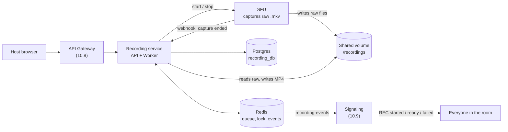
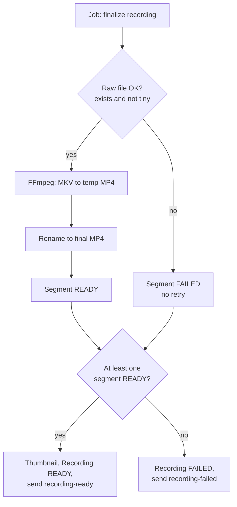
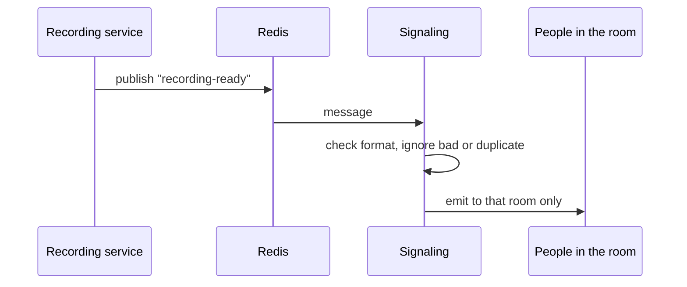
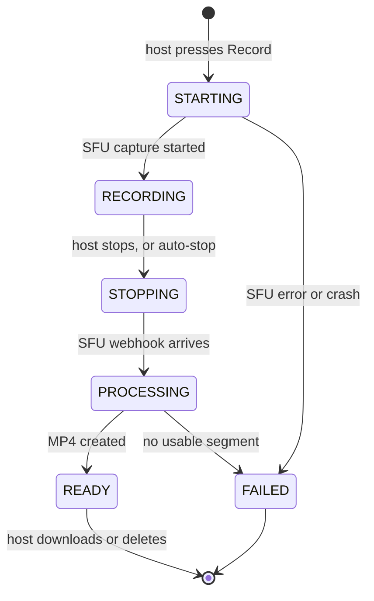

# What we built in Steps 10.6 to 10.11, in simple words

## The story in one line

Before: the host could press Record and Stop, but afterwards there was only a raw capture file nobody could use.
Now: after Stop, the system converts the capture to a normal MP4, lets the host list, play, download and delete it, tells the room about it, and cleans up after itself when something goes wrong.

**Status:** Steps 10.6 through 10.11 are completely implemented, verified through TypeScript builds and Prisma migrations, and committed step by step.

## The big picture

Think of it like a restaurant:

- **SFU** is the camera crew that films.
- **Recording service** is the manager and the editing room.
- **Redis queue** is the order ticket rail.
- **Shared volume** is the shelf where both teams put and take the tapes.
- **Signaling** is the loudspeaker that tells everyone what is happening.

## What each step does

### Step 10.6: Worker that converts MKV to MP4

**Problem:** your recording stayed stuck in `PROCESSING` forever. The raw `.mkv` is not meant for downloading.

**What we added:**

- A **worker** that takes the job from the queue (BullMQ).
- It uses **FFmpeg** to convert each raw file to MP4, which browsers can play.
- It makes a **thumbnail** picture.
- It marks the recording `READY` and announces it.

**Key points:**

- Tiny or broken raw files (like your 521-byte test) fail immediately, with no pointless retries.
- Temporary problems get 3 tries with waiting time in between.
- It writes to a temporary file first, then renames it, so nobody ever sees a half-made MP4.
- It never deletes the raw files at this stage.
- Recording service must run **in Docker**, so it can see the same volume as the SFU.

### Step 10.7: Storage and the recording APIs

**Problem:** the MP4 files exist, but the host has no way to reach them.

**What we added:** a storage layer plus four endpoints:

- `GET /recordings` to list
- `GET /recordings/:id` for details
- `GET /recordings/:id/download` to download
- `DELETE /recordings/:id` to delete

**Key points:**

- Only the person who started the recording can see, download, or delete it (others get 403).
- The server never trusts a path from the user. It looks up its own database record and uses the stored key.
- Files are streamed, not loaded into memory, and seeking in the video works.
- Not ready yet gives 409. File missing gives 404.
- The storage layer is separate, so S3 can be plugged in later.

### Step 10.8: Gateway proxy

**Problem:** the browser should only talk to the gateway, not to port 4007.

**What we added:** one rule that sends `/api/v1/recordings/*` to the recording service.

**Key points:**

- The gateway checks the login first.
- `/internal/*` is not forwarded, so only the SFU can call the webhook.
- This step is **not based on your gateway code**, because I have not seen it. I need your gateway file to make it exact.

### Step 10.9: Signaling events

**Problem:** participants never find out that recording started or finished.

**What we added:** signaling listens to Redis and forwards four events to the room: `recording-started`, `recording-stopped`, `recording-ready`, `recording-failed`. Late joiners also get `recording.active` when they join.

**Key points:** bad or duplicate messages are ignored, and clients never receive file paths or internal errors. This step is also **not based on your signaling code**.

### Step 10.10: Docker Compose and the full test

**Problem:** every part worked alone, but the product only works when all of them work together.

**What we added:**

- recording-service in Docker with the same `recordings_data` volume as the SFU
- A test script (`e2e-recording.mjs`) that does start, 20 seconds of recording, stop, wait for `READY`, download, and a range request
- Two failure tests: a missing raw file, and a broken FFmpeg that triggers retries and then final failure

**Key point:** use Chrome's fake camera and microphone for the test, because it produces real video and audio (a fake peer does not).

### Step 10.11: Hardening (making it safe when things go wrong)

| Feature              | Problem it solves                                  | What it does                                                                                                                   |
| :------------------- | :------------------------------------------------- | :----------------------------------------------------------------------------------------------------------------------------- |
| **Auto-stop**  | Someone forgets to stop and the disk fills         | Stops the recording after `MAX_RECORDING_MINUTES` (default 240)                                                              |
| **Recovery**   | A crash or a lost webhook leaves a recording stuck | Every 5 minutes it repairs stuck recordings. It uses `manifest.json` if available, otherwise marks them `FAILED`           |
| **Cleanup**    | Raw files waste disk space                         | Deletes raw files only after the MP4 is confirmed and the retention time has passed                                            |
| **Disk guard** | A full disk corrupts files                         | Refuses to start new recordings when space is low (503). It does not stop running ones, unless you enable the emergency option |
| **Health**     | You cannot see problems early                      | A new `/ready` page shows database, Redis and disk level                                                                     |

**Key points:**

- Raw files of failed segments are never auto-deleted, since they may be the only copy.
- The host closing their browser does **not** stop the recording, because the server records it.
- BullMQ retries a job that failed while the service was alive. Recovery fixes what BullMQ cannot see, such as the service dying before it queued the job.

## The full life of one recording

Every state has a way out, and recovery handles the ones that could get stuck. This is how we meet "never stuck in a middle status".

## Implementation and Verification Status

| Part                   | Status                                                                           |
| :--------------------- | :------------------------------------------------------------------------------- |
| Steps 10.1 to 10.5     | ✅ Built, tested, and verified                                                   |
| Step 10.6 (Worker)     | ✅ Implemented, compiled (`tsc`), Dockerfile & Compose updated                    |
| Step 10.7 (Storage/API)| ✅ Storage driver, download, stream range (206), query routes implemented         |
| Step 10.8 (Gateway)    | ✅ Proxy route `/v1/recordings` added to API gateway with auth and 10m timeout    |
| Step 10.9 (Signaling)  | ✅ Dedicated Redis subscriber for recording-events and join status added         |
| Step 10.10 (E2E Test)  | ✅ E2E script (`scripts/e2e-recording.mjs`) and Compose networking configured     |
| Step 10.11 (Hardening) | ✅ AutoStop worker, disk guard, recovery, cleanup, `/ready`, and migration added  |

## What you should do next

1. Start all containers: `docker compose up -d --build`.
2. Run end-to-end media test with fake device Chrome client and test script: `node services/recording-service/scripts/e2e-recording.mjs <ROOM_CODE>`.
3. Proceed to Phase F (Frontend React Integration) or Phase 11 (Notification Service).

