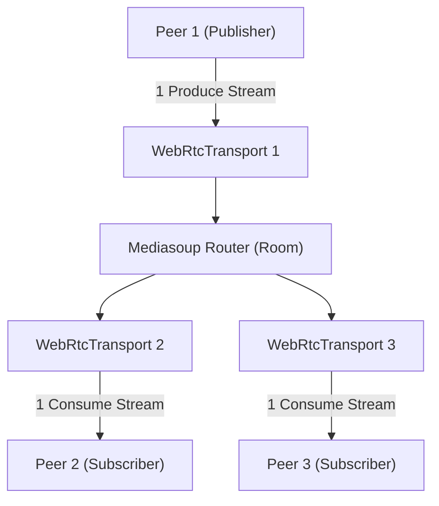

# sfu-service

**Port:** 4006 | **Engine:** Mediasoup v3 (Node.js & C++ WebRTC Engine)  
**Status:** ✅ Completed (with Phase 13 Observability)

Selective Forwarding Unit (SFU) microservice designed for multi-participant video calls (3+ participants). Solves full-mesh bandwidth bottlenecks by receiving media streams once per publisher and forwarding them selectively to all subscribers. Integrated with mediasoup workers, routers, WebRtcTransports, PlainTransports (for recording), and dynamic Prometheus observability.

---

## Architecture & Topologies

---

## Key Features & Observability

1. **Worker Pool Management:** Spawns Mediasoup Workers (`workerPool.ts`) across available CPU cores.
2. **Dynamic Room Routers:** Manages Mediasoup `Router` per active room with audio/video codec capabilities.
3. **WebRTC Transports & PlainTransports:** Establishes client send/recv transports and plain RTP pipes to `recording-service`.
4. **Producers & Consumers:** Handles live stream production, consumption, pausing, and resuming.
5. **Observability & Custom Metrics (`GET /metrics`):** Dynamic scrape-time collection (`registerSfuStatsProvider`) tracking:
   - `sfu_workers_active` (gauge)
   - `sfu_routers_active` (gauge)
   - `sfu_peers_active` (gauge)
   - `sfu_transports_active` (gauge by transport type)
   - `sfu_producers_active` (gauge by kind: audio/video)
   - `sfu_consumers_active` (gauge by kind: audio/video)

---

## Environment Variables

Source: `.env.docker`

| Variable | Example | Description |
|---|---|---|
| `PORT` | `4006` | Listening port |
| `MEDIASOUP_MIN_PORT` | `40000` | Minimum UDP port for WebRTC traffic |
| `MEDIASOUP_MAX_PORT` | `40100` | Maximum UDP port for WebRTC traffic |
| `ANNOUNCED_IP` | `127.0.0.1` | Public IP announced for WebRTC media |
| `NODE_ENV` | `production` | Environment mode |
| `OTEL_SERVICE_NAME` | `sfu-service` | Service identifier for OpenTelemetry traces |
| `METRICS_ENABLED` | `true` | Enables `/metrics` endpoint |
| `METRICS_TOKEN` | `secret` | Bearer token required for `/metrics` |
| `OTEL_ENABLED` | `true` | Enables OpenTelemetry tracing |
| `OTEL_EXPORTER_OTLP_ENDPOINT` | `http://jaeger:4318` | Jaeger OTLP/HTTP endpoint |

---

## Routes

| Method | Endpoint | Auth Required | Description |
|---|---|---|---|
| GET | `/health` | ❌ | Health check returning `{ status: "ok", service: "sfu-service" }` |
| GET | `/metrics` | Bearer `METRICS_TOKEN` | Prometheus exposition format (scraped by Prometheus container) |
| POST | `/api/v1/sfu/rooms/:roomId/join` | ✅ JWT | Joins room, creates or gets router, returns RTP capabilities |
| POST | `/api/v1/sfu/transports/webrtc` | ✅ JWT | Creates send or recv WebRtcTransport |
| POST | `/api/v1/sfu/transports/:transportId/connect` | ✅ JWT | Connects transport with DTLS parameters |
| POST | `/api/v1/sfu/producers` | ✅ JWT | Produces audio or video stream |
| POST | `/api/v1/sfu/consumers` | ✅ JWT | Consumes a producer stream |
